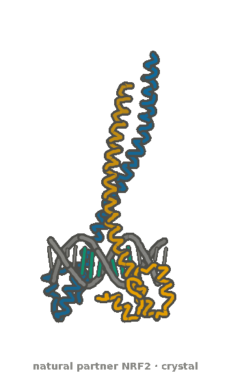
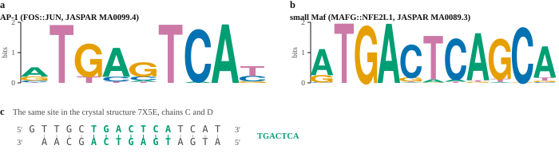
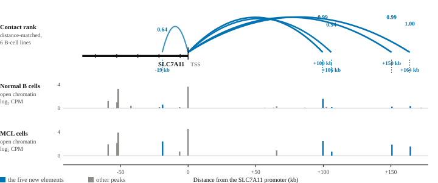
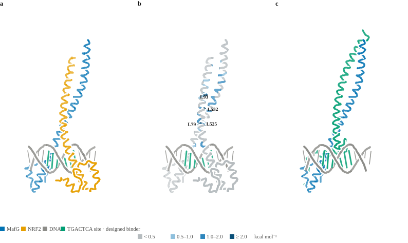

# Tonsil → MCL

**Differentiation-matched regulatory rewiring in mantle cell lymphoma, and protein-level drug design against the hub.**

從扁桃體正常 B 細胞分化出發，找出被套細胞淋巴瘤打開的調控迴路，再對迴路樞紐設計蛋白質藥物。

<p align="center">
  <a href="#english">English</a> &nbsp;·&nbsp;
  <a href="#中文">中文</a> &nbsp;·&nbsp;
  <a href="https://huggingface.co/ast-atp/Tonsil_to_MCL">Data and structures</a> &nbsp;·&nbsp;
  <a href="#data-sources--資料來源">Data sources / 資料來源</a> &nbsp;·&nbsp;
  <a href="#ethics--data-use--倫理與資料使用">Ethics / 倫理</a>
</p>

<p align="center">
  
</p>
<p align="center"><sub>
MafG (blue) on its DNA site (grey, with the TGACTCA core in green), first with its
natural partner NRF2 from crystal structure 7X5E (orange), then with our designed 90-residue binder
(green), superposed on the same MafG chain.<br>
MafG（藍）坐在 DNA 位點上（灰，TGACTCA 核心為綠），先是晶體結構裡的天然夥伴
NRF2（橘），再換成我們設計的 90 胺基酸結合劑（綠）。
</sub></p>

---

<a name="english"></a>
## English

### The question

Almost every study asks how mantle cell lymphoma (MCL) differs from a normal B cell.
MCL cells look like early B cells, so that comparison mostly measures development, not cancer.

This project asks a different question: **how does an MCL cell differ from the normal B cell at the same stage of development?**

### The method

```
1. Build a reference of normal B-cell development
   46,216 tonsil B cells · 46 of 48 annotated states · RNA and chromatin in the same nucleus

2. Give each tumour cell a soft position on those 46 states
   The model then predicts what a normal cell at that position would express

3. Subtract the prediction from the measurement
   What remains is the part that development cannot explain

4. Rebuild the control network from RNA and chromatin together
   Compare the tumour network with the normal network

5. Test with external models, then design a drug
```

<p align="center">
  <picture>
    <source media="(prefers-color-scheme: dark)" srcset="results/figs/overview.dark.svg">
    
  </picture>
</p>
<p align="center"><sub><b>Fig. 1 — What the study measures and what it builds.</b> <b>a</b>, Both readouts come from the same nucleus. <b>b</b>, Each tumour cell is compared with the normal state at its own stage of development. <b>c</b>, What remains is a seven-letter site and five new elements at <code>SLC7A11</code>. <b>d</b>, The protein that reads the site, drawn from real coordinates.</sub></p>

### Results

The strongest remaining signal is not a known cancer gene. It is a seven-letter piece of DNA,
**TGACTCA**, the landing site for the AP-1 and small Maf protein families.

<p align="center">
  <picture>
    <source media="(prefers-color-scheme: dark)" srcset="results/figs/motif.dark.svg">
    
  </picture>
</p>
<p align="center"><sub><b>Fig. 2 — The seven-letter site.</b> Information-content logos for the two families (JASPAR 2024), and the same core in the DNA of crystal structure 7X5E.</sub></p>

| Finding | Evidence |
|---|---|
| MCL opens TGACTCA sites genome-wide | AP-1 enriched 1.28–1.42×, BACH1 1.38× (background matched for length and GC) |
| B-cell identity factors lose their sites | POU family 0.70–0.85× |
| `SLC7A11` gains new elements absent from normal cells | Five candidates; **three open in both patients**, two only in M102. Expected expression 0.001, measured 0.206 |
| The residual survives three independent re-derivations — and the fourth method is measuring something else | Scored on each method's **own tumour-cell term**, three of the four place `SLC7A11` in the top 180 of 4,012 genes at **every one of 11 seeds** (A #176, B #22–104, D #22–106), at 4–9× that method's own noise floor. ContrastiveVI does not detect it at all (1.32× its floor, 0.92× on held-out seeds) because its score is the sign-flipped non-tumour residual (ρ = 0.967 against it, −0.012 against its own tumour term) — and that non-tumour comparator is 819 cells, 790 of them (96.5%) from a single donor. The tell: ContrastiveVI ranks `CCND1`, the t(11;14) product that defines the disease, **in the bottom 50 of 4,012 on its own tumour term at all 11 seeds** (last of all at three of them), and #2 once the subtraction is applied. Declared on seeds 0–4, confirmed on 6 seeds never looked at |
| Swapping the non-tumour comparator to the other donor does not change the published method's direction | The comparator is numerically **one donor**: replacing it with M413 alone (790 of the 819 cells) reproduces the pooled gene ranking at ρ = 0.995–0.999 for all four methods, while the two donors agree with each other at only ρ = 0.19–0.57. Swapped to the other donor (M102, **29 cells**), the published arithmetic method moves `SLC7A11` from 8.81× to 5.11× its noise floor — both strongly positive — and that donor difference is **1.15 standard errors**, i.e. inside sampling noise (the positive controls sit at 1.53 and 1.73). The generative methods report 5–10 SE and one of them flips sign, but their standard errors are model-smoothed (±0.0015 from 790 cells, ±0.0218 from 29), so that significance is an artefact of reporting the model's confidence rather than the data's. **2 donors remains the governing limit** — this says the direction survives the swap at the data's own resolution, not that the claim has been validated on two independent donors |
| The pathway is a real dependency module | The five genes' CRISPR profiles across 1,178 lines correlate at r = 0.278 against 0.001 for random five-gene sets (empirical p < 0.0005) |
| …and that module is **B-lymphoid-restricted** | Of the 18 lines that depend on `SLC7A11`, **12 are lymphoid and every one of those is a B-cell malignancy** (OR 26.6; empirical p = 0.021 against rate-matched genes). `GCLC` OR 65.8, `AIFM2` 74.8, `GCLM` 47.9 |
| The pathway is not mutated | 1.10× background in non-coding regions; **0** non-synonymous coding mutations in 21 pathway genes (one synonymous `BACH2` variant), against **50** in known drivers (same pipeline) |

The pathway runs in one line: cystine enters the cell → the cell builds glutathione → glutathione plus FSP1 blocks ferroptosis.

Two qualifications apply. Only the input end is raised in the residual (`SLC7A11` +0.205,
`SLC3A2` +0.178); `GCLC`, `GCLM` and `FSP1` sit slightly below the differentiation-matched
expectation, and their evidence is CRISPR dependency rather than expression. The dependency is also
lymphoid-selective rather than MCL-selective: MCL sits inside a B-cell-wide pattern.

### Where this sits in the literature

Ferroptosis resistance in MCL is an active and recent field: 8 papers, 6 of them since 2024, covering
BTK-inhibitor resistance, PI3Kδ-inhibitor resistance and iron-metabolism addiction. One of them
(*Biologics* 2024) is a mechanistic study of `xCT` in MCL by name.

Every one of those papers starts from the tumour, and none asks what the differentiation-matched
normal B cell would be doing. We reached the same axis from the opposite direction, and the parts
that are new lie in that direction: the `SLC7A11` elements, the lineage restriction, and the
four-method consensus. Counts for the individual genes, reproducible with
`scripts/51_novelty_screen.py` (re-run 2026-11-27): `"system xc−" + MCL` = 0; `MAFG` 0; `SLC3A2` 0;
`AIFM2/FSP1` 0; `SLC7A11` 1; `disulfidptosis` 0. A count of 0 at abstract level is not the same as
unexplored biology: the NRF2 antioxidant axis was studied in MCL patients as early as 2011.

<p align="center">
  <picture>
    <source media="(prefers-color-scheme: dark)" srcset="results/figs/locus_slc7a11.dark.svg">
    
  </picture>
</p>
<p align="center"><sub><b>Fig. 3 — The <code>SLC7A11</code> locus.</b> Every peak the pipeline calls in a 270 kb window, in normal and in tumour cells. The five new elements are blue. Each arc carries that element's contact rank against all position pairs at the same distance, as the median of six B-cell lines.</sub></p>

### External validation

All of the above comes from the same two patients, which is a weakness. We ran three tests with
AlphaGenome 2, which is trained on normal tissue only. One failed and two succeeded, and all three
are reported below.

| Test | Result |
|---|---|
| Baseline accessibility of the new elements | **Failed and retracted.** A peak-width artefact: width correlates with prediction at +0.74 and our elements are 3.5× wider. With a width-matched control the effect reverses (0.55×, p = 0.57) |
| Saturation mutagenesis of the MARE site | **MAFG promoter confirmed.** Breaking the site changes predicted `MAFG` expression 3.1× more than neighbouring bases (Bonferroni p ≈ 1×10⁻⁴). The positive control `HMOX1` works and is selective: only 1 of 3 TGACTCA copies scores |
| Cell-state conditioning (our own cells) | **SLC7A11 elements confirmed, in two patients.** Same DNA, only the cell state changes, so width and composition cancel exactly. Elements open ~2× under the tumour state against ~1.2× for non-rewired peaks in the same window (p = 7.9×10⁻⁴ and 1.9×10⁻⁵) |

### Drug design

The AP-1 and BACH1 families are redundant, but they all need the same partner at the site: **MafG**.
That is a statement about sequence and structure, and it holds. Whether it makes MafG druggable is a
separate question, and that has not been demonstrated. We report the design together with the two
findings that undercut it, because both are informative.

Evolutionary constraint (a protein language model) and the crystal interface converge on the same residues — two completely different kinds of evidence (`MAFG` p = 8.3×10⁻¹¹). Those positions also leave little room to escape: the interface accepts 10.5% of substitutions against 42.4% for the whole protein.

> **Caveat 1 — no genetic dependency.** Across 1,178 DepMap lines, knocking out `MAFG` does almost
> nothing (median gene effect −0.157; 2.5% of lines dependent). The three MCL lines are 0 / 3
> dependent and sit slightly *above* average (z = +0.36). `MAFG` shows **no** lymphoid enrichment
> (OR 0.86, empirical p = 0.55) while every downstream gene does, and its top co-dependencies
> (MCRIP1, SECTM1, ASPSCR1) have nothing to do with NRF2 or ferroptosis. Paralogue redundancy is
> the likely reason: lines expressing more `MAFK` depend less on `MAFG` (ρ = +0.094, p = 0.0019).
> A single knockout cannot test a molecule that blocks the shared interface of all three — but
> that remains an untested hypothesis, not a result.
>
> **Caveat 2 — the binder is not MafG-selective.** Against a panel of 7 bZIP targets, the design
> separates small Mafs from AP-1 and BACH1 cleanly, but **cannot separate MafG from MafF or MafK**
> (99-residue fragments, 85% / 76% identical, identical domain boundaries). Three co-folding models
> put the on-target/off-target gap between −0.011 and +0.051. Treat it as a **small-Maf-family
> binder**, and re-do the toxicity reasoning accordingly.

<p align="center">
  <picture>
    <source media="(prefers-color-scheme: dark)" srcset="results/figs/structures.dark.svg">
    
  </picture>
</p>
<p align="center"><sub><b>Fig. 4 — The same interface, three ways.</b> <b>a</b>, Crystal structure 7X5E: MafG (blue) and NRF2 (orange) on the DNA. <b>b</b>, The cost of removing each side chain, from the 191-position alanine scan. <b>c</b>, The designed 90-residue binder (green) on the same face. Panels a and b are crystal coordinates; the binder is a prediction, superposed on the crystal MafG.</sub></p>

The best design is a **90-residue mini-protein** that passes **all four wet-lab-calibrated filters**, thresholds derived from 3,766 binders tested in the laboratory:

| | ipSAE (mean ± sd) | ipTM | Interface error | pLDDT | Filters |
|---|---|---|---|---|---|
| **Best design** | **0.611 ± 0.020** (best sample 0.631) | 0.790 | 6.97 Å | 0.902 | **4 / 4** |
| Native NRF2 (positive control) | 0.519 ± 0.013 (best 0.539) | 0.713 | 9.16 Å | 0.937 | 3 / 4 |
| Scrambled (negative control) | 0.003–0.020 (best 0.013–0.076) | 0.39–0.47 | 17–20 Å | 0.58–0.65 | 0 / 4 |

All five numbers are over 5 diffusion samples. The ipSAE filter (threshold 0.61) is applied to the
**best** sample, as in the calibration paper; the best design's **mean** clears it by 0.001, so that
one filter is marginal. The other three are cleared by a wide margin.

```
LAAGGSVDTEKLAELQKKLEEMELELAKMQQELAELQKELEKLQKELAEAEAEMKAAGIPAKLSEEERARLLHWAALVEAPLHRVRRRPL
```

### Hypotheses tested and rejected

33 hypotheses and traps were tested and dropped. Several were our own first conclusions, and four of
those were retracted after this repository went public. The full table is in the report and the
showcase page.

Three separate artefacts had the same cause: a foreground group and a background group that differed
in length or base composition, first in motif length, then in GC content, then in peak width. Each
produced a result that looked clean and was wrong.

### Limitations

- **Two patients.** No third patient-derived MCL multiome exists in public data. An attempt to fix this made the problem worse, and is reported here in full. BLUEPRINT has 5 primary MCL patients on GRCh38, open access, with six histone marks and RNA-seq — but before comparing any peak we gated on expression, and `SLC7A11` is **0.07, 0.20, 0.01, 0.05 and 0.16 FPKM: 0 of 5 above 1**. The positive control passes emphatically (`CCND1` 214–693 FPKM, the defining t(11;14)), purity is clean (`MS4A1` 611–1,560, `CD3E` 0.94–6.43), and the rest of the module is expressed normally (`GCLC` 4–12, `GPX4` 45–80, `SLC3A2` 55–138) — so this is specific to `SLC7A11`, not a sample-quality artefact. One evidenced qualification: all five are venous blood and 3 of 5 are `SOX11`-negative, i.e. predominantly leukaemic non-nodal MCL, a different subtype from nodal tissue disease; the two `SOX11`-positive donors do rank 1st and 2nd for `SLC7A11` (0.20, 0.16) but that is still essentially zero. This is the strongest external test run on this axis, and it points the other way. Two consequences we accept: the claim needs a scope restriction to `SOX11`-positive nodal MCL, and the "200×" is a ratio of two small numbers (our 0.206 mean log1p-CP10K against 0.0009 in matched normal — large because the denominator is near zero). The cohort that would actually settle it — `SOX11`-positive, tissue-derived, independent of our two patients — does not exist in public data today.
- **`MAFG` elements gain coupling but lose openness.** We have no explanation. Our first explanation came from the width artefact and was retracted.
- **Delivery is out of scope by design.** A 90-residue protein does not cross a membrane by itself. Every design here assumes it reaches the nucleus.
- **The structure model cannot score single mutations on a protein–DNA interface.** 0 of 24 mutations passed the noise floor; the baseline is saturated.
- **It cannot rank them on a protein–protein interface either.** An orthogonal binding-energy model, calibrated against measured energies, gives a ranking that does not correlate with ours (Spearman +0.17, p = 0.58). Use the co-folding score for which positions sit in the interface, not for which mutation is worse.
- **The binder is a family binder, not a MafG binder.** See Caveat 2 above. The decisive experiment is one week of SPR against MafG, MafF and MafK.
- **`MAFG` is not a genetic dependency anywhere.** See Caveat 1 above.
- **Co-folding scores disagree with each other on this target.** On the specificity panel Boltz-2's own negative control scored 0.647 on MafK — nearly as high as the real design — so its "no selectivity" verdict is not usable. ESMFold's complex mode fails its positive control (natural NRF2 on MafG scores 0.060 against the design's 0.466), so it is usable only for monomer foldability. Chai-1 passes both controls and is the one we weight.
- **The best design is the worst folder.** ESMFold single-chain pLDDT: 0.735 for the lead, against 0.781 for a design that Boltz-2 ranked as a failure and 0.808 for native NRF2. Only 51% of its residues exceed pLDDT 0.70. A binder that only folds when bound is harder to express and more prone to aggregate.
- **Human genetics cannot test these elements.** Across GTEx (3 tissues) and 18 sorted B-cell / LCL eQTL datasets (>4,000 donors), `SLC7A11` has 4 fine-mapped credible-set variants in the whole 500 kb window and `MAFG`, `SLC3A2`, `GCLM` have none. Zero fall in our elements — but with 2.5 kb of foreground the test could only have detected a 4.4× enrichment. This is no power, not a negative result. The right test has since been run, with the same no-power result. The memory-B caQTL data (TenK10K, n = 913) is not on the eQTL Catalogue — the authors released it themselves on Hugging Face (`anglixue/TenK10K_multiome`, CC-BY-4.0). All five `SLC7A11` elements and the `MAFG` MARE have a matching tested peak in memory B, and every one has q ≥ 0.983. But only **301 of 14,998 chr4 peaks (2.01%)** and 374 of 15,389 chr17 peaks (2.43%) are significant anywhere in that dataset, so the expected number of hits among our six elements is 0.125. Observing zero is the base rate, not evidence. The authors' own caQTL→eQTL SMR finds 0 hits for `SLC7A11` or `MAFG` in any of 28 cell types. Independently reproduced from the downloaded files (base rates and per-element q values both match). So: the assay and the cell type were right; the power was never there. `results/180_bcell_eqtl.json`'s `caqtl_note` still says "not yet released" and is superseded by `results/206_external_validation_scouting.md`.
- **Cell lines are a poor model for this axis.** All three DepMap MCL lines express `SLC7A11` *below* the median (44th, 17th and 12th percentile), while the patient tumours sit 200× above matched normal B cells. Any cystine- or ferroptosis-related experiment run in JVM-2, MAVER-1 or Z-138 risks a meaningless negative. The problem is sharper than "poor": cell lines model the inverted régime. Across 1,103 lines, the cells that *need* this module are the ones expressing *least* of it — self-correlation between a gene's own expression and its own CRISPR effect is +0.166 for `GCLM` (99th percentile of 594 random genes), +0.135 `GCLC` (98th), +0.104 `SLC7A11` (96th), and within B-lymphoid lines `SLC7A11` reaches +0.357. The genome-wide background runs the *other* way (median −0.0123, only 41.9% positive, Wilcoxon p = 1.2×10⁻⁵; shuffling line labels returns −0.0038), so this is a real property of the module, not an artefact. Patient tumours are 200× *above* matched normal. Three independent analyses reached this caveat separately, and it applies to the whole axis, not to one candidate gene.
- **The B-lymphoid restriction still has no mechanism**, and one mechanism we proposed has since been retracted. Scope is sharper than before — `SLC7A11` dependency is 12/53 (22.6%) in non-plasma-cell B lines against 0/19 plasma-cell myeloma, 0/18 T/NK, 1/42 myeloid and 5/1,043 non-haematopoietic (within-lymphoid Fisher p = 6.4×10⁻⁴, empirical p = 0.016), and the requirement localises to de novo glutathione synthesis, where **`GSS` is a new module member** (6/7 dependents among B lines, OR 143, empirical p = 0.003), completing `SLC7A11`→`GCLC`→`GCLM`→`GSS`. But the "B cells lack an FSP1 backup arm" model failed: myeloid lines have the *lowest* `AIFM2` of any group (median z = −1.02) with only 2.6% dependency, and in non-haematopoietic lines `SLC3A2` expression predicts dependency exactly as well as `AIFM2` does (r = +0.133 vs +0.134). The selenocysteine arm (`SCLY`, `SEPSECS`, `SEPHS2`) is the best remaining hypothesis — two independent screens converged on it — but nothing in that screen passed a family-wise threshold, so it is a hypothesis for a wet experiment, not a result.
- **Starving cystine is the wrong lever, and we can say why.** A flux-balance model of human metabolism (Human-GEM, gated on an exact stoichiometric identity — 0.5170 observed against 2×0.208 + 0.101 predicted — plus a fail-stop that must return zero, a sulfate check and a requirement that knocking out `SLC7A11` actually does something) says that cutting cystine makes xCT *less* essential, not more: as cystine falls, transsulfuration's relative share rises. The lever that makes xCT absolute is closing transsulfuration. In B cells it is already closed (`CBS` exceeds 0.1 in 0 of 46 normal states, `CBSL` 0 of 46, `CTH` 1 of 46), and with it closed knocking out `SLC7A11` removes **100% of glutathione capacity at every cystine concentration**. Free cysteine in the medium only raises the ceiling — at 0.2 mM it still removes 67.5%. The practical consequence: **an xCT inhibitor needs the free-cysteine supply blocked too.** This is a stoichiometric statement, not a cell-biology one; it needs cystine-restricted medium ± cysteine rescue to test.
- **That mechanism does not explain the lineage restriction.** We made the prediction, tested it, and it failed. If "no transsulfuration" were the discriminator, then across all DepMap lines lower transsulfuration should mean stronger `SLC7A11` dependency. It does not: across 1,103 lines Spearman r = **−0.030** (p = 0.32, *wrong sign*); within the 1,012 non-lymphoid lines r = −0.054; against a null of 1,999 random genes the empirical p is 0.789; and the negative control `RPL13A`, a ribosomal gene every line needs, correlates *more* strongly (r = +0.059) and in the predicted direction. The group-level difference that looked promising (dependent lines' transsulfuration score 2.322 vs 2.865, p = 0.034) is fully explained by lineage composition, since lymphoid lines are simply lower (2.249 vs 2.899, p = 0.0066). The OR 26.6 B-lymphoid restriction therefore still has no mechanism.
- **The molecular-dynamics assay has no discriminating power**, and therefore supports no conclusion in either direction. This retracts what this file said earlier. Three 10 ns replicates per system gave a native-contact fraction of 0.875 ± 0.020 on MafG against 0.892 ± 0.009 on MafK (ΔQ = −0.016), which looked like an independent confirmation of non-selectivity. The pre-specified negative control then showed that a scrambled-sequence design holds on at Q = 0.890, indistinguishable from the real design. An assay that cannot reject a scrambled sequence cannot support any conclusion about selectivity, so the ΔQ is withdrawn as evidence. The gate in `scripts/190_md_interface.py` returned `A5_assay_cannot_discriminate` and cancelled the 67 GPU-hour extension automatically. The lesson generalises: 10 ns of MD started from a co-folding prediction is a stability test of that prediction rather than a binding test, because "native contacts" are defined from the predicted pose, so if the predictor placed a scrambled sequence in contact, short MD will keep it there. Reaching even this conclusion required first fixing a periodic-image error that had made MafK's three replicates look like they had no interface at all (`enforcePeriodicBox` is on by default, so each molecule is wrapped separately and two chains in contact can read as 3.5 nm apart). That correction is validated in `scripts/193_md_validation.py`: lattice-translation invariance to 1×10⁻⁶ nm, and 400 synthetic rigid separations of 1.5–5.0 nm all return Q = 0.0000.

### The report

A five-page write-up in the format of a computational-biology paper: one page revisiting
Massoni-Badosa *et al.* claim by claim, three pages on the extension above, one page of figures.

| File | |
|---|---|
| `REPORT_assignment.html` | The report, English. Open it in a browser; print to PDF for a paper copy. |
| `REPORT_assignment.zh.html` | The same report in Chinese. |
| `REPORT_v3.md` | The long version, with all 29 rejected hypotheses (Chinese). |

Both HTML files are built from one bilingual source, `docs/report_template.html`, by
`scripts/112_build_report.py`; `scripts/113_estimate_pages.py` checks that each language still
fits on five A4 pages.

---

<a name="中文"></a>
## 中文

### 問題

幾乎所有研究都在問「被套細胞淋巴瘤和正常 B 細胞差在哪」。但 MCL 細胞看起來就像早期 B 細胞，所以那種比較主要量到的是分化，不是癌症。

這個專案改問：**MCL 細胞和「分化程度完全相同的那顆正常 B 細胞」差在哪？**

### 方法

```
1. 建立正常 B 細胞分化參考
   46,216 顆扁桃體 B 細胞 · 48 個註釋狀態取 46 個 · RNA 與染色質同一顆細胞核

2. 讓每顆腫瘤細胞在這 46 個狀態上取得軟性位置
   再由模型推算「若這顆細胞是正常的，它該表現多少」

3. 把實測減掉推算值
   剩下的就是分化解釋不了的部分

4. 用 RNA 與染色質共同重建調控網絡
   比較腫瘤網絡與正常網絡

5. 用外部模型驗證，然後設計藥物
```

<p align="center">
  <picture>
    <source media="(prefers-color-scheme: dark)" srcset="results/figs/overview.dark.svg">
    
  </picture>
</p>
<p align="center"><sub><b>圖 1 — 這項研究量什麼、做出什麼。</b>a 同一顆細胞核同時給 RNA 與開放染色質；b 每顆腫瘤細胞和分化程度相同的正常細胞比；c 剩下的訊號指向 TGACTCA 與 <code>SLC7A11</code> 的五個新生元件；d 讀取那個位點的蛋白質，由真實座標繪製。</sub></p>

### 結果

最強的殘餘訊號不是任何已知癌症基因，而是一段 7 個字母的 DNA：**TGACTCA**，AP-1 與 small Maf 家族的落腳點。

<p align="center">
  <picture>
    <source media="(prefers-color-scheme: dark)" srcset="results/figs/motif.dark.svg">
    
  </picture>
</p>
<p align="center"><sub><b>圖 2 — 七個字母的位點。</b>兩個家族的資訊量 logo（JASPAR 2024），以及晶體結構 7X5E 裡帶著同一段核心的 DNA。</sub></p>

| 發現 | 證據 |
|---|---|
| MCL 全基因組打開 TGACTCA 位點 | AP-1 富集 1.28–1.42×、BACH1 1.38×（背景已配對長度與 GC） |
| B 細胞身分因子失去位點 | POU 家族 0.70–0.85× |
| `SLC7A11` 長出正常細胞沒有的元件 | 五個候選，其中**三個在兩位病人都開啟**，兩個只在 M102。期望表現 0.001，實測 0.206 |
| 殘差經得起三種獨立重算 —— 而第四個方法量的是別的東西 | 改用每個方法**自己的腫瘤項**評分，四法中有三個在 **11 個種子的每一個**都把 `SLC7A11` 排進 4,012 個基因的前 180（A #176、B #22–104、D #22–106），落在各自雜訊底的 **4–9 倍**。`ContrastiveVI` 完全沒有偵測到它（1.32× 雜訊底，保留集 0.92×，低於自己的底），因為它的分數就是非腫瘤殘差的反號（與它 ρ = 0.967，與自己的腫瘤項 −0.012）—— 而那個非腫瘤比較組只有 819 個細胞，其中 790 個（96.5%）來自**單一捐贈者**。最明顯的證據：`ContrastiveVI` 把定義這個病的 t(11;14) 產物 `CCND1`，在自己的腫瘤項上 **11 個種子全部排在 4,012 名的倒數 50 內**（其中三次是最後一名），相減之後卻排第 2。宣告於種子 0–4，並在 6 個從未檢視過的種子上確認 |
| 把非腫瘤比較組換成另一位捐贈者，已發表方法的方向不變 | 這個比較組在數值上就是**一位病人**：換成「只用 M413」（819 個細胞裡的 790 個）後，基因排名與合併版的 Spearman 是 **0.995–0.999**（四個方法都是），而兩位捐贈者彼此只相關 0.19–0.57。換成另一位（M102，**29 個細胞**）後，已發表採用的算術法把 `SLC7A11` 從 8.81× 移到 **5.11×** 自己的雜訊底 —— 兩者都是強正值 —— 而那個捐贈者差異只有 **1.15 個標準誤**，在抽樣雜訊之內（陽性對照是 1.53 與 1.73）。生成模型報出 5–10 個標準誤、其中一個甚至變號，但它們的標準誤是模型平滑過的（790 個細胞 ±0.0015、29 個細胞 ±0.0218），那個「顯著」是**報了模型的信心而不是資料的不確定性**。**2 位捐贈者仍是支配性的限制** —— 這一條說的是「在資料自己的解析度內，換捐贈者不改變方向」，**不是**「這個宣稱已在兩位獨立捐贈者上被驗證」 |
| 這條路徑是一個真實的依賴模組 | 五個基因在 1,178 株上的 CRISPR 輪廓兩兩相關 r = 0.278，隨機五基因組是 0.001（經驗 p < 0.0005） |
| …而且這個模組**限定在 B 淋巴系** | 依賴 `SLC7A11` 的 18 株裡，**12 株是淋巴系，而且每一株都是 B 細胞腫瘤**（OR 26.6；對依賴率配對的隨機基因，經驗 p = 0.021）。`GCLC` OR 65.8、`AIFM2` 74.8、`GCLM` 47.9 |
| 這條路徑沒有突變驅動 | 非編碼區僅背景 1.10×；21 個路徑基因 **0** 個非同義編碼突變（僅一個同義的 `BACH2` 變異），而同一流程在已知 driver 抓到 **50** 個 |

路徑是一條線：胱胺酸進入細胞 → 細胞合成穀胱甘肽 → 穀胱甘肽加上 FSP1 阻擋鐵死亡。

有兩個限定。殘差上升的只有輸入端（`SLC7A11` +0.205、`SLC3A2` +0.178）；
`GCLC`、`GCLM`、`FSP1` 反而略低於分化配對的期望值，它們的證據來自 CRISPR 依賴性，而非表現量。
這個依賴性也是淋巴系選擇性、而非 MCL 選擇性：MCL 落在一個涵蓋整個 B 細胞系的模式裡面。

### 這項發現在文獻裡的位置

MCL 的鐵死亡抗性是近兩年相當活躍的題目：8 篇論文，其中 6 篇在 2024 年以後，涵蓋 BTK 抑制劑抗藥、
PI3Kδ 抑制劑抗藥、鐵代謝成癮。其中一篇（*Biologics* 2024）標題就是 MCL 的 `xCT` 機制研究。

但那 8 篇全部從腫瘤出發，沒有一篇問「分化程度相同的那顆正常 B 細胞會怎樣」。
我們從相反的方向抵達同一條軸，而真正新的東西就在那個方向上：`SLC7A11` 的新生元件、
依賴性的譜系限定、以及四法共識。個別基因的計數（用 `scripts/51_novelty_screen.py` 可重現，
2026-11-27 重跑）：`"system xc−" + MCL` = 0；`MAFG` 0；`SLC3A2` 0；`AIFM2/FSP1` 0；
`SLC7A11` 1；`disulfidptosis` 0。但摘要層級為 0 不等於生物學未被探索：
NRF2 抗氧化軸早在 2011 年就有 MCL 病人層級的研究。

<p align="center">
  <picture>
    <source media="(prefers-color-scheme: dark)" srcset="results/figs/locus_slc7a11.dark.svg">
    
  </picture>
</p>
<p align="center"><sub><b>圖 3 — <code>SLC7A11</code> 基因座。</b>270 kb 視窗裡所有 peak，正常與腫瘤各一軌；五個新生元件標藍。弧線高度是該元件在「同距離所有配對」中的接觸排名（6 條 B 細胞株中位數）。</sub></p>

### 外部驗證

以上全部來自同樣兩位病人，這是弱點。我們用 AlphaGenome 2（只學過正常組織）做了三個測試，
一個失敗、兩個成功，三個都在下面報告。

| 測試 | 結果 |
|---|---|
| 新生元件的基線可及性 | **失敗並撤回。** 這是 peak 寬度假象：寬度與預測值相關 +0.74，而我們的元件寬 3.5 倍。改用寬度配對對照後效應反轉（0.55×、p = 0.57） |
| MARE 位點的飽和突變 | **MAFG 啟動子獲確認。** 破壞該位點使預測的 `MAFG` 表現改變量為鄰近鹼基的 3.1 倍（Bonferroni p ≈ 1×10⁻⁴）。陽性對照 `HMOX1` 有效且具選擇性：三個 TGACTCA 只有一個顯著 |
| 細胞狀態條件化（用我們自己的細胞） | **SLC7A11 元件獲確認，兩位病人一致。** 同一段 DNA、只換細胞狀態，所以寬度與組成完全抵銷。元件在腫瘤狀態下開啟約 2 倍，同窗格未重接線的 peak 僅約 1.2 倍（p = 7.9×10⁻⁴ 與 1.9×10⁻⁵） |

### 藥物設計

AP-1 與 BACH1 家族成員彼此冗餘，但都需要同一個夥伴：**MafG**。
這是一句關於序列與結構的陳述，而它成立。但「所以 MafG 可以成藥」是另一個問題，
而這一點並未被證明。我們仍然把設計報告出來，並附上兩個削弱它的發現，因為兩者都有資訊量。

演化約束（蛋白質語言模型）與晶體介面收斂到同一組殘基，這是兩種完全不同的證據（`MAFG` p = 8.3×10⁻¹¹）。這些位置也幾乎沒有逃逸空間：介面只接受 10.5% 的取代，全蛋白質平均是 42.4%。

> **保留一：沒有遺傳依賴性。** 在 1,178 株 DepMap 細胞株裡敲掉 `MAFG` 幾乎沒有影響
> （中位 gene effect −0.157，只有 2.5% 的株達依賴門檻）。三株 MCL 0 / 3 依賴，
> 而且比平均還略**不**依賴（z = +0.36）。`MAFG` **沒有**任何淋巴系富集
> （OR 0.86、經驗 p = 0.55），而下游每一個基因都有；它的共依賴夥伴
> （MCRIP1、SECTM1、ASPSCR1）和 NRF2、鐵死亡都無關。
> 最可能的原因是旁系冗餘：`MAFK` 表現越高的株，對 `MAFG` 的依賴越低（ρ = +0.094, p = 0.0019）。
> 單基因敲除測不到一個同時擋住三者共用介面的分子——但那仍然是未檢定的假說，不是結果。
>
> **保留二：結合劑對 MafG 沒有選擇性。** 在 7 個 bZIP 標的的盤上，設計品能乾淨地把
> small Maf 和 AP-1、BACH1 分開，但**分不開 MafG、MafF、MafK**
> （99 殘基片段，相同度 85% / 76%，結構域邊界完全相同）。三個共摺疊模型給出的
> on-target 與 off-target 差距落在 −0.011 到 +0.051 之間。
> 應視為**small Maf 家族結合劑**，毒性評估要照這個前提重寫。

<p align="center">
  <picture>
    <source media="(prefers-color-scheme: dark)" srcset="results/figs/structures.dark.svg">
    
  </picture>
</p>
<p align="center"><sub><b>圖 4 — 同一個介面的三種看法。</b>a 晶體結構 7X5E：MafG（藍）與 NRF2（橘）坐在 DNA 上；b 每個位置拿掉側鏈要付的結合能（191 位丙胺酸掃描）；c 設計的 90 胺基酸結合劑（綠）落在同一面。a、b 是晶體座標，c 的結合劑是預測後疊合上去的。</sub></p>

最佳設計是一個 **90 殘基的迷你蛋白質**，通過**全部四個濕實驗校準門檻**（門檻取自 3,766 個實驗測試過的結合劑）：

| | ipSAE（平均 ± 標準差） | ipTM | 介面誤差 | pLDDT | 通過 |
|---|---|---|---|---|---|
| **最佳設計** | **0.611 ± 0.020**（最佳取樣 0.631） | 0.790 | 6.97 Å | 0.902 | **4 / 4** |
| 天然 NRF2（陽性對照） | 0.519 ± 0.013（最佳 0.539） | 0.713 | 9.16 Å | 0.937 | 3 / 4 |
| 亂序（陰性對照） | 0.003–0.020（最佳 0.013–0.076） | 0.39–0.47 | 17–20 Å | 0.58–0.65 | 0 / 4 |

五個數字都是 5 次 diffusion 取樣的結果。ipSAE 這道門檻（0.61）依校準論文的做法取**最佳取樣**判定；
最佳設計的**平均值**只超過門檻 0.001，所以這一道是壓線通過，另外三道則是大幅通過。

```
LAAGGSVDTEKLAELQKKLEEMELELAKMQQELAELQKELEKLQKELAEAEAEMKAAGIPAKLSEEERARLLHWAALVEAPLHRVRRRPL
```

### 被推翻的假設

33 個假設與陷阱被檢定後放棄，其中好幾個是我們自己最初的結論，而且有四個是在這個倉庫公開之後才撤回的。
完整表格在報告與展示頁。

三個獨立的假象來自同一個原因：前景組與背景組在長度或鹼基組成上不同，先是 motif 長度，再是 GC 含量，
最後是 peak 寬度。每一次都產生看起來乾淨、實際上錯誤的結果。

### 限制

- **只有兩位病人。** 公開資料中不存在第三例病人來源的 MCL 多體學。試圖補救的結果讓問題變得更嚴重，以下照實報告。BLUEPRINT 有 5 位原發 MCL 病人、GRCh38、開放下載、6 種組蛋白標記加 RNA-seq —— 但在比較任何 peak 之前先做了表現量把關，而 `SLC7A11` 是 **0.07、0.20、0.01、0.05、0.16 FPKM：0/5 超過 1**。陽性對照通過得非常明確（`CCND1` 214–693 FPKM，t(11;14) 的定義性易位），純度乾淨（`MS4A1` 611–1,560、`CD3E` 0.94–6.43），而且模組其他成員全部正常表現（`GCLC` 4–12、`GPX4` 45–80、`SLC3A2` 55–138）—— 所以這是 `SLC7A11` 專屬的，不是樣本品質的假象。一個有證據的限定：五位全部來自靜脈血、3/5 是 `SOX11` 陰性，也就是以白血病型非淋巴結 MCL 為主，和淋巴結組織型是不同亞型；兩位 `SOX11` 陽性者的 `SLC7A11` 確實排名第 1、2（0.20、0.16），但那仍然等於零。這是這條軸線上做過最強的外部檢定，而它指向相反的方向。我們接受兩個後果：這個宣稱需要限定在 `SOX11` 陽性的淋巴結型 MCL，而「200 倍」是兩個小數字的比值（我們的 0.206 mean log1p-CP10K 對配對正常的 0.0009 —— 比值大是因為分母近乎零）。真正能定案的世代（`SOX11` 陽性、組織來源、與我們兩位病人無關）在今天的公開資料裡並不存在。
- **`MAFG` 元件獲得協同性卻失去開放度。** 目前沒有解釋。我們最初的解釋來自寬度假象，已撤回。
- **遞送依設計排除在範圍外。** 90 殘基的蛋白質無法自行穿過細胞膜，所有設計都預設可到達細胞核。
- **結構模型無法評分蛋白質–DNA 介面上的單點突變。** 24 個突變 0 個超過雜訊地板，基線已飽和。
- **蛋白質–蛋白質介面也不能用它排名。** 用實測結合能校準過的正交模型重跑，排名與我們的互不相關（Spearman +0.17, p = 0.58）。共摺疊分數只能說「哪些位置在介面上」，不能說「哪個突變比較嚴重」。
- **結合劑是家族結合劑，不是 MafG 結合劑。** 見上面的保留二。決定性的實驗是一週的 SPR，分別測 MafG、MafF、MafK。
- **`MAFG` 在任何地方都不是遺傳依賴。** 見上面的保留一。
- **共摺疊模型在這個標的上彼此矛盾。** 在特異性盤上，Boltz-2 自己的陰性對照對 MafK 拿到 0.647——幾乎和真正的設計品一樣高——所以它的「沒有選擇性」判定不可用。ESMFold 的複合體模式則是**陽性對照失敗**（天然 NRF2 對 MafG 只有 0.060，設計品 0.466），所以它只能用在單體可摺疊性。Chai-1 兩個對照都通過，是我們採信的那一個。
- **最佳設計同時是最不會自己摺的那一個。** ESMFold 單鏈 pLDDT：領先設計 0.735，而被 Boltz-2 判為失敗的另一個設計是 0.781，天然 NRF2 是 0.808。它只有 51% 的殘基 pLDDT 超過 0.70。一個只有結合時才成形的分子，表現與純化更難，也更容易聚集。
- **人類遺傳學測不了這些元件。** 跨 GTEx（3 個組織）與 18 組分選 B 細胞／LCL eQTL 資料集（超過 4,000 位捐贈者），`SLC7A11` 在整個 500 kb 視窗裡只有 4 個精細定位的 credible-set 變異，`MAFG`、`SLC3A2`、`GCLM` 則是零。落在元件內的是 0 個——但前景只有 2,517 bp，這個設計最小只能偵測到 4.4 倍的富集。這是沒有檢定力，不是陰性結果。那個「對的測試」後來做了，結果同樣是沒有檢定力。記憶 B 細胞的 caQTL 不在 eQTL Catalogue 上——作者自己發布在 Hugging Face（`anglixue/TenK10K_multiome`，CC-BY-4.0，n = 913）。五個 `SLC7A11` 元件與 `MAFG` 的 MARE 在記憶 B 細胞裡**全部都有對應的受測 peak**，而且每一個的 q 都 ≥ 0.983。但整個資料集裡 chr4 只有 **301 / 14,998 個 peak（2.01%）**、chr17 只有 374 / 15,389（2.43%）達到顯著，所以六個元件在基礎率下的期望命中數是 0.125，觀察到 0 個就是基礎率本身，不是證據。作者自己的 caQTL→eQTL SMR 在 28 種細胞型別裡對 `SLC7A11` 與 `MAFG` 也是 0 命中。已從下載的檔案獨立重現（基礎率與每個元件的 q 值都吻合）。所以：細胞型別與檢定方法都對，檢定力從來就不存在。 `results/180_bcell_eqtl.json` 的 `caqtl_note` 仍寫著「尚未釋出」，已被 `results/206_external_validation_scouting.md` 取代。
- **細胞株是這條軸線的壞模型。** 三株 DepMap MCL 的 `SLC7A11` 表現全都**低於**中位（第 44、17、12 百分位），而病人腫瘤是配對正常 B 細胞的 200 倍。任何與胱胺酸或鐵死亡相關的實驗若用 JVM-2、MAVER-1、Z-138 來做，很可能得到一個沒有意義的陰性結果。而且問題比「壞」更尖銳：細胞株模擬的是相反的 régime。1,103 株裡，真正需要這個模組的是表現最少的那些株：基因自己的表現對自己 CRISPR 效應的相關是 `GCLM` +0.166（594 個隨機基因的第 99 百分位）、`GCLC` +0.135（98）、`SLC7A11` +0.104（96），而在 B 淋巴系株內 `SLC7A11` 達到 +0.357。全基因組的背景是反方向的（中位 −0.0123、僅 41.9% 為正、Wilcoxon p = 1.2×10⁻⁵；打亂株標籤後回到 −0.0038），所以這是這個模組真實的性質，不是假象。而病人腫瘤比配對正常 B 細胞高 200 倍。三個獨立分析各自得出這個警告，而它適用於整條軸線，不是某一個候選基因。
- **B 細胞限制目前仍然沒有機制**，而且有一個我們自己提出的機制後來被撤回。範圍比以前清楚了——`SLC7A11` 依賴性在 B 系非漿細胞株是 12/53（22.6%），而漿細胞骨髓瘤 0/19、T/NK 0/18、髓系 1/42、非造血 5/1,043（淋巴系內部 Fisher p = 6.4×10⁻⁴、經驗 p = 0.016），而且需求定位在「從頭合成穀胱甘肽」這一段，其中 **`GSS` 是一個全新的模組成員**（B 細胞株 6/7 依賴、OR 143、經驗 p = 0.003），把 `SLC7A11`→`GCLC`→`GCLM`→`GSS` 補成完整一條。但「B 細胞缺乏 FSP1 備援手臂」這個模型失敗了：髓系細胞株的 `AIFM2` 是所有群組**最低**的（中位 z = −1.02）卻只有 2.6% 依賴，而在非造血株內 `SLC3A2` 的表現預測依賴性和 `AIFM2` 一樣好（r = +0.133 vs +0.134）。selenocysteine 手臂（`SCLY`、`SEPSECS`、`SEPHS2`）是目前最好的剩餘假說——兩個獨立篩選收斂到它——但那個篩選**沒有任何基因通過族系錯誤率門檻**，所以它是一個等濕實驗的假說，不是結果。
- **餓掉胱胺酸是錯的槓桿**，而原因可以說清楚。人類代謝的通量平衡模型（Human-GEM，過了四道門檻：化學計量恆等式 —— 實測 0.5170 對預期 2×0.208 + 0.101、必須歸零的 fail-stop、硫酸鹽檢查、以及「敲掉 `SLC7A11` 必須真的有效果」）說：降低胱胺酸會讓 xCT 變得更不必需，而不是更必需，因為胱胺酸一少，轉硫途徑的相對貢獻就上升。讓 xCT 變成絕對必需的槓桿是關掉轉硫途徑。而在 B 細胞裡它本來就是關著的（`CBS` 在 46 個正常狀態中 0 個超過 0.1、`CBSL` 0/46、`CTH` 1/46），關掉之後敲除 `SLC7A11` 會**在每一個胱胺酸濃度下失去 100% 的穀胱甘肽產能**。培養基裡的游離半胱胺酸只是抬高上限 —— 0.2 mM 之下仍失去 67.5%。實務推論：**xCT 抑制劑要有效，必須同時堵住游離半胱胺酸的供應。** 這是化學計量的陳述、不是細胞生物學的陳述，需要用胱胺酸限制培養基 ± 半胱胺酸回補來檢定。
- **但這個機制解釋不了譜系限制。** 我們提出預測、做了檢定，然後失敗。如果「沒有轉硫途徑」是鑑別因子，那麼全 DepMap 裡轉硫表現越低就該越依賴 `SLC7A11`。並非如此：1,103 株的 Spearman r = **−0.030**（p = 0.32，**方向還相反**）；1,012 株非淋巴系內 r = −0.054；對 1,999 個隨機基因的虛無分佈經驗 p = 0.789；而陰性對照 `RPL13A`（每一株都需要的核糖體基因）相關性**還更強**（r = +0.059）且方向正確。那個看起來有希望的群組差異（依賴者轉硫分數 2.322 vs 2.865，p = 0.034）可以完全用譜系組成解釋，因為淋巴系本來就比較低（2.249 vs 2.899，p = 0.0066）。因此 OR 26.6 的 B 淋巴系限制目前仍然沒有機制解釋。
- **分子動力學這個讀數沒有鑑別力**，因此兩個方向的結論都無法支持。這是對本文件早先說法的撤回。每個系統三個 10 ns 重複，原生接觸比例在 MafG 上 0.875 ± 0.020、在 MafK 上 0.892 ± 0.009（ΔQ = −0.016），看起來像是對「沒有選擇性」的獨立確認。但事前指定的陰性對照顯示，打亂序列的設計品維持在 Q = 0.890，和真正的設計品無法區分。一個連打亂序列都拒絕不了的讀數，不能支持任何關於選擇性的結論，所以那個 ΔQ 作為證據被撤回。`scripts/190_md_interface.py` 的門檻判定回報 `A5_assay_cannot_discriminate`，自動取消了 67 GPU 小時的延長。這個教訓可以推廣：從共摺疊預測出發的 10 ns MD，是對那個預測的穩定性測試，而不是結合測試，因為「原生接觸」是用預測的姿態定義的，所以如果預測器把打亂序列也擺成接觸，短時間的 MD 就會讓它留在那裡。而要得到連這個結論，都必須先修掉一個週期影像錯誤——它讓 MafK 的三個重複看起來根本沒有界面（`enforcePeriodicBox` 預設開啟，每個分子各自折回盒內，兩條還接觸著的鏈會被讀成相距 3.5 nm）。修正由 `scripts/193_md_validation.py` 驗證：整數盒向量平移不變性到 1×10⁻⁶ nm，400 個 1.5–5.0 nm 的人工剛體分離全部回報 Q = 0.0000。

### 報告

一份五頁、依計算生物學論文格式寫成的報告：一頁逐項重新檢視 Massoni-Badosa 等人的主張，
三頁寫上述的延伸分析，一頁放所有圖。

| 檔案 | |
|---|---|
| `REPORT_assignment.html` | 報告英文版。用瀏覽器開啟；要紙本就列印成 PDF。 |
| `REPORT_assignment.zh.html` | 同一份報告的中文版。 |
| `REPORT_v3.md` | 加長版，含全部 29 個被推翻的假設（中文）。 |

兩份 HTML 都由同一份雙語來源 `docs/report_template.html` 以 `scripts/112_build_report.py`
產生；`scripts/113_estimate_pages.py` 負責檢查兩種語言各自仍然剛好五頁 A4。

---

<a name="data-sources--資料來源"></a>
## Data sources / 資料來源

All primary data is public. Nothing in this repository was generated by us at the bench.
所有原始資料皆為公開資料，本倉庫沒有任何我們自己實驗產生的資料。

### Primary single-cell data / 主要單細胞資料

| Dataset | Source | Link |
|---|---|---|
| **Human Tonsil Atlas** (normal B-cell reference, 46,216 cells, 46 of 48 states used; and the MCL multiome samples M102 / M413) | Massoni-Badosa et al., *Immunity* 2024, "An atlas of cells in the human tonsil" | [DOI 10.1016/j.immuni.2024.01.006](https://doi.org/10.1016/j.immuni.2024.01.006) · Zenodo [8373756](https://zenodo.org/records/8373756) |
| **MCL external cohort** (11 patients, scRNA, used for replication) | GEO | [GSE303064](https://www.ncbi.nlm.nih.gov/geo/query/acc.cgi?acc=GSE303064) |
| **MCL subclones** (5 patients, SingleCellExperiment with inferCNV labels) | Zenodo | [18200523](https://zenodo.org/records/18200523) |
| **MCL somatic mutations** (22 patients, whole genome) | Zenodo | [16098829](https://zenodo.org/records/16098829) |
| Additional GEO series used during exploration | GEO | [GSE184031](https://www.ncbi.nlm.nih.gov/geo/query/acc.cgi?acc=GSE184031) · [GSE239497](https://www.ncbi.nlm.nih.gov/geo/query/acc.cgi?acc=GSE239497) |

### Reference genome and annotation / 參考基因組與註釋

| Resource | Version | Link |
|---|---|---|
| Human genome | GRCh38 primary assembly | [GENCODE release 44](https://ftp.ebi.ac.uk/pub/databases/gencode/Gencode_human/release_44/GRCh38.primary_assembly.genome.fa.gz) |
| Gene annotation | GENCODE v44 | [GTF](https://ftp.ebi.ac.uk/pub/databases/gencode/Gencode_human/release_44/gencode.v44.primary_assembly.annotation.gtf.gz) |
| Transcription factor motifs | JASPAR2024 CORE vertebrates, non-redundant | [download](https://jaspar.elixir.no/download/data/2024/CORE/JASPAR2024_CORE_vertebrates_non-redundant_pfms_jaspar.txt) |
| Protein sequences and accessions | UniProt (REST) | [rest.uniprot.org](https://rest.uniprot.org/) |

### Structures / 結構

| PDB | Content | Used for |
|---|---|---|
| [7X5E](https://www.rcsb.org/structure/7X5E) | MafG with DNA | MafG dimer and DNA-binding interfaces; binder target definition |
| [8YOQ](https://www.rcsb.org/structure/8YOQ) | FSP1 (AIFM2), 1.79 Å, with 6-OH-FAD and NADP | FSP1 cofactor pocket; template for co-folding |
| [7OGS](https://www.rcsb.org/structure/7OGS) | IRF4 with DNA | Earlier target iteration (superseded) |

### Functional genomics and screens / 功能基因體與篩選

| Resource | Content | Link |
|---|---|---|
| **DepMap** | CRISPR gene-effect scores; MCL lines JVM-2, MAVER-1, Z-138 | [depmap.org](https://depmap.org/portal/) |
| **PIONEER2** | Interactome-wide interface predictions (9.3 GB bulk file; we stream-filtered it to 35 proteins) | [pioneer2.yulab.org/downloads](https://pioneer2.yulab.org/downloads) · preprint [bioRxiv 2025.06.09.658393](https://doi.org/10.1101/2025.06.09.658393) |
| **PubMed** | Novelty screening via E-utilities | [eutils](https://eutils.ncbi.nlm.nih.gov/entrez/eutils/) |

### Models / 模型

| Model | Role | Link |
|---|---|---|
| **AlphaGenome 2** (Google DeepMind) | DNA sequence → chromatin and expression; saturation mutagenesis; cell-state conditioning | [alphagenome.google/api](https://alphagenome.google/api) |
| **ESM-2 650M** (Meta) | Protein language model; saturation mutagenesis of 7 proteins, 60,000+ variants | [github.com/facebookresearch/esm](https://github.com/facebookresearch/esm) |
| **Boltz-2** (MIT) | Co-folding; 110 complexes / 159 predictions. Open equivalent of AlphaFold 3 | [github.com/jwohlwend/boltz](https://github.com/jwohlwend/boltz) |
| **RFdiffusion3** (Baker lab) | Generative backbone design | [github.com/RosettaCommons](https://github.com/RosettaCommons) |
| **ProteinMPNN** (Baker lab) | Sequence design on a backbone | [github.com/dauparas/ProteinMPNN](https://github.com/dauparas/ProteinMPNN) |
| **Borzoi** (Calico) | Sequence → RNA coverage; in-silico deletion. Successor to Enformer | [github.com/calico/borzoi](https://github.com/calico/borzoi) · via [gReLU](https://genentech.github.io/gReLU/) |
| **IPSAE** (Dunbrack lab) | Interface scoring. We reimplemented the formulas and reconciled exactly against the official tool | [github.com/DunbrackLab/IPSAE](https://github.com/DunbrackLab/IPSAE) · [bioRxiv 2025.02.10.637595](https://doi.org/10.1101/2025.02.10.637595) |
| **Chai-1 0.6.1** (Chai Discovery) | Co-folding. The only one of the three co-folding models that passes both its own positive and negative control on this target, so it is the one we weight | [github.com/chaidiscovery/chai-lab](https://github.com/chaidiscovery/chai-lab) |
| **ESMFold** (Meta, via `transformers`) | Single-chain foldability of the designs. Its complex mode fails its own positive control and is therefore not used for interfaces | [github.com/facebookresearch/esm](https://github.com/facebookresearch/esm) |
| **StaB-ddG** (ICML 2025) | Binding ΔΔG from inverse-folding log-probabilities plus a thermodynamic cycle — an interface score with no co-folding confidence in it | [github.com/LDeng0205/StaB-ddG](https://github.com/LDeng0205/StaB-ddG) |
| **scVI · ContrastiveVI** (`scvi-tools` 1.4.2) | Generative single-cell models. Counterfactual and contrastive re-derivations of the differentiation-matched residual, as a check on the arithmetic one | [scvi-tools.org](https://scvi-tools.org) |
| **Human-GEM 2.1.1** (SysBio Chalmers) | Genome-scale metabolic model; flux-balance analysis of the cystine–glutathione axis via `cobrapy` | [github.com/SysBioChalmers/Human-GEM](https://github.com/SysBioChalmers/Human-GEM) |
| **OpenMM 8.6.1** | Explicit-solvent molecular dynamics and single-trajectory MM/GBSA on the designed interface (amber14 + GBn2) | [openmm.org](https://openmm.org) |

**AlphaFold 3 was not used.** Its weights require an application to DeepMind. Boltz-2 is the open model of the same class and is what we ran.
**沒有使用 AlphaFold 3** —— 其權重需向 DeepMind 申請。Boltz-2 是同級的開源模型，我們用的是它。

### Calibration thresholds / 校準門檻

The binder filters are not ours. They come from published benchmarks:
結合劑的門檻不是我們定的，全部取自已發表的基準測試：

| Threshold | Source |
|---|---|
| `ipSAE > 0.61` | Overath et al., 3,766 experimentally tested binders / 15 targets, [bioRxiv 2025.08.14.670059](https://doi.org/10.1101/2025.08.14.670059) |
| `ipTM ≥ 0.50`, `interface pAE ≤ 10.85 Å`, `pLDDT ≥ 0.80` | BindCraft default filters |
| `pae_interaction < 10 Å` | Bennett et al., *Nature Communications* 2023 — an independent laboratory converging on the same number |

---

<a name="ethics--data-use--倫理與資料使用"></a>
## Ethics and data use / 倫理與資料使用

This repository contains code and aggregate results only.

**Deliberately excluded from this repository:**

| Excluded | Why |
|---|---|
| Per-cell tables with cell barcodes and donor identifiers | Patient-derived. Redistribution is outside the scope of the original data use terms |
| Per-patient somatic variant calls (`chrom`/`pos`/`ref`/`alt`) | Individual-level genotype data |
| Raw sequencing data, count matrices, genome FASTA | Size, and the same considerations above |
| The 9.3 GB PIONEER2 bulk file and the 38 MB filtered extract | Redistribution of another group's dataset |
| Model weights | Size, and each model's own licence |
| API keys | Never committed. Stored outside the repository with `600` permissions |

**What is included:** every analysis script, the reports, the interactive showcase page, and results at gene level, peak level, design level or as statistical summaries.

To reproduce the analysis, download the primary data from the links above and run the scripts in numerical order. Every script states its inputs and outputs in its docstring.

**倉庫只包含程式碼與彙總層級結果。** 刻意排除：含細胞條碼與捐贈者編號的逐細胞表格、每位病人的體細胞變異位點、原始定序資料、PIONEER2 的原始與過濾檔、模型權重、API 金鑰。要重現分析，請自上方連結下載原始資料，再依編號順序執行腳本。

### Citation

If this work is useful, please cite the primary data sources above — above all the Human Tonsil Atlas (Massoni-Badosa et al., *Immunity* 2024), without which none of this exists.
若本專案有用，請引用上方的原始資料來源，尤其是 Human Tonsil Atlas（Massoni-Badosa 等人，*Immunity* 2024）——沒有它，這些都不存在。

---

## Repository layout / 倉庫結構

```
scripts/                     84 analysis scripts, numbered in execution order
                             84 個分析腳本，依執行順序編號
results/                     Aggregate results: CSV and JSON (59 MB)
                             彙總結果：CSV 與 JSON
results/figs/                Figures for the report and the showcase page (SVG, GIF)
                             報告與展示頁的圖
docs/                        report_template.html, tool status notes, API application steps
                             報告模板、工具現況備忘、API 申請步驟
licenses/                    Licenses of third-party files redistributed here
                             本倉庫轉載的第三方檔案的授權副本
REPORT_assignment.html       Five-page course report, English — the version to hand in
                             五頁課程報告，英文版（交作業用這份）
REPORT_assignment.zh.html    The same report in Chinese
                             同一份報告的中文版
REPORT_v3.md                 Long report with every rejected hypothesis (Chinese)
                             加長版報告，含所有被推翻的假設（中文）
af3_input.md                 THIRD-PARTY: verbatim copy of AlphaFold 3 docs/input.md
                             (Google DeepMind, Apache-2.0) — see the header in that file
                             第三方：AlphaFold 3 docs/input.md 的逐字複本，出處見該檔檔首
```

**Large files / 大型檔案**：the tables and structure predictions that exceed this repository's
size budget live at <https://huggingface.co/ast-atp/Tonsil_to_MCL> — peak-level and pseudobulk
tables, the prepared target surfaces, and every co-folding and design output, which is enough to
recompute each interface metric reported here without re-running the pipeline.
超出本倉庫體積預算的彙總表與結構預測放在上面那個 Hugging Face 倉庫，可用來重算報告裡的每個介面指標。

**Not redistributed / 刻意未轉載**：`results/95_pioneer2_axis.tsv.gz` is a derived subset of the
PIONEER2 interface dataset. That dataset states **no licence** on any of its pages (checked
2026-11-22, see `docs/TOOLING_NOTES.md`), so it defaults to all rights reserved and we do not
republish it here or on Hugging Face. Run `scripts/95_pioneer2.py` to rebuild it from the original
source. PIONEER2 的介面資料集**沒有授權聲明**，所以我們不轉載衍生檔；用該腳本可自行重建。

**License / 授權**：CC BY 4.0 (`LICENSE`). Use freely, including commercially, with attribution.
可自由使用（含商業用途），但須標注來源。

**Third-party content / 第三方內容**：`af3_input.md` is not our work. It is a
verbatim copy of `docs/input.md` from
[google-deepmind/alphafold3](https://github.com/google-deepmind/alphafold3),
© Google DeepMind, redistributed under the Apache License 2.0 (copy in
`licenses/`). Everything else in this repository is our own.
`af3_input.md` 不是本專案的產出，是上述檔案的逐字複本，依 Apache-2.0 轉載。

### Key scripts / 關鍵腳本

| Script | What it does |
|---|---|
| `13_assemble_reference.py` | Build the normal B-cell multiome reference |
| `15_residual_core.py` | Differentiation matching and residual calculation |
| `110_revisit_fig7.py` | Re-test the four published MCL claims (Section 1 of the report) |
| `50_mcl_atac_on_atlas.py` | Requantify MCL ATAC onto the atlas peak coordinates |
| `52_peak_gene_links.py` | Peak–gene links with an empirical null |
| `27_motif_enrichment.py` | Motif enrichment with a length- and GC-matched background |
| `71_esm_dms.py` | ESM-2 saturation mutagenesis |
| `91_alphagenome.py` | AlphaGenome 2 baseline and saturation mutagenesis |
| `92_ag_cellcond.py` | AlphaGenome 2 cell-state conditioning |
| `93_ipsae.py` | ipSAE, pDockQ, pDockQ2, LIS, and the calibrated filters |
| `95_pioneer2.py` | Stream-filter the 9.3 GB PIONEER2 file without storing it |

---

## Status / 狀態

This is exploratory computational work. Nothing here has been tested in a laboratory. Every claim is
a hypothesis with a stated confidence level and, where we found one, a stated failure mode.

這是探索性的計算工作，沒有任何結果經過實驗驗證。每一項主張都是帶有明確信心水準的假說，並在我們找到時標明其失效模式。
