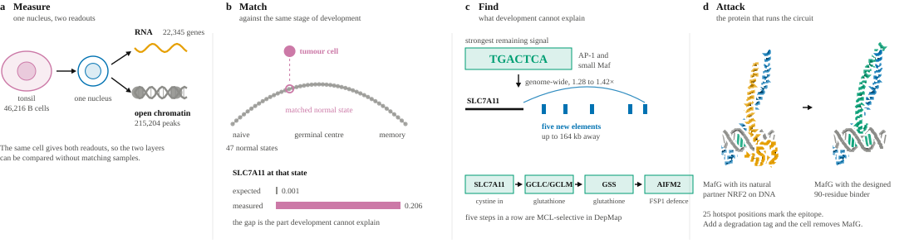

# Tonsil → MCL

**Differentiation-matched regulatory rewiring in mantle cell lymphoma, and protein-level drug design against the hub.**

從扁桃體正常 B 細胞分化出發，找出被套細胞淋巴瘤打開的調控迴路，再對迴路樞紐設計蛋白質藥物。

<p align="center">
  <a href="#english">English</a> &nbsp;·&nbsp;
  <a href="#中文">中文</a> &nbsp;·&nbsp;
  <a href="https://huggingface.co/ast-atp/Tonsil_to_MCL">Data and structures</a> &nbsp;·&nbsp;
  <a href="#data-sources--資料來源">Data sources / 資料來源</a> &nbsp;·&nbsp;
  <a href="#ethics--data-use--倫理與資料使用">Ethics / 倫理</a>
</p>

<p align="center">
  
</p>
<p align="center"><sub>
MafG (blue) on its DNA site (grey, with the TGACTCA core in green), first with its
natural partner NRF2 from crystal structure 7X5E (orange), then with our designed 90-residue binder
(green), superposed on the same MafG chain.<br>
MafG（藍）坐在 DNA 位點上（灰，TGACTCA 核心為綠），先是晶體結構裡的天然夥伴
NRF2（橘），再換成我們設計的 90 胺基酸結合劑（綠）。
</sub></p>

---

<a name="english"></a>
## English

### The question

Almost every study asks how mantle cell lymphoma (MCL) differs from a normal B cell.
MCL cells look like early B cells, so that comparison mostly measures development, not cancer.

This project asks a different question: **how does an MCL cell differ from the normal B cell at the same stage of development?**

### The method

```
1. Build a reference of normal B-cell development
   46,216 tonsil B cells · 46 of 48 annotated states · RNA and chromatin in the same nucleus

2. Give each tumour cell a soft position on those 46 states
   The model then predicts what a normal cell at that position would express

3. Subtract the prediction from the measurement
   What remains is the part that development cannot explain

4. Rebuild the control network from RNA and chromatin together
   Compare the tumour network with the normal network

5. Test with external models, then design a drug
```

<p align="center">
  <picture>
    <source media="(prefers-color-scheme: dark)" srcset="results/figs/overview.dark.svg">
    
  </picture>
</p>
<p align="center"><sub><b>Fig. 1 — What the study measures and what it builds.</b> <b>a</b>, Both readouts come from the same nucleus. <b>b</b>, Each tumour cell is compared with the normal state at its own stage of development. <b>c</b>, What remains is a seven-letter site and five new elements at <code>SLC7A11</code>. <b>d</b>, The protein that reads the site, drawn from real coordinates.</sub></p>

### Results

The strongest remaining signal is not a known cancer gene. It is a seven-letter piece of DNA,
**TGACTCA**, the landing site for the AP-1 and small Maf protein families.

<p align="center">
  <picture>
    <source media="(prefers-color-scheme: dark)" srcset="results/figs/motif.dark.svg">
    
  </picture>
</p>
<p align="center"><sub><b>Fig. 2 — The seven-letter site.</b> Information-content logos for the two families (JASPAR 2024), and the same core in the DNA of crystal structure 7X5E.</sub></p>

| Finding | Evidence |
|---|---|
| MCL opens TGACTCA sites genome-wide | AP-1 enriched 1.28–1.42×, BACH1 1.38× (background matched for length and GC) |
| B-cell identity factors lose their sites | POU family 0.70–0.85× |
| `SLC7A11` gains new elements absent from normal cells | Five candidates; **three open in both patients**, two only in M102. Expected expression 0.001, measured 0.206 |
| The residual survives three independent re-derivations — and the fourth method is measuring something else | Scored on each method's **own tumour-cell term**, three of the four place `SLC7A11` in the top 180 of 4,012 genes at **every one of 11 seeds** (A #176, B #22–104, D #22–106), at 4–9× that method's own noise floor. ContrastiveVI does not detect it at all (1.32× its floor, 0.92× on held-out seeds) because its score is the sign-flipped non-tumour residual (ρ = 0.967 against it, −0.012 against its own tumour term) — and that non-tumour comparator is 819 cells, 790 of them (96.5%) from a single donor. The tell: ContrastiveVI ranks `CCND1`, the t(11;14) product that defines the disease, **in the bottom 50 of 4,012 on its own tumour term at all 11 seeds** (last of all at three of them), and #2 once the subtraction is applied. Declared on seeds 0–4, confirmed on 6 seeds never looked at |
| Swapping the non-tumour comparator to the other donor does not change the published method's direction | The comparator is numerically **one donor**: replacing it with M413 alone (790 of the 819 cells) reproduces the pooled gene ranking at ρ = 0.995–0.999 for all four methods, while the two donors agree with each other at only ρ = 0.19–0.57. Swapped to the other donor (M102, **29 cells**), the published arithmetic method moves `SLC7A11` from 8.81× to 5.11× its noise floor — both strongly positive — and that donor difference is **1.15 standard errors**, i.e. inside sampling noise (the positive controls sit at 1.53 and 1.73). The generative methods report 5–10 SE and one of them flips sign, but their standard errors are model-smoothed (±0.0015 from 790 cells, ±0.0218 from 29), so that significance is an artefact of reporting the model's confidence rather than the data's. **2 donors remains the governing limit** — this says the direction survives the swap at the data's own resolution, not that the claim has been validated on two independent donors |
| The pathway is a real dependency module | The five genes' CRISPR profiles across 1,178 lines correlate at r = 0.278 against 0.001 for random five-gene sets (empirical p < 0.0005) |
| …and that module is **B-lymphoid-restricted** | Of the 18 lines that depend on `SLC7A11`, **12 are lymphoid and every one of those is a B-cell malignancy** (OR 26.6; empirical p = 0.021 against rate-matched genes). `GCLC` OR 65.8, `AIFM2` 74.8, `GCLM` 47.9 |
| The pathway is not mutated | 1.10× background in non-coding regions; **0** non-synonymous coding mutations in 21 pathway genes (one synonymous `BACH2` variant), against **50** in known drivers (same pipeline) |

The pathway runs in one line: cystine enters the cell → the cell builds glutathione → glutathione plus FSP1 blocks ferroptosis.

Two qualifications apply. Only the input end is raised in the residual (`SLC7A11` +0.205,
`SLC3A2` +0.178); `GCLC`, `GCLM` and `FSP1` sit slightly below the differentiation-matched
expectation, and their evidence is CRISPR dependency rather than expression. The dependency is also
lymphoid-selective rather than MCL-selective: MCL sits inside a B-cell-wide pattern.

### Where this sits in the literature

Ferroptosis resistance in MCL is an active and recent field: 8 papers, 6 of them since 2024, covering
BTK-inhibitor resistance, PI3Kδ-inhibitor resistance and iron-metabolism addiction. One of them
(*Biologics* 2024) is a mechanistic study of `xCT` in MCL by name.

Every one of those papers starts from the tumour, and none asks what the differentiation-matched
normal B cell would be doing. We reached the same axis from the opposite direction, and the parts
that are new lie in that direction: the `SLC7A11` elements, the lineage restriction, and the
four-method consensus. Counts for the individual genes, reproducible with
`scripts/51_novelty_screen.py` (re-run 2026-11-27): `"system xc−" + MCL` = 0; `MAFG` 0; `SLC3A2` 0;
`AIFM2/FSP1` 0; `SLC7A11` 1; `disulfidptosis` 0. A count of 0 at abstract level is not the same as
unexplored biology: the NRF2 antioxidant axis was studied in MCL patients as early as 2011.

<p align="center">
  <picture>
    <source media="(prefers-color-scheme: dark)" srcset="results/figs/locus_slc7a11.dark.svg">
    
  </picture>
</p>
<p align="center"><sub><b>Fig. 3 — The <code>SLC7A11</code> locus.</b> Every peak the pipeline calls in a 270 kb window, in normal and in tumour cells. The five new elements are blue. Each arc carries that element's contact rank against all position pairs at the same distance, as the median of six B-cell lines.</sub></p>

### External validation

All of the above comes from the same two patients, which is a weakness. We ran three tests with
AlphaGenome 2, which is trained on normal tissue only. One failed and two succeeded, and all three
are reported below.

| Test | Result |
|---|---|
| Baseline accessibility of the new elements | **Failed and retracted.** A peak-width artefact: width correlates with prediction at +0.74 and our elements are 3.5× wider. With a width-matched control the effect reverses (0.55×, p = 0.57) |
| Saturation mutagenesis of the MARE site | **MAFG promoter confirmed.** Breaking the site changes predicted `MAFG` expression 3.1× more than neighbouring bases (Bonferroni p ≈ 1×10⁻⁴). The positive control `HMOX1` works and is selective: only 1 of 3 TGACTCA copies scores |
| Cell-state conditioning (our own cells) | **SLC7A11 elements confirmed, in two patients.** Same DNA, only the cell state changes, so width and composition cancel exactly. Elements open ~2× under the tumour state against ~1.2× for non-rewired peaks in the same window (p = 7.9×10⁻⁴ and 1.9×10⁻⁵) |

### Drug design

The AP-1 and BACH1 families are redundant, but they all need the same partner at the site: **MafG**.
That is a statement about sequence and structure, and it holds. Whether it makes MafG druggable is a
separate question, and that has not been demonstrated. We report the design together with the two
findings that undercut it, because both are informative.

Evolutionary constraint (a protein language model) and the crystal interface converge on the same residues — two completely different kinds of evidence (`MAFG` p = 8.3×10⁻¹¹). Those positions also leave little room to escape: the interface accepts 10.5% of substitutions against 42.4% for the whole protein.

> **Caveat 1 — no genetic dependency.** Across 1,178 DepMap lines, knocking out `MAFG` does almost
> nothing (median gene effect −0.157; 2.5% of lines dependent). The three MCL lines are 0 / 3
> dependent and sit slightly *above* average (z = +0.36). `MAFG` shows **no** lymphoid enrichment
> (OR 0.86, empirical p = 0.55) while every downstream gene does, and its top co-dependencies
> (MCRIP1, SECTM1, ASPSCR1) have nothing to do with NRF2 or ferroptosis. Paralogue redundancy is
> the likely reason: lines expressing more `MAFK` depend less on `MAFG` (ρ = +0.094, p = 0.0019).
> A single knockout cannot test a molecule that blocks the shared interface of all three — but
> that remains an untested hypothesis, not a result.
>
> **Caveat 2 — the binder is not MafG-selective.** Against a panel of 7 bZIP targets, the design
> separates small Mafs from AP-1 and BACH1 cleanly, but **cannot separate MafG from MafF or MafK**
> (99-residue fragments, 85% / 76% identical, identical domain boundaries). Three co-folding models
> put the on-target/off-target gap between −0.011 and +0.051. Treat it as a **small-Maf-family
> binder**, and re-do the toxicity reasoning accordingly.

<p align="center">
  <picture>
    <source media="(prefers-color-scheme: dark)" srcset="results/figs/structures.dark.svg">
    
  </picture>
</p>
<p align="center"><sub><b>Fig. 4 — The same interface, three ways.</b> <b>a</b>, Crystal structure 7X5E: MafG (blue) and NRF2 (orange) on the DNA. <b>b</b>, The cost of removing each side chain, from the 191-position alanine scan. <b>c</b>, The designed 90-residue binder (green) on the same face. Panels a and b are crystal coordinates; the binder is a prediction, superposed on the crystal MafG.</sub></p>

The best design is a **90-residue mini-protein** that passes **all four wet-lab-calibrated filters**, thresholds derived from 3,766 binders tested in the laboratory:

| | ipSAE (mean ± sd) | ipTM | Interface error | pLDDT | Filters |
|---|---|---|---|---|---|
| **Best design** | **0.611 ± 0.020** (best sample 0.631) | 0.790 | 6.97 Å | 0.902 | **4 / 4** |
| Native NRF2 (positive control) | 0.519 ± 0.013 (best 0.539) | 0.713 | 9.16 Å | 0.937 | 3 / 4 |
| Scrambled (negative control) | 0.003–0.020 (best 0.013–0.076) | 0.39–0.47 | 17–20 Å | 0.58–0.65 | 0 / 4 |

All five numbers are over 5 diffusion samples. The ipSAE filter (threshold 0.61) is applied to the
**best** sample, as in the calibration paper; the best design's **mean** clears it by 0.001, so that
one filter is marginal. The other three are cleared by a wide margin.

```
LAAGGSVDTEKLAELQKKLEEMELELAKMQQELAELQKELEKLQKELAEAEAEMKAAGIPAKLSEEERARLLHWAALVEAPLHRVRRRPL
```

### Hypotheses tested and rejected

70 hypotheses and traps were tested and dropped. Several were our own first conclusions, and fourteen
of those were retracted or corrected after this repository went public. The full table is in the report and the
showcase page.

Three separate artefacts had the same cause: a foreground group and a background group that differed
in length or base composition, first in motif length, then in GC content, then in peak width. Each
produced a result that looked clean and was wrong.

### Limitations

- **Two patients.** No third patient-derived MCL multiome exists in public data. An attempt to fix this made the problem worse, and is reported here in full. BLUEPRINT has 5 primary MCL patients on GRCh38, open access, with six histone marks and RNA-seq — but before comparing any peak we gated on expression, and `SLC7A11` is **0.07, 0.20, 0.01, 0.05 and 0.16 FPKM: 0 of 5 above 1**. The positive control passes emphatically (`CCND1` 214–693 FPKM, the defining t(11;14)), purity is clean (`MS4A1` 611–1,560, `CD3E` 0.94–6.43), and the rest of the module is expressed normally (`GCLC` 4–12, `GPX4` 45–80, `SLC3A2` 55–138) — so this is specific to `SLC7A11`, not a sample-quality artefact. One evidenced qualification: all five are venous blood and 3 of 5 are `SOX11`-negative, i.e. predominantly leukaemic non-nodal MCL, a different subtype from nodal tissue disease; the two `SOX11`-positive donors do rank 1st and 2nd for `SLC7A11` (0.20, 0.16) but that is still essentially zero. This is the strongest external test run on this axis, and it points the other way. Two consequences we accept: the claim needs a scope restriction to `SOX11`-positive nodal MCL, and the "200×" is a ratio of two small numbers (our 0.206 mean log1p-CP10K against 0.0009 in matched normal — large because the denominator is near zero). The cohort that would actually settle it — `SOX11`-positive, tissue-derived, independent of our two patients — does not exist in public data today.
- **A second independent cohort cannot test this gene at all, and testing it exposed a confound in our own contrast.** `GSE303064` (19 usable samples, scRNA, `SOX11` up in the malignant cells of 18 of them — the subtype BLUEPRINT lacked) was pre-registered before any number was read, with a detectability gate that returns `no_power` rather than a negative. The gate failed: `SLC7A11` is detected in a median of **0.43%** of malignant cells, and only 2 of 19 samples reach 5%. Droplet 3' scRNA does not capture this transcript, and no statistic recovers power that was never there. Separately, the pre-registered ubiquitous negative control `RPL13A` failed (+0.428, 19 of 19 samples, *p*<sub>adj</sub> = 6.1 x 10^-5), so we tested why: cells with `CCND1` == 0 are not only non-malignant, they are **shallower** - malignant cells carry 1.456x the UMI (range 1.09-2.56, 19 of 19 above 1) and 1.27x the genes, and CP10K scaling does not put dropped zeros back. All five ubiquitous genes shift up in 19 of 19 samples (`TMSB4X` +0.555, `RPL13A` +0.428, `RPS6` +0.412, `ACTB` +0.384, `GAPDH` +0.350; each *p* = 3.8 x 10^-6), and the size of the artefact tracks the depth gap across samples (Spearman *r* = **0.705**, *p* = 0.00074). The bias pushes every gene up in malignant cells, so our earlier finding that the B-cell identity module falls in malignant cells (17 of 19) holds **against** the bias and is conservative; but no positive delta from this contrast is interpretable, and "no consistent trend in antigen presentation" is now undecided rather than negative.
- **The design rationale does not survive its own target dossier: the small Maf family is partly redundant.** The argument for this target was that the AP-1 and BACH1 readers are redundant with each other but converge on one necessary partner, `MafG`. `MAFG` itself was never checked. Across 1,103 DepMap lines, lines expressing more `MAFF` and `MAFK` are **less** dependent on `MAFG` (Spearman *r* = +0.0776, *p* = 0.00998; against 1,000 random genes the empirical *p* = **0.0190**; `MAFK` alone *r* = +0.0936, *p* = 0.00187). That is the signature of functional redundancy, and it inverts the design objective: the specificity panel treated binding to `MafF` and `MafK` as off-target to be minimised, but if the three substitute for one another then cross-reactivity is a requirement rather than a defect. Two limits belong with it: *r* = +0.0776 explains about 0.6% of the variance, so this is partial and not complete redundancy, and expression is a weak proxy for protein activity — the real test is a double knockout, which a single-gene CRISPR screen cannot do. What the dossier does **not** find is any other blocker. `MAFG` is dependent in only 2.5% of 1,178 lines (the `RPL13A` control is 100%), and its population constraint does not disqualify it: LOEUF 0.636, against three approved targets in this disease that are all **more** constrained — `BTK` 0.183, `IKZF1` 0.328 (lenalidomide, approved in MCL) and `BCL2` 0.333. Within the family the risk is asymmetric: `MAFF` is fully loss-of-function tolerant (LOEUF 3.386) while `MAFK` is more constrained than `MAFG` (0.516). `MAFG` is also ubiquitously expressed, with a median above 1 in 34 of 34 lineages, so the window is against differentiation-matched normal B cells and not against the body.
- **Tumour-gained accessibility is not written in the local sequence, and four independent lines say so.** The elements the tumour opens are not a distinguishable sequence class. A DNA language model (Nucleotide Transformer 500M) embedding 2,417 gained peaks and 2,417 width- and GC-matched stable peaks gives a cross-validated AUC of **0.5071**, inside a permutation null of 0.5000 ± 0.0117 (empirical *p* = **0.28**). That null result is interpretable only because the pre-specified positive control passed: the same embedding and the same probe separate proximal (< 1 kb) from distal (> 50 kb) peaks at **AUC 0.8906**. Dinucleotide-preserving shuffles score 0.5059, so the model is not reading composition. This agrees with motif counting (empirical *p* = 0.796), and with 22 whole genomes carrying just one synonymous mutation across the whole axis. Yet AlphaGenome's saturation mutagenesis shows the MARE core **is** causal for predicted accessibility (motif-to-flank ratios 2.19, 2.54 and 2.96 for the `MAFG` promoter). Put together: the sequence is necessary but it is not what differs. The grammar that makes these elements openable is equally present in the peaks the tumour leaves closed, so the cause sits in trans — factor availability and chromatin state — and there is no causal variant here to find.
- **`MAFG` elements gain coupling but lose openness.** We have no explanation. Our first explanation came from the width artefact and was retracted.
- **Delivery is out of scope by design.** A 90-residue protein does not cross a membrane by itself. Every design here assumes it reaches the nucleus.
- **The structure model cannot score single mutations on a protein–DNA interface.** 0 of 24 mutations passed the noise floor; the baseline is saturated.
- **It cannot rank them on a protein–protein interface either.** An orthogonal binding-energy model, calibrated against measured energies, gives a ranking that does not correlate with ours (Spearman +0.17, p = 0.58). Use the co-folding score for which positions sit in the interface, not for which mutation is worse.
- **The binder is a family binder, not a MafG binder.** See Caveat 2 above. The decisive experiment is one week of SPR against MafG, MafF and MafK.
- **`MAFG` is not a genetic dependency anywhere.** See Caveat 1 above.
- **Co-folding scores disagree with each other on this target.** On the specificity panel Boltz-2's own negative control scored 0.647 on MafK — nearly as high as the real design — so its "no selectivity" verdict is not usable. ESMFold's complex mode fails its positive control (natural NRF2 on MafG scores 0.060 against the design's 0.466), so it is usable only for monomer foldability. Chai-1 passes both controls and is the one we weight.
- **The best design is the worst folder.** ESMFold single-chain pLDDT: 0.735 for the lead, against 0.781 for a design that Boltz-2 ranked as a failure and 0.808 for native NRF2. Only 51% of its residues exceed pLDDT 0.70. A binder that only folds when bound is harder to express and more prone to aggregate.
- **Human genetics cannot test these elements.** Across GTEx (3 tissues) and 18 sorted B-cell / LCL eQTL datasets (>4,000 donors), `SLC7A11` has 4 fine-mapped credible-set variants in the whole 500 kb window and `MAFG`, `SLC3A2`, `GCLM` have none. Zero fall in our elements — but with 2.5 kb of foreground the test could only have detected a 4.4× enrichment. This is no power, not a negative result. The right test has since been run, with the same no-power result. The memory-B caQTL data (TenK10K, n = 913) is not on the eQTL Catalogue — the authors released it themselves on Hugging Face (`anglixue/TenK10K_multiome`, CC-BY-4.0). All five `SLC7A11` elements and the `MAFG` MARE have a matching tested peak in memory B, and every one has q ≥ 0.983. But only **301 of 14,998 chr4 peaks (2.01%)** and 374 of 15,389 chr17 peaks (2.43%) are significant anywhere in that dataset, so the expected number of hits among our six elements is 0.125. Observing zero is the base rate, not evidence. The authors' own caQTL→eQTL SMR finds 0 hits for `SLC7A11` or `MAFG` in any of 28 cell types. Independently reproduced from the downloaded files (base rates and per-element q values both match). So: the assay and the cell type were right; the power was never there. `results/180_bcell_eqtl.json`'s `caqtl_note` still says "not yet released" and is superseded by `results/206_external_validation_scouting.md`.
- **Cell lines are a poor model for this axis.** All three DepMap MCL lines express `SLC7A11` *below* the median (44th, 17th and 12th percentile), while the patient tumours sit 200× above matched normal B cells. Any cystine- or ferroptosis-related experiment run in JVM-2, MAVER-1 or Z-138 risks a meaningless negative. The problem is sharper than "poor": cell lines model the inverted régime. Across 1,103 lines, the cells that *need* this module are the ones expressing *least* of it — self-correlation between a gene's own expression and its own CRISPR effect is +0.166 for `GCLM` (99th percentile of 594 random genes), +0.135 `GCLC` (98th), +0.104 `SLC7A11` (96th), and within B-lymphoid lines `SLC7A11` reaches +0.357. The genome-wide background runs the *other* way (median −0.0123, only 41.9% positive, Wilcoxon p = 1.2×10⁻⁵; shuffling line labels returns −0.0038), so this is a real property of the module, not an artefact. Patient tumours are 200× *above* matched normal. Three independent analyses reached this caveat separately, and it applies to the whole axis, not to one candidate gene.
- **The B-lymphoid restriction still has no mechanism**, and one mechanism we proposed has since been retracted. Scope is sharper than before — `SLC7A11` dependency is 12/53 (22.6%) in non-plasma-cell B lines against 0/19 plasma-cell myeloma, 0/18 T/NK, 1/42 myeloid and 5/1,043 non-haematopoietic (within-lymphoid Fisher p = 6.4×10⁻⁴, empirical p = 0.016), and the requirement localises to de novo glutathione synthesis, where **`GSS` is a new module member** (6/7 dependents among B lines, OR 143, empirical p = 0.003), completing `SLC7A11`→`GCLC`→`GCLM`→`GSS`. But the "B cells lack an FSP1 backup arm" model failed: myeloid lines have the *lowest* `AIFM2` of any group (median z = −1.02) with only 2.6% dependency, and in non-haematopoietic lines `SLC3A2` expression predicts dependency exactly as well as `AIFM2` does (r = +0.133 vs +0.134). The selenocysteine arm (`SCLY`, `SEPSECS`, `SEPHS2`) is the best remaining hypothesis — two independent screens converged on it — but nothing in that screen passed a family-wise threshold, so it is a hypothesis for a wet experiment, not a result.
- **Starving cystine is the wrong lever, and we can say why.** A flux-balance model of human metabolism (Human-GEM, gated on an exact stoichiometric identity — 0.5170 observed against 2×0.208 + 0.101 predicted — plus a fail-stop that must return zero, a sulfate check and a requirement that knocking out `SLC7A11` actually does something) says that cutting cystine makes xCT *less* essential, not more: as cystine falls, transsulfuration's relative share rises. The lever that makes xCT absolute is closing transsulfuration. In B cells it is already closed (`CBS` exceeds 0.1 in 0 of 46 normal states, `CBSL` 0 of 46, `CTH` 1 of 46), and with it closed knocking out `SLC7A11` removes **100% of glutathione capacity at every cystine concentration**. Free cysteine in the medium only raises the ceiling — at 0.2 mM it still removes 67.5%. The practical consequence: **an xCT inhibitor needs the free-cysteine supply blocked too.** This is a stoichiometric statement, not a cell-biology one; it needs cystine-restricted medium ± cysteine rescue to test.
- **That mechanism does not explain the lineage restriction.** We made the prediction, tested it, and it failed. If "no transsulfuration" were the discriminator, then across all DepMap lines lower transsulfuration should mean stronger `SLC7A11` dependency. It does not: across 1,103 lines Spearman r = **−0.030** (p = 0.32, *wrong sign*); within the 1,012 non-lymphoid lines r = −0.054; against a null of 1,999 random genes the empirical p is 0.789; and the negative control `RPL13A`, a ribosomal gene every line needs, correlates *more* strongly (r = +0.059) and in the predicted direction. The group-level difference that looked promising (dependent lines' transsulfuration score 2.322 vs 2.865, p = 0.034) is fully explained by lineage composition, since lymphoid lines are simply lower (2.249 vs 2.899, p = 0.0066). The OR 26.6 B-lymphoid restriction therefore still has no mechanism.
- **The molecular-dynamics assay has no discriminating power**, and therefore supports no conclusion in either direction. This retracts what this file said earlier. Three 10 ns replicates per system gave a native-contact fraction of 0.875 ± 0.020 on MafG against 0.892 ± 0.009 on MafK (ΔQ = −0.016), which looked like an independent confirmation of non-selectivity. The pre-specified negative control then showed that a scrambled-sequence design holds on at Q = 0.890, indistinguishable from the real design. An assay that cannot reject a scrambled sequence cannot support any conclusion about selectivity, so the ΔQ is withdrawn as evidence. The gate in `scripts/190_md_interface.py` returned `A5_assay_cannot_discriminate` and cancelled the 67 GPU-hour extension automatically. The lesson generalises: 10 ns of MD started from a co-folding prediction is a stability test of that prediction rather than a binding test, because "native contacts" are defined from the predicted pose, so if the predictor placed a scrambled sequence in contact, short MD will keep it there. Reaching even this conclusion required first fixing a periodic-image error that had made MafK's three replicates look like they had no interface at all (`enforcePeriodicBox` is on by default, so each molecule is wrapped separately and two chains in contact can read as 3.5 nm apart). That correction is validated in `scripts/193_md_validation.py`: lattice-translation invariance to 1×10⁻⁶ nm, and 400 synthetic rigid separations of 1.5–5.0 nm all return Q = 0.0000.

### The report

A five-page write-up in the format of a computational-biology paper: one page revisiting
Massoni-Badosa *et al.* claim by claim, three pages on the extension above, one page of figures.

| File | |
|---|---|
| `REPORT_assignment.html` | The report, English. Open it in a browser; print to PDF for a paper copy. |
| `REPORT_assignment.zh.html` | The same report in Chinese. |
| `REPORT_v3.md` | The long version, with all 70 rejected hypotheses (Chinese). |

Both HTML files are built from one bilingual source, `docs/report_template.html`, by
`scripts/112_build_report.py`; `scripts/113_estimate_pages.py` checks that each language still
fits on five A4 pages.

---

<a name="中文"></a>
## 中文

### 問題

幾乎所有研究問的都是「套細胞淋巴瘤與正常 B 細胞有何差異」。但 MCL 細胞的表型近似早期 B 細胞，因此這類比較所測得的主要是分化差異，而非癌化差異。

本專案改問：**MCL 細胞與分化程度完全相同的正常 B 細胞之間，差異何在？**

### 方法

```
1. 建立正常 B 細胞分化參考
   46,216 個扁桃體 B 細胞 · 48 個註釋狀態取 46 個 · RNA 與染色質取自同一細胞核

2. 將每個腫瘤細胞在這 46 個狀態上做軟性定位
   再由模型推估該細胞若為正常細胞時的預期表現量

3. 以實測值減去預期值
   其殘差即為分化無法解釋的部分

4. 以 RNA 與染色質共同重建調控網絡
   比較腫瘤網絡與正常網絡

5. 以外部模型驗證，並進行藥物設計
```

<p align="center">
  <picture>
    <source media="(prefers-color-scheme: dark)" srcset="results/figs/overview.dark.svg">
    
  </picture>
</p>
<p align="center"><sub><b>圖 1 — 本研究的測量對象與產出。</b>a 同一細胞核同時提供 RNA 與開放染色質；b 每個腫瘤細胞與分化程度相同的正常細胞相比；c 殘餘訊號指向 TGACTCA 與 <code>SLC7A11</code> 的五個新生元件；d 讀取該位點的蛋白質，依真實座標繪製。</sub></p>

### 結果

最強的殘餘訊號並非任何已知癌症基因，而是一段 7 個字母的 DNA 序列 **TGACTCA**，即 AP-1 與 small Maf 家族的結合位點。

<p align="center">
  <picture>
    <source media="(prefers-color-scheme: dark)" srcset="results/figs/motif.dark.svg">
    
  </picture>
</p>
<p align="center"><sub><b>圖 2 — 這個七字母位點。</b>兩個家族的資訊量 logo（JASPAR 2024），以及晶體結構 7X5E 中帶有同一段核心序列的 DNA。</sub></p>

| 發現 | 證據 |
|---|---|
| MCL 在全基因組範圍開放 TGACTCA 位點 | AP-1 富集 1.28–1.42×、BACH1 1.38×（背景已就長度與 GC 含量配對） |
| B 細胞身分因子的位點則流失 | POU 家族 0.70–0.85× |
| `SLC7A11` 新生出正常細胞所無的調控元件 | 五個候選元件，其中**三個在兩位病人皆為開放**，兩個僅見於 M102。期望表現量 0.001，實測 0.206 |
| 殘差可通過三種獨立重算的檢驗，而第四種方法所測量的是另一回事 | 改以各方法**自身的腫瘤項**評分後，四種方法中有三種在**全部 11 個種子**都把 `SLC7A11` 排進 4,012 個基因的前 180 名（A #176、B #22–104、D #22–106），且落在各自雜訊底的 **4–9 倍**。`ContrastiveVI` 則完全未偵測到它（1.32× 雜訊底，保留集 0.92×，低於自身雜訊底），原因是它的分數即為非腫瘤殘差的反號（兩者 ρ = 0.967，與自身腫瘤項則為 −0.012），而該非腫瘤比較組僅有 819 個細胞，其中 790 個（96.5%）來自**單一捐贈者**。最明確的證據是：`ContrastiveVI` 在自身腫瘤項上，把定義本疾病的 t(11;14) 產物 `CCND1` 在**全部 11 個種子都排在 4,012 名的倒數 50 名之內**（其中三次為最後一名），相減之後卻升至第 2 名。本結論宣告於種子 0–4，並在 6 個從未檢視過的種子上得到確認 |
| 將非腫瘤比較組換成另一位捐贈者後，已發表方法的方向不變 | 這個比較組在數值上即等於**一位病人**：換成「僅用 M413」（819 個細胞中的 790 個）後，基因排名與合併版的 Spearman 為 **0.995–0.999**（四種方法皆然），而兩位捐贈者彼此只相關 0.19–0.57。換成另一位（M102，**29 個細胞**）後，已發表採用的算術法將 `SLC7A11` 由 8.81× 移至 **5.11×** 自身雜訊底，兩者皆為強正值，而該捐贈者差異僅 **1.15 個標準誤**，落在抽樣雜訊之內（陽性對照為 1.53 與 1.73）。生成模型則報出 5–10 個標準誤，其中一個甚至變號，但它們的標準誤經過模型平滑（790 個細胞 ±0.0015、29 個細胞 ±0.0218），那個「顯著」**反映的是模型的信心而非資料的不確定性**。**2 位捐贈者仍是支配性的限制**：本列所能主張的是「在資料自身的解析度內，更換捐贈者不改變方向」，**而非**「此一宣稱已在兩位獨立捐贈者上得到驗證」 |
| 這條路徑確實構成一個依賴模組 | 五個基因在 1,178 個細胞株上的 CRISPR 輪廓兩兩相關 r = 0.278，隨機五基因組為 0.001（經驗 p < 0.0005） |
| 且此模組**限定於 B 淋巴系** | 依賴 `SLC7A11` 的 18 個細胞株中，**12 個屬淋巴系，且每一個都是 B 細胞腫瘤**（OR 26.6；相對於依賴率配對的隨機基因，經驗 p = 0.021）。`GCLC` OR 65.8、`AIFM2` 74.8、`GCLM` 47.9 |
| 這條路徑並非突變驅動 | 非編碼區僅為背景的 1.10×；21 個路徑基因共 **0** 個非同義編碼突變（僅一個同義的 `BACH2` 變異），而同一流程在已知 driver 上檢出 **50** 個 |

這條路徑是線性的：胱胺酸輸入細胞 → 細胞合成穀胱甘肽 → 穀胱甘肽與 FSP1 共同阻擋鐵死亡。

此處有兩項限定。殘差上升者僅見於輸入端（`SLC7A11` +0.205、`SLC3A2` +0.178）；
`GCLC`、`GCLM`、`FSP1` 反而略低於分化配對的期望值，其證據來自 CRISPR 依賴性而非表現量。
此依賴性亦屬淋巴系選擇性而非 MCL 選擇性：MCL 落在一個涵蓋整個 B 細胞譜系的模式之內。

### 這項發現在文獻裡的位置

MCL 的鐵死亡抗性是近兩年相當活躍的題目：共 8 篇論文，其中 6 篇發表於 2024 年以後，涵蓋 BTK
抑制劑抗藥性、PI3Kδ 抑制劑抗藥性與鐵代謝成癮；其中一篇（*Biologics* 2024）的標題即為 MCL 的
`xCT` 機制研究。

但這 8 篇全部以腫瘤為起點，沒有一篇追問分化程度相同的正常 B 細胞會是何種狀態。
本研究從相反的方向抵達同一條軸線，而真正的新意也正在這個方向上：`SLC7A11` 的新生元件、
依賴性的譜系限定，以及四種方法的共識。個別基因的檢索計數（以 `scripts/51_novelty_screen.py`
可重現，2026-11-27 重跑）：`"system xc−" + MCL` = 0；`MAFG` 0；`SLC3A2` 0；`AIFM2/FSP1` 0；
`SLC7A11` 1；`disulfidptosis` 0。但摘要層級的計數為 0 並不等於該生物學未被探索：
NRF2 抗氧化軸早在 2011 年即有 MCL 病人層級的研究。

<p align="center">
  <picture>
    <source media="(prefers-color-scheme: dark)" srcset="results/figs/locus_slc7a11.dark.svg">
    
  </picture>
</p>
<p align="center"><sub><b>圖 3 — <code>SLC7A11</code> 基因座。</b>270 kb 視窗內的所有 peak，正常與腫瘤各一軌；五個新生元件以藍色標示。弧線高度為該元件在同距離所有配對中的接觸排名（6 個 B 細胞株的中位數）。</sub></p>

### 外部驗證

以上結果全部出自同兩位病人，這是本研究的弱點。我們以 AlphaGenome 2（僅在正常組織上訓練）
進行三項檢定，一項失敗、兩項成功，三項均報告如下。

| 檢定 | 結果 |
|---|---|
| 新生元件的基線可及性 | **失敗並撤回。** 此為 peak 寬度造成的假象：寬度與預測值相關 +0.74，而本研究的元件寬出 3.5 倍。改用寬度配對的對照後，效應方向反轉（0.55×、p = 0.57） |
| MARE 位點的飽和突變 | **MAFG 啟動子獲得確認。** 破壞該位點後，預測的 `MAFG` 表現改變量達鄰近鹼基的 3.1 倍（Bonferroni p ≈ 1×10⁻⁴）。陽性對照 `HMOX1` 有效且具選擇性：三個 TGACTCA 位點中僅一個顯著 |
| 細胞狀態條件化（使用本研究自己的細胞） | **SLC7A11 元件獲得確認，兩位病人一致。** 序列固定、僅更換細胞狀態，因此寬度與鹼基組成的影響完全抵銷。元件在腫瘤狀態下的開放程度約為 2 倍，同窗格內未重接線的 peak 僅約 1.2 倍（p = 7.9×10⁻⁴ 與 1.9×10⁻⁵） |

### 藥物設計

AP-1 與 BACH1 家族成員彼此冗餘，但都需要同一個夥伴：**MafG**。
這是關於序列與結構的陳述，且該陳述成立。但「MafG 因此可以成藥」是另一個問題，
而這一點尚未得到證明。我們仍然報告設計結果，並一併列出兩項削弱它的發現，因為兩者都有資訊量。

演化約束（蛋白質語言模型）與晶體介面收斂到同一組殘基，這是兩種性質完全不同的證據（`MAFG` p = 8.3×10⁻¹¹）。這些位置的逃逸空間也極為有限：介面僅容許 10.5% 的取代，全蛋白質平均則為 42.4%。

> **保留一：不存在遺傳依賴性。** 在 1,178 個 DepMap 細胞株中敲除 `MAFG` 幾乎沒有影響
> （中位 gene effect −0.157，僅 2.5% 的細胞株達到依賴門檻）。三個 MCL 細胞株為 0 / 3 依賴，
> 且依賴程度略低於平均（z = +0.36）。`MAFG` 不具任何淋巴系富集
> （OR 0.86、經驗 p = 0.55），而下游每一個基因都有；其共依賴夥伴
> （MCRIP1、SECTM1、ASPSCR1）與 NRF2 及鐵死亡均無關聯。
> 最可能的原因是旁系同源的冗餘：`MAFK` 表現量越高的細胞株，對 `MAFG` 的依賴越低（ρ = +0.094, p = 0.0019）。
> 單基因敲除無法偵測到一個同時阻斷三者共用介面的分子，但這仍是未經檢定的假說，而非結果。
>
> **保留二：結合劑對 MafG 不具選擇性。** 在含 7 個 bZIP 標的的檢定盤上，設計品可明確區分
> small Maf 與 AP-1、BACH1，但**無法區分 MafG、MafF、MafK**
> （99 殘基片段，相同度 85% / 76%，結構域邊界完全一致）。三個共摺疊模型所給出的
> on-target 與 off-target 差距落在 −0.011 至 +0.051 之間。
> 因此應視為**small Maf 家族結合劑**，毒性評估須依此前提重寫。

<p align="center">
  <picture>
    <source media="(prefers-color-scheme: dark)" srcset="results/figs/structures.dark.svg">
    
  </picture>
</p>
<p align="center"><sub><b>圖 4 — 同一介面的三種視角。</b>a 晶體結構 7X5E：MafG（藍）與 NRF2（橘）結合於 DNA 之上；b 各位置移除側鏈所需付出的結合能（191 個位置的丙胺酸掃描）；c 所設計的 90 胺基酸結合劑（綠）落在同一面。a、b 取自晶體座標，c 的結合劑則為預測後疊合而成。</sub></p>

最佳設計是一個 **90 殘基的迷你蛋白質**，通過**全部四項濕實驗校準門檻**（門檻取自 3,766 個經實驗測試的結合劑）：

| | ipSAE（平均 ± 標準差） | ipTM | 介面誤差 | pLDDT | 通過 |
|---|---|---|---|---|---|
| **最佳設計** | **0.611 ± 0.020**（最佳取樣 0.631） | 0.790 | 6.97 Å | 0.902 | **4 / 4** |
| 天然 NRF2（陽性對照） | 0.519 ± 0.013（最佳 0.539） | 0.713 | 9.16 Å | 0.937 | 3 / 4 |
| 亂序序列（陰性對照） | 0.003–0.020（最佳 0.013–0.076） | 0.39–0.47 | 17–20 Å | 0.58–0.65 | 0 / 4 |

這五個數值都來自 5 次 diffusion 取樣。ipSAE 這道門檻（0.61）依校準論文的做法以**最佳取樣**判定；
最佳設計的**平均值**僅高於門檻 0.001，因此這一項屬勉強通過，另外三項則有明顯餘裕。

```
LAAGGSVDTEKLAELQKKLEEMELELAKMQQELAELQKELEKLQKELAEAEAEMKAAGIPAKLSEEERARLLHWAALVEAPLHRVRRRPL
```

### 被推翻的假設

共有 70 個假設與陷阱在檢定後被放棄，其中若干是我們自己最初的結論，並有十四個是在本倉庫公開之後才撤回或更正。
完整表格見報告與展示頁。

三個獨立的假象出自同一個原因：前景組與背景組在長度或鹼基組成上並不相同，依序為 motif 長度、
GC 含量與 peak 寬度。每一次都得到表面乾淨而實際錯誤的結果。

### 限制

- **僅有兩位病人。** 公開資料中不存在第三例病人來源的 MCL 多體學資料。我們嘗試補救，結果反而使問題更為嚴重，以下照實報告。BLUEPRINT 具備 5 位原發 MCL 病人、GRCh38、開放下載、6 種組蛋白標記與 RNA-seq，但在比較任何 peak 之前先做了表現量把關，而 `SLC7A11` 為 **0.07、0.20、0.01、0.05、0.16 FPKM：0/5 高於 1**。陽性對照通過得十分明確（`CCND1` 214–693 FPKM，即 t(11;14) 的定義性易位），檢體純度良好（`MS4A1` 611–1,560、`CD3E` 0.94–6.43），且模組其他成員全部正常表現（`GCLC` 4–12、`GPX4` 45–80、`SLC3A2` 55–138），因此這是 `SLC7A11` 專有的現象，而非檢體品質造成的假象。此處有一項有證據支持的限定：五位病人全部取自靜脈血、3/5 為 `SOX11` 陰性，亦即以白血病型非淋巴結 MCL 為主，與淋巴結組織型屬不同亞型；兩位 `SOX11` 陽性者的 `SLC7A11` 確實排名第 1、2（0.20、0.16），但其數值仍等同於零。這是這條軸線上所做過最強的外部檢定，而其結果指向相反的方向。我們接受兩項後果：此一宣稱須限定於 `SOX11` 陽性的淋巴結型 MCL；而「200 倍」是兩個小數值的比值（本研究的 0.206 mean log1p-CP10K 對配對正常細胞的 0.0009，比值之所以大是因為分母近乎零）。真正足以定案的世代（`SOX11` 陽性、組織來源、且與本研究兩位病人無關）在現今的公開資料中並不存在。
- **第二個獨立世代完全無法檢定這個基因，而檢定的過程還揭露了我們自己對照組的一項混淆。** `GSE303064`（19 個可用樣本、scRNA，其中 18 個的惡性細胞 `SOX11` 升高，正是 BLUEPRINT 所缺的那個亞型）在讀取任何數字之前即完成預先註冊，並設定了一道可偵測性門檻：偵測不到即判為 `no_power`，不得寫成陰性結果。該門檻**未通過**：`SLC7A11` 在惡性細胞的偵測率中位數僅 **0.43%**，僅 2/19 個樣本達到 5%。液滴式 3' scRNA 無法捕捉這段轉錄本，而檢定力自始不存在一事，更換任何統計量都無法補救。此外，事先註冊的泛表現陰性對照 `RPL13A` **未通過**（+0.428、19/19 個樣本、*p*<sub>adj</sub> = 6.1×10⁻⁵），因此我們追查原因：`CCND1` == 0 的細胞不僅是非惡性細胞，其**定序深度也較淺**：惡性細胞的 UMI 為其 1.456 倍（範圍 1.09–2.56，19/19 皆大於 1）、偵測基因數為 1.27 倍，而 CP10K 縮放並不會補回 dropout 所造成的零值。五個泛表現基因在 19/19 個樣本中全部同向偏高（`TMSB4X` +0.555、`RPL13A` +0.428、`RPS6` +0.412、`ACTB` +0.384、`GAPDH` +0.350，每一個 *p* = 3.8×10⁻⁶），且假訊號的大小跨樣本追隨定序深度的差異（Spearman *r* = **0.705**、*p* = 0.00074）。此偏誤的方向是使惡性細胞的每個基因都偏高，因此我們先前「B 細胞身分模組在惡性細胞中下降（17/19）」是**逆著**偏誤而成立，屬於保守估計；但以此切法算出的任何正向差值都不可解讀，而「抗原呈現沒有一致趨勢」現在應標記為**未決**，而非陰性。
- **設計理念過不了自己的標的檔案：small Maf 家族部分冗餘。** 選這個標的的論述是「AP-1 與 BACH1 的讀取因子彼此冗餘，但收斂到唯一一個必要夥伴 `MafG`」，而 `MAFG` 自己從來沒有被檢查過。在 1,103 株 DepMap 細胞株裡，`MAFF` 與 `MAFK` 表現較高的株**較不**依賴 `MAFG`（Spearman *r* = +0.0776、*p* = 0.00998；對照 1,000 個隨機基因的經驗 *p* = **0.0190**；單獨 `MAFK` *r* = +0.0936、*p* = 0.00187）。這是功能冗餘的特徵，而它把設計目標整個反過來：特異性盤把「也黏 `MafF`／`MafK`」當成要最小化的 off-target，但若三者可以互相替代，**交叉反應就是必要條件而不是缺點**。兩個限縮必須一起寫：*r* = +0.0776 只解釋約 0.6% 的變異，所以這是部分冗餘而非完全可替代；而表現量是蛋白質活性的弱代理 —— 真正的檢定是雙重剔除，單基因 CRISPR 篩選做不到。檔案**沒有**找到的是其他否決理由：`MAFG` 在 1,178 株裡只有 **2.5%** 依賴（`RPL13A` 對照是 100%），而族群遺傳學的受限程度也不構成否決 —— LOEUF **0.636**，而這個病裡三個已上市的標的**全部更受限**：`BTK` 0.183、`IKZF1` 0.328（lenalidomide，已在 MCL 核准）、`BCL2` 0.333。家族內的風險是不對稱的：`MAFF` 完全耐受功能喪失（LOEUF 3.386），而 `MAFK` 比 `MAFG` 更受限（0.516）。`MAFG` 也是普遍表現，34 個譜系全部中位 > 1，所以窗口是對分化配對的正常 B 細胞而言，不是對全身而言。
- **腫瘤新開的可及性不寫在局部序列裡，而且有四條獨立證據這麼說。** 腫瘤打開的那些元件，在序列上不是一個可區分的類別。用 DNA 語言模型（Nucleotide Transformer 500M）把 2,417 個新開 peak 與 2,417 個寬度／GC 配對的穩定 peak 嵌成向量，交叉驗證 AUC 是 **0.5071**，落在置換虛無 0.5000 ± 0.0117 之內（經驗 *p* = **0.28**）。這個陰性結果能被解讀，唯一的理由是事先指定的陽性對照**通過**了：同一個嵌入、同一個探針把近端（< 1 kb）與遠端（> 50 kb）peak 分到 **AUC 0.8906**。雙核苷酸保留打亂後是 0.5059，所以模型讀的不是組成。這與樣式計數一致（經驗 *p* = 0.796），也與 22 份全基因組在整條軸線上只有一個同義突變一致。但 AlphaGenome 的全飽和突變顯示 MARE 核心對預測可及性**確實有因果**（motif/flank 比值 2.19、2.54，`MAFG` 啟動子 2.96）。合起來是：**序列是必要的，但不是區別所在。** 讓這些元件可以被打開的文法，在腫瘤沒有打開的 peak 裡一樣多，所以原因在反式 —— 因子的可用量與染色質狀態 —— 而這裡沒有致病變異可找。
- **`MAFG` 元件獲得協同性卻失去開放度。** 目前沒有解釋。我們最初的解釋出自寬度假象，已撤回。
- **遞送問題依設計排除於範圍之外。** 90 殘基的蛋白質無法自行穿過細胞膜，所有設計均預設可到達細胞核。
- **結構模型無法為蛋白質–DNA 介面上的單點突變評分。** 24 個突變中 0 個高於雜訊地板，基線已飽和。
- **蛋白質–蛋白質介面同樣不能用它來排名。** 以實測結合能校準過的正交模型重跑後，其排名與本研究的互不相關（Spearman +0.17, p = 0.58）。共摺疊分數只能指出「哪些位置位於介面上」，不能指出「哪個突變較為嚴重」。
- **結合劑是家族結合劑，而非 MafG 結合劑。** 見前述保留二。決定性的實驗是為期一週的 SPR，分別測定 MafG、MafF、MafK。
- **`MAFG` 在任何情境下都不是遺傳依賴。** 見前述保留一。
- **共摺疊模型在這個標的上彼此矛盾。** 在特異性檢定盤上，Boltz-2 自身的陰性對照對 MafK 得到 0.647，幾乎與真正的設計品相當，因此它所判定的「無選擇性」不可採用。ESMFold 的複合體模式則是**陽性對照失敗**（天然 NRF2 對 MafG 僅 0.060，設計品 0.466），因此它只能用於單體可摺疊性。Chai-1 兩個對照均通過，是本研究採信的模型。
- **最佳設計同時也是最不易自行摺疊的一個。** ESMFold 單鏈 pLDDT：領先設計為 0.735，而被 Boltz-2 判為失敗的另一個設計為 0.781，天然 NRF2 為 0.808。其殘基中僅 51% 的 pLDDT 高於 0.70。一個僅在結合時才形成構型的分子，表現與純化都更困難，也更容易聚集。
- **人類遺傳學無法檢定這些元件。** 跨 GTEx（3 個組織）與 18 組分選 B 細胞／LCL eQTL 資料集（超過 4,000 位捐贈者），`SLC7A11` 在整個 500 kb 視窗內僅有 4 個精細定位的 credible-set 變異，`MAFG`、`SLC3A2`、`GCLM` 則為零。落在元件內的為 0 個，但前景僅有 2,517 bp，此一設計最小只能偵測到 4.4 倍的富集，因此這是檢定力不足，而非陰性結果。該項適當的檢定其後已完成，結果同樣是檢定力不足。記憶 B 細胞的 caQTL 並未收錄於 eQTL Catalogue，而由作者自行發布於 Hugging Face（`anglixue/TenK10K_multiome`，CC-BY-4.0，n = 913）。五個 `SLC7A11` 元件與 `MAFG` 的 MARE 在記憶 B 細胞中**都有對應的受測 peak**，且每一個的 q 值都 ≥ 0.983。但整個資料集中 chr4 僅有 **301 / 14,998 個 peak（2.01%）** 達顯著、chr17 僅 374 / 15,389（2.43%），因此六個元件在基礎率下的期望命中數為 0.125，觀察到 0 個即等於基礎率本身，不構成證據。作者自己的 caQTL→eQTL SMR 在 28 種細胞型別中對 `SLC7A11` 與 `MAFG` 同樣是 0 命中。以上已自下載的檔案獨立重現（基礎率與各元件的 q 值皆吻合）。因此結論是：細胞型別與檢定方法都正確，檢定力則自始不存在。`results/180_bcell_eqtl.json` 的 `caqtl_note` 仍記載「尚未釋出」，該敘述已由 `results/206_external_validation_scouting.md` 取代。
- **細胞株是這條軸線的不良模型。** 三個 DepMap MCL 細胞株的 `SLC7A11` 表現量全部**低於**中位（第 44、17、12 百分位），而病人腫瘤為配對正常 B 細胞的 200 倍。任何與胱胺酸或鐵死亡相關的實驗若以 JVM-2、MAVER-1、Z-138 進行，很可能得到一個沒有意義的陰性結果。而且問題比「不良」更為尖銳：細胞株所模擬的是相反的情形。在 1,103 個細胞株中，真正需要這個模組的是表現量最低的那些：基因自身表現量與自身 CRISPR 效應的相關性為 `GCLM` +0.166（594 個隨機基因中的第 99 百分位）、`GCLC` +0.135（98）、`SLC7A11` +0.104（96），而在 B 淋巴系細胞株內 `SLC7A11` 更達 +0.357。全基因組的背景則為反方向（中位 −0.0123、僅 41.9% 為正、Wilcoxon p = 1.2×10⁻⁵；打亂細胞株標籤後回到 −0.0038），因此這是該模組真實的性質，而非假象。而病人腫瘤的表現量為配對正常 B 細胞的 200 倍。三個獨立分析各自得出這項警告，且它適用於整條軸線，而非某一個候選基因。
- **B 細胞限制目前仍無機制解釋**，且我們自己提出的一個機制其後已撤回。範圍比以往清楚：`SLC7A11` 依賴性在 B 系非漿細胞株為 12/53（22.6%），而漿細胞骨髓瘤 0/19、T/NK 0/18、髓系 1/42、非造血 5/1,043（淋巴系內部 Fisher p = 6.4×10⁻⁴、經驗 p = 0.016），且需求定位於「從頭合成穀胱甘肽」這一段，其中 **`GSS` 是一個全新的模組成員**（B 細胞株 6/7 依賴、OR 143、經驗 p = 0.003），將 `SLC7A11`→`GCLC`→`GCLM`→`GSS` 補成完整一條。但「B 細胞缺乏 FSP1 備援手臂」這個模型並不成立：髓系細胞株的 `AIFM2` 是所有群組中**最低**的（中位 z = −1.02），卻只有 2.6% 依賴；而在非造血細胞株內，`SLC3A2` 的表現量預測依賴性的能力與 `AIFM2` 相當（r = +0.133 對 +0.134）。selenocysteine 手臂（`SCLY`、`SEPSECS`、`SEPHS2`）是目前最好的剩餘假說，有兩個獨立篩選收斂到它，但該篩選**沒有任何基因通過族系錯誤率門檻**，因此它是一個有待濕實驗檢驗的假說，而非結果。
- **限制胱胺酸供應並非正確的槓桿**，而其原因可以說明清楚。人類代謝的通量平衡模型（Human-GEM，已通過四道門檻：化學計量恆等式，實測 0.5170 對預期 2×0.208 + 0.101；必須歸零的 fail-stop；硫酸鹽檢查；以及「敲除 `SLC7A11` 必須確實產生效果」）顯示：降低胱胺酸會使 xCT 變得更不必需，而非更必需，因為胱胺酸一旦減少，轉硫途徑的相對貢獻便隨之上升。能使 xCT 成為絕對必需的槓桿是關閉轉硫途徑，而在 B 細胞中它本來就是關閉的（`CBS` 在 46 個正常狀態中 0 個高於 0.1、`CBSL` 0/46、`CTH` 1/46）；關閉之後敲除 `SLC7A11` 將**在每一個胱胺酸濃度下損失 100% 的穀胱甘肽產能**。培養基中的游離半胱胺酸只能抬高上限，在 0.2 mM 之下仍損失 67.5%。實務推論是：**xCT 抑制劑若要有效，必須同時阻斷游離半胱胺酸的供應。** 這是化學計量層面的陳述，而非細胞生物學層面的陳述，須以胱胺酸限制培養基 ± 半胱胺酸回補加以檢定。
- **但此機制無法解釋譜系限制。** 我們提出預測、進行檢定，結果失敗。若「缺乏轉硫途徑」是鑑別因子，則全 DepMap 中轉硫表現量越低者就應越依賴 `SLC7A11`。實際並非如此：1,103 個細胞株的 Spearman r = **−0.030**（p = 0.32，**方向且相反**）；1,012 個非淋巴系細胞株內 r = −0.054；相對於 1,999 個隨機基因的虛無分布，經驗 p = 0.789；而陰性對照 `RPL13A`（每一個細胞株都需要的核糖體基因）的相關性**還更強**（r = +0.059）且方向正確。那個看來有希望的群組差異（依賴者轉硫分數 2.322 對 2.865，p = 0.034）可以完全由譜系組成解釋，因為淋巴系本來就較低（2.249 對 2.899，p = 0.0066）。因此 OR 26.6 的 B 淋巴系限制目前仍無機制解釋。
- **分子動力學這項讀數不具鑑別力**，因此兩個方向的結論都無法支持。這是對本文件早先說法的撤回。每個系統三個 10 ns 重複，原生接觸比例在 MafG 上為 0.875 ± 0.020、在 MafK 上為 0.892 ± 0.009（ΔQ = −0.016），看來像是對「無選擇性」的獨立確認。但事前指定的陰性對照顯示，打亂序列的設計品維持在 Q = 0.890，與真正的設計品無法區分。一項連打亂序列都無法排除的讀數，不能支持任何關於選擇性的結論，因此該 ΔQ 作為證據已撤回。`scripts/190_md_interface.py` 的門檻判定回報 `A5_assay_cannot_discriminate`，自動取消了 67 GPU 小時的延長計算。這個教訓可以推廣：自共摺疊預測出發的 10 ns MD，是對該預測的穩定性測試，而不是結合測試，因為「原生接觸」是以預測的姿態定義的；若預測器也把打亂序列擺成接觸狀態，短時間的 MD 就會讓它維持在那裡。而要得到連這個結論，都必須先修正一個週期影像錯誤，它使 MafK 的三個重複看起來根本沒有介面（`enforcePeriodicBox` 預設開啟，每個分子各自折回盒內，兩條仍在接觸的鏈會被讀成相距 3.5 nm）。修正由 `scripts/193_md_validation.py` 驗證：整數盒向量平移的不變性達 1×10⁻⁶ nm，400 個 1.5–5.0 nm 的人工剛體分離全部回報 Q = 0.0000。

### 報告

一份五頁、依計算生物學論文格式撰寫的報告：一頁逐項重新檢視 Massoni-Badosa 等人的主張，
三頁為上述延伸分析，一頁為全部圖表。

| 檔案 | |
|---|---|
| `REPORT_assignment.html` | 報告英文版。以瀏覽器開啟；需紙本時列印為 PDF。 |
| `REPORT_assignment.zh.html` | 同一份報告的中文版。 |
| `REPORT_v3.md` | 加長版，含全部 70 個被推翻的假設（中文）。 |

兩份 HTML 均由同一份雙語來源 `docs/report_template.html` 透過 `scripts/112_build_report.py`
產生；`scripts/113_estimate_pages.py` 則負責檢查兩種語言各自仍為恰好五頁 A4。

---

<a name="data-sources--資料來源"></a>
## Data sources / 資料來源

All primary data is public. Nothing in this repository was generated by us at the bench.
所有原始資料皆為公開資料，本倉庫沒有任何我們自己實驗產生的資料。

### Primary single-cell data / 主要單細胞資料

| Dataset | Source | Link |
|---|---|---|
| **Human Tonsil Atlas** (normal B-cell reference, 46,216 cells, 46 of 48 states used; and the MCL multiome samples M102 / M413) | Massoni-Badosa et al., *Immunity* 2024, "An atlas of cells in the human tonsil" | [DOI 10.1016/j.immuni.2024.01.006](https://doi.org/10.1016/j.immuni.2024.01.006) · Zenodo [8373756](https://zenodo.org/records/8373756) |
| **MCL external cohort** (11 patients, scRNA, used for replication) | GEO | [GSE303064](https://www.ncbi.nlm.nih.gov/geo/query/acc.cgi?acc=GSE303064) |
| **MCL subclones** (5 patients, SingleCellExperiment with inferCNV labels) | Zenodo | [18200523](https://zenodo.org/records/18200523) |
| **MCL somatic mutations** (22 patients, whole genome) | Zenodo | [16098829](https://zenodo.org/records/16098829) |
| Additional GEO series used during exploration | GEO | [GSE184031](https://www.ncbi.nlm.nih.gov/geo/query/acc.cgi?acc=GSE184031) · [GSE239497](https://www.ncbi.nlm.nih.gov/geo/query/acc.cgi?acc=GSE239497) |

### Reference genome and annotation / 參考基因組與註釋

| Resource | Version | Link |
|---|---|---|
| Human genome | GRCh38 primary assembly | [GENCODE release 44](https://ftp.ebi.ac.uk/pub/databases/gencode/Gencode_human/release_44/GRCh38.primary_assembly.genome.fa.gz) |
| Gene annotation | GENCODE v44 | [GTF](https://ftp.ebi.ac.uk/pub/databases/gencode/Gencode_human/release_44/gencode.v44.primary_assembly.annotation.gtf.gz) |
| Transcription factor motifs | JASPAR2024 CORE vertebrates, non-redundant | [download](https://jaspar.elixir.no/download/data/2024/CORE/JASPAR2024_CORE_vertebrates_non-redundant_pfms_jaspar.txt) |
| Protein sequences and accessions | UniProt (REST) | [rest.uniprot.org](https://rest.uniprot.org/) |

### Structures / 結構

| PDB | Content | Used for |
|---|---|---|
| [7X5E](https://www.rcsb.org/structure/7X5E) | MafG with DNA | MafG dimer and DNA-binding interfaces; binder target definition |
| [8YOQ](https://www.rcsb.org/structure/8YOQ) | FSP1 (AIFM2), 1.79 Å, with 6-OH-FAD and NADP | FSP1 cofactor pocket; template for co-folding |
| [7OGS](https://www.rcsb.org/structure/7OGS) | IRF4 with DNA | Earlier target iteration (superseded) |

### Functional genomics and screens / 功能基因體與篩選

| Resource | Content | Link |
|---|---|---|
| **DepMap** | CRISPR gene-effect scores; MCL lines JVM-2, MAVER-1, Z-138 | [depmap.org](https://depmap.org/portal/) |
| **PIONEER2** | Interactome-wide interface predictions (9.3 GB bulk file; we stream-filtered it to 35 proteins) | [pioneer2.yulab.org/downloads](https://pioneer2.yulab.org/downloads) · preprint [bioRxiv 2025.06.09.658393](https://doi.org/10.1101/2025.06.09.658393) |
| **PubMed** | Novelty screening via E-utilities | [eutils](https://eutils.ncbi.nlm.nih.gov/entrez/eutils/) |

### Models / 模型

| Model | Role | Link |
|---|---|---|
| **AlphaGenome 2** (Google DeepMind) | DNA sequence → chromatin and expression; saturation mutagenesis; cell-state conditioning | [alphagenome.google/api](https://alphagenome.google/api) |
| **ESM-2 650M** (Meta) | Protein language model; saturation mutagenesis of 7 proteins, 60,000+ variants | [github.com/facebookresearch/esm](https://github.com/facebookresearch/esm) |
| **Boltz-2** (MIT) | Co-folding; 110 complexes / 159 predictions. Open equivalent of AlphaFold 3 | [github.com/jwohlwend/boltz](https://github.com/jwohlwend/boltz) |
| **RFdiffusion3** (Baker lab) | Generative backbone design | [github.com/RosettaCommons](https://github.com/RosettaCommons) |
| **ProteinMPNN** (Baker lab) | Sequence design on a backbone | [github.com/dauparas/ProteinMPNN](https://github.com/dauparas/ProteinMPNN) |
| **Borzoi** (Calico) | Sequence → RNA coverage; in-silico deletion. Successor to Enformer | [github.com/calico/borzoi](https://github.com/calico/borzoi) · via [gReLU](https://genentech.github.io/gReLU/) |
| **IPSAE** (Dunbrack lab) | Interface scoring. We reimplemented the formulas and reconciled exactly against the official tool | [github.com/DunbrackLab/IPSAE](https://github.com/DunbrackLab/IPSAE) · [bioRxiv 2025.02.10.637595](https://doi.org/10.1101/2025.02.10.637595) |
| **Chai-1 0.6.1** (Chai Discovery) | Co-folding. The only one of the three co-folding models that passes both its own positive and negative control on this target, so it is the one we weight | [github.com/chaidiscovery/chai-lab](https://github.com/chaidiscovery/chai-lab) |
| **ESMFold** (Meta, via `transformers`) | Single-chain foldability of the designs. Its complex mode fails its own positive control and is therefore not used for interfaces | [github.com/facebookresearch/esm](https://github.com/facebookresearch/esm) |
| **StaB-ddG** (ICML 2025) | Binding ΔΔG from inverse-folding log-probabilities plus a thermodynamic cycle — an interface score with no co-folding confidence in it | [github.com/LDeng0205/StaB-ddG](https://github.com/LDeng0205/StaB-ddG) |
| **scVI · ContrastiveVI** (`scvi-tools` 1.4.2) | Generative single-cell models. Counterfactual and contrastive re-derivations of the differentiation-matched residual, as a check on the arithmetic one | [scvi-tools.org](https://scvi-tools.org) |
| **Human-GEM 2.1.1** (SysBio Chalmers) | Genome-scale metabolic model; flux-balance analysis of the cystine–glutathione axis via `cobrapy` | [github.com/SysBioChalmers/Human-GEM](https://github.com/SysBioChalmers/Human-GEM) |
| **OpenMM 8.6.1** | Explicit-solvent molecular dynamics and single-trajectory MM/GBSA on the designed interface (amber14 + GBn2) | [openmm.org](https://openmm.org) |

**AlphaFold 3 was not used.** Its weights require an application to DeepMind. Boltz-2 is the open model of the same class and is what we ran.
**沒有使用 AlphaFold 3** —— 其權重需向 DeepMind 申請。Boltz-2 是同級的開源模型，我們用的是它。

### Calibration thresholds / 校準門檻

The binder filters are not ours. They come from published benchmarks:
結合劑的門檻不是我們定的，全部取自已發表的基準測試：

| Threshold | Source |
|---|---|
| `ipSAE > 0.61` | Overath et al., 3,766 experimentally tested binders / 15 targets, [bioRxiv 2025.08.14.670059](https://doi.org/10.1101/2025.08.14.670059) |
| `ipTM ≥ 0.50`, `interface pAE ≤ 10.85 Å`, `pLDDT ≥ 0.80` | BindCraft default filters |
| `pae_interaction < 10 Å` | Bennett et al., *Nature Communications* 2023 — an independent laboratory converging on the same number |

---

<a name="ethics--data-use--倫理與資料使用"></a>
## Ethics and data use / 倫理與資料使用

This repository contains code and aggregate results only.

**Deliberately excluded from this repository:**

| Excluded | Why |
|---|---|
| Per-cell tables with cell barcodes and donor identifiers | Patient-derived. Redistribution is outside the scope of the original data use terms |
| Per-patient somatic variant calls (`chrom`/`pos`/`ref`/`alt`) | Individual-level genotype data |
| Raw sequencing data, count matrices, genome FASTA | Size, and the same considerations above |
| The 9.3 GB PIONEER2 bulk file and the 38 MB filtered extract | Redistribution of another group's dataset |
| Model weights | Size, and each model's own licence |
| API keys | Never committed. Stored outside the repository with `600` permissions |

**What is included:** every analysis script, the reports, the interactive showcase page, and results at gene level, peak level, design level or as statistical summaries.

To reproduce the analysis, download the primary data from the links above and run the scripts in numerical order. Every script states its inputs and outputs in its docstring.

**倉庫只包含程式碼與彙總層級結果。** 刻意排除：含細胞條碼與捐贈者編號的逐細胞表格、每位病人的體細胞變異位點、原始定序資料、PIONEER2 的原始與過濾檔、模型權重、API 金鑰。要重現分析，請自上方連結下載原始資料，再依編號順序執行腳本。

### Citation

If this work is useful, please cite the primary data sources above — above all the Human Tonsil Atlas (Massoni-Badosa et al., *Immunity* 2024), without which none of this exists.
若本專案有用，請引用上方的原始資料來源，尤其是 Human Tonsil Atlas（Massoni-Badosa 等人，*Immunity* 2024）——沒有它，這些都不存在。

---

## Repository layout / 倉庫結構

```
scripts/                     84 analysis scripts, numbered in execution order
                             84 個分析腳本，依執行順序編號
results/                     Aggregate results: CSV and JSON (59 MB)
                             彙總結果：CSV 與 JSON
results/figs/                Figures for the report and the showcase page (SVG, GIF)
                             報告與展示頁的圖
docs/                        report_template.html, tool status notes, API application steps
                             報告模板、工具現況備忘、API 申請步驟
licenses/                    Licenses of third-party files redistributed here
                             本倉庫轉載的第三方檔案的授權副本
REPORT_assignment.html       Five-page course report, English — the version to hand in
                             五頁課程報告，英文版（交作業用這份）
REPORT_assignment.zh.html    The same report in Chinese
                             同一份報告的中文版
REPORT_v3.md                 Long report with every rejected hypothesis (Chinese)
                             加長版報告，含所有被推翻的假設（中文）
af3_input.md                 THIRD-PARTY: verbatim copy of AlphaFold 3 docs/input.md
                             (Google DeepMind, Apache-2.0) — see the header in that file
                             第三方：AlphaFold 3 docs/input.md 的逐字複本，出處見該檔檔首
```

**Large files / 大型檔案**：the tables and structure predictions that exceed this repository's
size budget live at <https://huggingface.co/ast-atp/Tonsil_to_MCL> — peak-level and pseudobulk
tables, the prepared target surfaces, and every co-folding and design output, which is enough to
recompute each interface metric reported here without re-running the pipeline.
超出本倉庫體積預算的彙總表與結構預測放在上面那個 Hugging Face 倉庫，可用來重算報告裡的每個介面指標。

**Not redistributed / 刻意未轉載**：`results/95_pioneer2_axis.tsv.gz` is a derived subset of the
PIONEER2 interface dataset. That dataset states **no licence** on any of its pages (checked
2026-11-22, see `docs/TOOLING_NOTES.md`), so it defaults to all rights reserved and we do not
republish it here or on Hugging Face. Run `scripts/95_pioneer2.py` to rebuild it from the original
source. PIONEER2 的介面資料集**沒有授權聲明**，所以我們不轉載衍生檔；用該腳本可自行重建。

**License / 授權**：CC BY 4.0 (`LICENSE`). Use freely, including commercially, with attribution.
可自由使用（含商業用途），但須標注來源。

**Third-party content / 第三方內容**：`af3_input.md` is not our work. It is a
verbatim copy of `docs/input.md` from
[google-deepmind/alphafold3](https://github.com/google-deepmind/alphafold3),
© Google DeepMind, redistributed under the Apache License 2.0 (copy in
`licenses/`). Everything else in this repository is our own.
`af3_input.md` 不是本專案的產出，是上述檔案的逐字複本，依 Apache-2.0 轉載。

### Key scripts / 關鍵腳本

| Script | What it does |
|---|---|
| `13_assemble_reference.py` | Build the normal B-cell multiome reference |
| `15_residual_core.py` | Differentiation matching and residual calculation |
| `110_revisit_fig7.py` | Re-test the four published MCL claims (Section 1 of the report) |
| `50_mcl_atac_on_atlas.py` | Requantify MCL ATAC onto the atlas peak coordinates |
| `52_peak_gene_links.py` | Peak–gene links with an empirical null |
| `27_motif_enrichment.py` | Motif enrichment with a length- and GC-matched background |
| `71_esm_dms.py` | ESM-2 saturation mutagenesis |
| `91_alphagenome.py` | AlphaGenome 2 baseline and saturation mutagenesis |
| `92_ag_cellcond.py` | AlphaGenome 2 cell-state conditioning |
| `93_ipsae.py` | ipSAE, pDockQ, pDockQ2, LIS, and the calibrated filters |
| `95_pioneer2.py` | Stream-filter the 9.3 GB PIONEER2 file without storing it |

---

## Status / 狀態

This is exploratory computational work. Nothing here has been tested in a laboratory. Every claim is
a hypothesis with a stated confidence level and, where we found one, a stated failure mode.

這是探索性的計算工作，沒有任何結果經過實驗驗證。每一項主張都是帶有明確信心水準的假說，並在我們找到時標明其失效模式。
