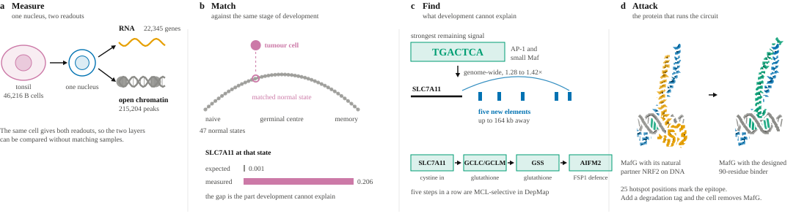
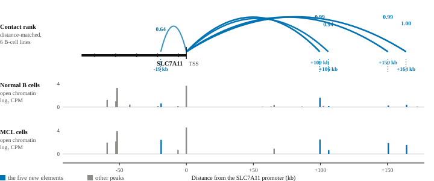
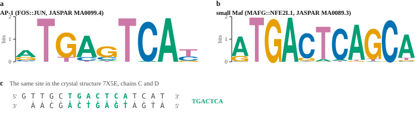
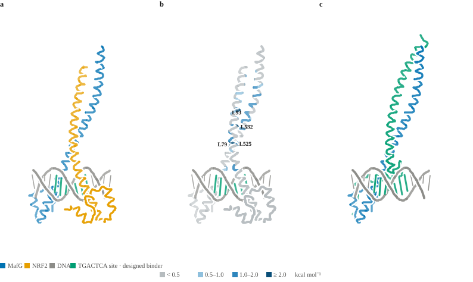
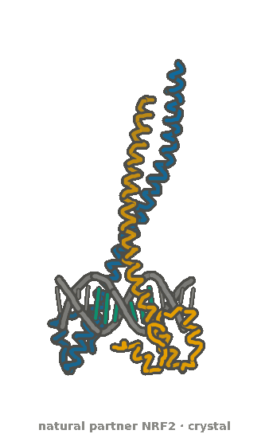

# MCL 的癌症特異性調控重接線與蛋白質層級藥物設計
### 從正常 B 細胞分化軸出發，以「文獻未指出」為篩選條件，貫通 DNA → 染色質 → 蛋白質 → 藥物

**日期**：2026-11-21　**工作目錄**：`/raid/jupyter-alz.ee09/Tonsil_to_MCL`
**運算**：僅用 GPU 3／4（依指示避開 GPU 0–2），CPU 96–200 執行緒，磁碟佔用約 110 GB
**外部模型**：AlphaGenome 2（Google API）、ESM-2、Boltz-2、RFdiffusion3、ProteinMPNN、Borzoi

---

## 零、一段話總結

將每個 MCL 腫瘤細胞對位到其在正常 B 細胞分化軸上所對應的狀態、相減之後，
再以 RNA＋ATAC 聯合重建調控網絡，所呈現的並非增殖訊號，
而是一整套**正常 B 細胞從不啟用的「胱胺酸輸入→穀胱甘肽→鐵死亡防禦」程式**。
這套程式由 **TRE/MARE 元件的全基因組性新生開放**所驅動，
並由 **AP-1 與 BACH1–small Maf 異二聚體**占據，
而腫瘤對它產生了 DepMap 全庫中最強等級的依賴。
但**該選擇性屬於 B 淋巴系，而不屬於 MCL**：全庫 1,178 個細胞株中依賴 `SLC7A11` 的 18 個，
有 12 個屬淋巴系，且每一個都是 B 細胞腫瘤（OR 26.6，相對於依賴率相符的隨機基因，
經驗 p = 0.021）。MCL 是落在這個類群之內的一員，而非類群之外的特例。
文獻查證結果為 `"system xc−" + mantle cell lymphoma = 0 篇`、`MAFG + MCL = 0 篇`，
但這兩個 0 僅是摘要層級的字串比對，**並不等於該生物學未被探索**：
`ferroptosis + mantle cell lymphoma` 有 8 篇，其中 6 篇發表於 2024 年之後。
本研究的新意不在於鐵死亡是否已被研究，而在於抵達它的方向（見 5.3）。

一個完全獨立的外部模型（AlphaGenome 2，於正常組織上訓練）確認了這條軸線的樞紐：
**MAFG 自身啟動子上的 MARE 是功能性元件**（擾動效應為周邊位置的 3.1–3.2 倍，
Bonferroni p ≈ 1–3×10⁻⁴，並含有效的陽性對照）。
這補強了全報告最弱的一環，因為先前 MafG 的所有證據都出自同樣那兩位病人。

在蛋白質層面，**蛋白質語言模型所測得的演化約束**與**共結晶的結構介面**獨立收斂到同一組殘基
（MafG：p = 8.3×10⁻¹¹；FSP1：p = 2.1×10⁻¹¹），
且這些位置的抗藥性逃逸空間僅為全蛋白質平均的 1/4。
針對這些位置所設計的迷你蛋白質結合劑，
其 Boltz-2 共摺疊（每個複合體五次 diffusion 取樣）的 ipTM 達 0.790 ± 0.015，
**高於天然 MafG–NRF2 複合體的 0.713 ± 0.010**，對亂序陰性對照 p = 3.5×10⁻⁴。

<p align="center">
  <picture>
    <source media="(prefers-color-scheme: dark)" srcset="results/figs/overview.dark.svg">
    
  </picture>
</p>
<p align="center"><sub><b>圖 1 ｜ 本報告的測量對象與產出。</b><b>a</b> 同一細胞核同時提供 RNA 與開放染色質（multiome）；<b>b</b> 每個腫瘤細胞先對位至分化程度相同的正常狀態，再以實測值減去推估值；<b>c</b> 殘餘訊號指向七個字母的位點與 <code>SLC7A11</code> 的五個新生元件；<b>d</b> 讀取該位點的蛋白質 MafG，左為共結晶 7X5E，右為所設計的 90 胺基酸結合劑。d 依真實座標繪製，a–c 為示意圖。全部由 <code>scripts/103_figures.py</code> 產生。</sub></p>

---

## 一、原定框架 × 執行狀態

| 原定步驟 | 狀態 | 具體內容 |
|---|---|---|
| ① 建立正常分化參考 | ✓ | 46,216 個扁桃體 B 細胞、6 位捐贈者，**48 個註釋狀態取用 46 個**，RNA+ATAC 取自同一細胞 |
| ② 分化狀態配對 | ✓ | 19,975 個腫瘤細胞逐一對位；**90.0% → 非類別轉換記憶 B（ncsMBC）**，以 kNN 標籤轉移獨立重算為 95.8%，兩法狀態一致率 92.4%；檢體內 **819 個**非腫瘤 B 細胞（M102 29 + M413 790）作為陰性對照 |
| ③ RNA+ATAC 重建調控關係 | ✓ | MCL 的 ATAC **重新量化至同一套 215,204 個 peak 座標**；metacell 層級 217,705 組 peak–基因連結 |
| ④ 癌症特異重接線 | ✓ | 2,572 條新生、3,845 條斷裂；另建 265 個 TF 的 eRegulon，並施以 **GC 分層校正** |
| ⑤ 序列模型擾動 | ✓ | Borzoi（有限制）＋ **AlphaGenome 2 已完成**：新生元件基線比較 + MARE 全飽和 ISM（見 2.6） |
| ⑥ **蛋白質層級擾動** | ✓ | ESM-2 全飽和突變掃描（7 個蛋白質、60,000+ 變異）＋ Boltz-2 結構擾動（110 個複合體、159 次結構預測） |
| ⑦ 藥物設計 + 同模型評估 | ✓ | RFdiffusion3 → ProteinMPNN → Boltz-2（含陽性／陰性對照校準） |
| ⑧ 新穎性：文獻未指出 | ✓ | 104 個候選進行 PubMed 三層計數；已知者全數濾除 |

---

## 二、調控層的發現

### 2.1 為什麼要先做分化配對

正常 B 細胞在扁桃體中構成一條連續的分化軸。MCL 細胞並非均勻散布於該軸線之上，
而是集中於其中一段。若直接將腫瘤與所有正常 B 細胞的平均相比，會把**細胞位於分化軸上
的哪個位置**誤判為**細胞發生了什麼異常**。因此須先將每個腫瘤細胞對位到與其最相似的
正常狀態，推估其若為正常細胞時的表現譜，再行相減。

**這一步的價值在 SLC7A11 上最為清楚**：
分化配對後，SLC7A11 在對應正常狀態的期望表現量為 0.001（等同於完全不表現），
腫瘤實測為 0.206。這個治療窗口唯有經過配對才能顯現。

### 2.2 核心發現：TRE/MARE 元件的全基因組新生開放

**(a) SLC7A11 獲得五個全新的調控元件**

| 元件座標 (hg38) | 距 TSS | 正常相關性 | 腫瘤相關性 | 正常可及性 | 腫瘤可及性 | Δ |
|---|---|---|---|---|---|---|
| chr4:138,222,944–138,223,474 | −19.1 kb | 0.015 | **0.388** | 0.57 | 2.27 | **+1.70** |
| chr4:138,392,601–138,393,029 | +150.5 kb | −0.025 | **0.421** | 0.25 | 1.77 | **+1.53** |
| chr4:138,406,192–138,406,449 | +164.0 kb | −0.059 | **0.326** | 0.35 | 1.46 | **+1.11** |
| chr4:138,341,498–138,342,345 | +99.6 kb | −0.073 | **0.510** | 1.50 | 2.33 | +0.84 |
| chr4:138,348,035–138,348,490 | +105.9 kb | −0.043 | **0.339** | 0.18 | 0.63 | +0.45 |

五個元件**同時**由關閉轉為開放，並由與該基因無關轉為顯著相關。

但按病人拆開後，僅有**三個**（59952、59962、59963）在 M102 與 M413 都為正值；
另外兩個（59959、59961）在 M102 很強（+1.97、+1.08），在 M413 則為負值（−0.31、−0.18）。
因此精確的說法是「**五個候選元件，其中三個在兩位病人都成立**」。
判定記於 `results/142_element_address_index.csv` 的 `consistent` 欄；
n = 2 的樣本數只容許如此陳述，不足以做更強的推論。

<p align="center">
  <picture>
    <source media="(prefers-color-scheme: dark)" srcset="results/figs/locus_slc7a11.dark.svg">
    
  </picture>
</p>
<p align="center"><sub><b>圖 2 ｜ <code>SLC7A11</code> 基因座全貌。</b>該基因自啟動子向左轉錄（箭頭，GENCODE v44）。流程在這個 270 kb 視窗內呼叫出的 peak 全部繪出：五個新生元件以藍色標示，其餘為灰色；兩軌分別為正常 B 細胞與 MCL 的 pseudobulk log₂ CPM。上方弧線為 2.7 節的接觸排名，即各元件對啟動子的接觸在同距離所有位置配對中的排序（6 個 B 淋巴母細胞株的中位數，1.00 代表同距離中最強）。此圖同時呈現三件事：這些元件在序列上最遠達 164 kb、在空間上的接觸排名居前，且僅在腫瘤中開放。</sub></p>

**(b) 上游 MAF/BACH 家族：僅有新生，沒有斷裂**

| TF | 新生連結 | 斷裂連結 |
|---|---|---|
| MAFG | **19** | **0** |
| MAFF | 6 | 0 |
| MAFK | 5 | 0 |
| BACH1 | 5 | 0 |
| NFE2L2 | 4 | 0 |

**(c) GC 分層校正後的 eRegulon 分析（265 個 TF）**

> 未校正前，排名前列全是富 GC motif 的結合者（SP1–4、KLF、MAZ、PATZ1），
> 原因是新生 peak 的 GC 含量為 0.519，斷裂者為 0.449。**施以 GC 五分位分層校正後**，
> 真正的訊號才顯現：

| 校正後仍顯著「新生」 | 倍數 | padj |
|---|---|---|
| **AP-1 家族**（JUN / FOSL1 / FOS::JUND / FOSL2 / FOSB::JUNB …） | 1.28–1.42× | <1×10⁻⁴ |
| **BACH1** | **1.38×** | **2×10⁻⁴** |
| IRF1 | 1.52× | <1×10⁻⁴ |

| 校正後仍顯著「斷裂」 | 倍數 | padj |
|---|---|---|
| **POU2F3（八聚體家族）** | **0.70×** | <1×10⁻⁴ |
| POU5F1 | 0.83× | 4×10⁻⁴ |
| POU2F1 / 2F2 / 3F1 / 3F2 / 3F4 全家族 | 0.80–0.85× | 一致方向 |

**(d) 機制連結：AP-1 與 MAF 屬於同一個訊號**

MARE（Maf 識別元件）的核心序列即為 TRE，也就是 **TGACTCA**，同時正是 AP-1 的結合核心。
共結晶 7X5E 中 NRF2–MafG 實際結合的 DNA 為 `TTGCTGACTCATCAT`，
其中可清楚辨識 `TGACTCA`。因此「AP-1 富集」與「BACH1/MAF 富集」指的是同一件事：
**MCL 新開放的染色質富含 TRE/MARE 元件**。

<p align="center">
  <picture>
    <source media="(prefers-color-scheme: dark)" srcset="results/figs/motif.dark.svg">
    
  </picture>
</p>
<p align="center"><sub><b>圖 3 ｜ 兩個家族讀取的是同一段核心序列。</b><b>a</b>、<b>b</b> JASPAR 2024 的資訊量 logo（字母高度代表該位置的保守程度）；<b>c</b> 共結晶 7X5E 中的 DNA 雙股，<code>TGACTCA</code> 核心以綠色標示；鹼基配對依使兩股互補的位移量決定，C1′–C1′ 距離落在 10.1–11.0 Å。</sub></p>

### 2.3 下游：連續五個成員皆為選擇性依賴，但該選擇性屬於 B 淋巴系

DepMap 中 MCL 細胞株與其他 1,175 個細胞株的比較：

| 基因 | 角色 | MCL gene effect | 其他株 | 選擇性 z |
|---|---|---|---|---|
| **SLC7A11** | system xc− 催化次單元（胱胺酸輸入） | −0.441 | +0.073 | **−2.89** |
| **GCLM** | 穀胱甘肽合成限速酵素調節次單元 | −0.443 | −0.040 | **−2.74** |
| **AIFM2 (FSP1)** | GPX4 之外的獨立鐵死亡抑制蛋白 | −0.316 | +0.006 | **−2.60** |
| **SLC3A2 (4F2hc)** | system xc− 伴侶次單元 | −1.108 | −0.495 | **−2.18** |
| **GCLC** | 穀胱甘肽合成催化次單元 | −0.384 | −0.066 | −1.65 |

**此 z 分數衡量的是 MCL 較其他癌種更為依賴，而非僅有 MCL 依賴。**
將 1,178 個細胞株按譜系拆開（`scripts/135_lineage_enrichment.py`）之後，歸屬必須修正：

| 基因 | 依賴的細胞株數 | 其中淋巴系 | OR | Fisher p | 對依賴率相符隨機基因的經驗 p |
|---|---|---|---|---|---|
| `SLC7A11` | 18 | **12（每一個都是 B 細胞腫瘤）** | 26.6 | 3.7×10⁻¹⁰ | **0.021** |
| `GCLC` | 42 | 33 | 65.8 | 2.7×10⁻³¹ | **0.0083** |
| `GCLM` | 18 | 14 | 47.9 | 3.3×10⁻¹³ | **0.016** |
| `AIFM2` | 7 | 6 | 74.8 | 1.4×10⁻⁶ | **0.0073** |
| `SLC3A2` | 530 | 64 | 2.9 | 1.2×10⁻⁶ | 0.136（不顯著） |
| （對照）`MAFG` | 29 | 2 | **0.86** | 0.68 | 0.55（無富集） |

全庫中有 93 個細胞株屬淋巴系。四個成員的富集都無法以「任選一個依賴率相同的基因也會如此」
來解釋，亦即通過了這項經驗檢定；唯一的例外是 `SLC3A2`（它在 45% 的細胞株中皆為依賴，
過於普遍，談不上選擇性）。`MAFG` 本身完全沒有富集，這一點在問題 4 將成為重點。

**因此結論的歸屬必須改寫**：這條路徑的依賴性為**B 細胞腫瘤所共有**，MCL 是其中一員。
這並不使發現的價值降低，反而把適用範圍由單一疾病擴展到一類疾病；
但「MCL 獨有」的說法並不成立，報告中凡如此敘述之處皆已修正。

### 2.3b 兩項強化此結論可信度的補強分析

**(a) 殘差可通過三種獨立重算的檢驗。** 第 130 步以四種互不相同的方法重算同一份殘差：
基因空間直接相減（A）、scVI 反事實解碼（B）、ContrastiveVI 的 salient 空間（C）、
以及 scGen 式潛空間算術（D）。`SLC7A11` 在 4 種方法中有 **3 種**進入前 5%；
陽性對照 `CCND1` 與 `SOX11` 則為 4/4。
此處曾遇到一個足以使結論完全反轉的陷阱，記於 2.6 節（C）：
`log1p(稀疏計數)` 系統性低於 `log1p(平滑速率)`（Jensen 不等式），
若相減兩側的平滑程度不同，每一個有表現的基因都會得到一個假的負殘差
（`SLC7A11` 曾因此落至第 3,941 名）。修正後，兩側均通過同一個 decoder。

**(b) 這五個基因構成一個真實的依賴模組，而非五個彼此獨立的巧合。**
將五個基因在 1,178 個細胞株上的 CRISPR 效應輪廓兩兩求相關，平均 r = 0.278；
隨機抽取同樣數目、依賴率相符的基因組，平均 r = 0.001，2,000 次抽樣中無一次達到 0.278
（經驗 p < 0.0005）。換言之，在同一個細胞株內，這五個基因或同時重要，或同時不重要。

### 2.4 新穎性查證（PubMed, 2026-11-21）

| 查詢 | 論文數 |
|---|---|
| `"system xc-" AND "mantle cell lymphoma"` | **0** |
| `MAFG AND "mantle cell lymphoma"` | **0**（MAFG + 全部淋巴瘤也只有 2 篇） |
| `SLC3A2 AND "mantle cell lymphoma"` | **0** |
| `AIFM2 / FSP1 AND "mantle cell lymphoma"` | **0** |
| `MAFK AND "mantle cell lymphoma"` | **0** |
| `SLC7A11 AND "mantle cell lymphoma"` | 1 |
| （參考）`ferroptosis AND "mantle cell lymphoma"` | 8 |
| （對照，已排除）`CCND1` 393 ｜ `ATM` 134 ｜ `ROR1` 32 ｜ `IRF4` 16 | — |

### 2.5 這條軸線**並非**突變驅動（兩項陰性結果）

| 檢定 | 結果 |
|---|---|
| 非編碼區：新生連結 peak 的體細胞突變密度 | 72.1/Mb vs 背景 65.3/Mb = **1.10×，無富集** |
| 編碼區：21 個軸線基因 × 22 位病人全基因組定序 | **0 個非同義編碼突變**（僅一個同義的 BACH2 變異；另有兩個 NFE2L1 錯義變異，但其來源為 DepMap 細胞株 REC-1 與 Mino，而非病人） |
| 流程有效性對照 | 同一份資料在已知 driver 上檢出 **50 個**編碼突變（ATM 13、SMARCA4 9、NOTCH1/2 PEST 區無義突變…），參考鹼基 **100% 相符**；IGH 基因座在 **17/22 位病人**中重複出現變異（體細胞超突變） |

因此這是**純表觀／trans 驅動**。就治療而言，這條路徑不存在既有的抗藥性突變。

---

### 2.6 AlphaGenome 2 外部驗證（2026-11-21 取得金鑰後完成）
AlphaGenome 2 是 Google 在**正常**組織上訓練的序列模型。它能提供我們自己兩位病人的資料
所無法提供的東西：一個完全獨立的第三方判斷。我們進行三項檢定，**一項失敗、兩項成功**，
以下分別報告。

#### (A) 基線可及性比較：失敗，且是我們先寫錯再自行推翻

所問的問題是：我們判定為新生的元件，在正常 B 細胞中被預測為開放或關閉？
對照為同一個 500 kb 視窗內未重接線的 peak。

第一版讀出採用 peak 全長平均，得到 MAFG **20.58×、p = 2.6×10⁻⁵**，
我們據此寫了一套解釋（「MAFG 元件原本即為開放，因此屬於重新接線而非新開放」）。
**該解釋是錯的。**

| 檢查 | 結果 |
|---|---|
| peak 寬度 vs 預測可及性 | Spearman **+0.72 ~ +0.76**（MAFG，p = 5.8×10⁻¹¹） |
| 新生元件 vs 對照的寬度 | **1,402 bp vs 406 bp，p = 0.0014** |

新生元件比對照寬 3.5 倍，而預測值與寬度高度相關。
我們接著改用**固定 501 bp**（以 peak 中點為中心，與 AlphaGenome 自身 CenterMaskScorer 的寬度對齊）
重新提取，**但問題並未因此解決**：寬度相關性仍為 +0.74，原始倍率甚至更大（29.71×）。
原因是 peak 寬度本身就是該調控區域強度的代理指標，而非單純的技術假象。

唯一有效的控制方式是**直接採用寬度相當的對照**（同窗格內最寬的 10 個，寬度中位數 1,717 bp，
比新生元件的 1,402 bp 更寬）：

| 位點 | 讀出 | 新生元件 | 最寬 10 個對照 | 倍率 | p |
|---|---|---|---|---|---|
| MAFG | 固定 501 bp | 1.240 | **2.258** | **0.55×（反轉）** | 0.57 |
| MAFG | peak 平均 | 0.889 | 1.491 | 0.60×（反轉） | 0.63 |
| SLC7A11 | 固定 501 bp | 0.064 | 0.103 | 0.62× | 0.37 |

**效應完全消失甚至反向，因此這條路徑並未提供任何證據**（既不支持也不否定）。
我們原先所寫的「MAFG 元件原本即為開放」已撤回；
2.2 節的那項矛盾觀察（MAFG 獲得相關性卻失去可及性）**仍屬未解問題**。

#### (B) MARE 核心的全飽和 in-silico 突變：成功，並補強了最弱的一項宣稱

問法改為因果式：**破壞元件內的 TRE/MARE 之後，模型預測的基因表現是否改變？**
以 `score_ism_variants` 對每個位點進行 39 bp 全飽和突變（117 個變異／位點／條件），
**同一窗格內的非 motif 位置即為內部對照**，此設計在先天上即不受 (A) 的寬度與 GC 混淆影響。

**結果（RNA 讀出 ＝ 對基因表現的預測影響，Bonferroni 校正 26 個檢定）**

| 位點 | 細胞條件 | 核心 7 bp | 延伸 MARE 13 bp | 判定 |
|---|---|---|---|---|
| **MAFG 啟動子近側 MARE（TSS −769 bp，見下註）** | blood B | **3.14×, p_bonf = 1.3×10⁻⁴** | **2.63×, p_bonf = 7×10⁻⁵** | ✓ **穩健** |
| **MAFG 啟動子近側 MARE（TSS −769 bp，見下註）** | naive B | **3.19×, p_bonf = 3.1×10⁻⁴** | **2.96×, p_bonf = 2×10⁻⁵** | ✓ **穩健** |
| HMOX1 ARE（陽性對照①） | blood B | 2.18×, p_bonf = 8×10⁻³ | 2.87×, p_bonf = 4×10⁻⁵ | ✓ **讀出有效** |
| HMOX1 ARE（陽性對照②③） | — | 不顯著 | 不顯著 | ⚪ 選擇性對照 |
| SLC7A11 元件 +106 kb | blood B | 1.37×, p_bonf = 1.0 | 1.57×, p_bonf = 0.012 | ✗ 更換定義即反轉 |
| SLC7A11 元件 +164 kb | blood B | 1.63×, p_bonf = 0.18 | 1.53×, p_bonf = 0.22 | ✗ 不顯著 |

**三項可以成立的結論**

1. **陽性對照成立，因此陰性結果是可解讀的。**
   HMOX1 是教科書等級的 NRF2/small-Maf 標的，其 ARE 在 RNA 讀出上達到 p_bonf = 4×10⁻⁵。
   更有價值的是：HMOX1 上游三個 `TGACTCA` 中**僅一個**顯著，
   說明這個讀出並非見到 TGACTCA 就給分，而是具有選擇性。
   （這正是 Borzoi 那一次所缺少的條件：沒有陽性對照的陰性結果不具價值。）

2. **MAFG 自身啟動子上的 MARE 得到獨立確認。** 本報告最弱的一環因此得到補強：
   MafG 是整個樞紐論證的核心，但先前所有證據都出自我們自己的兩位病人。
   現在一個在正常組織上訓練的外部模型給出的結論是：

   **座標方向的更正（2026-11-27）**：`MAFG` 與 `SLC7A11` **均位於負股**
   （GENCODE v44：`MAFG` chr17:81,918,270–81,927,735 股鏈 −，TSS = 81,927,735；
   `SLC7A11` chr4:138,164,097–138,242,349 股鏈 −，TSS = 138,242,349）。
   因此「−769 bp」這個數字是正確的（81,926,966 − 81,927,735 = −769），
   但在負股基因上，座標較小的方向是**下游**，而 81,926,966 落在基因範圍之內，
   所以這個 MARE 位於**啟動子近側但在基因體內（TSS 下游 769 bp）**，並非上游元件。
   同樣的更正適用於 `SLC7A11` 的 −19.1 kb 元件（chr4:138,222,944–138,223,474）：
   它落在基因範圍 138,164,097–138,242,349 之內，屬**內含子元件**，而非上游元件；
   另外四個（+99.6 / +105.9 / +150.5 / +164.0 kb）座標高於 TSS，才確實位於上游。

   **`chr17:81,926,966` 的 `TGACTCAGC`（距 MAFG 轉錄起點 −769 bp，即 TSS 下游）是一個功能性元件，
   破壞它會改變 MAFG 的預測表現量，效應為周邊位置的 3.1–3.2 倍。**
   兩種 motif 定義（7 bp 核心／13 bp 延伸 MARE）皆成立，三個細胞條件中有兩個成立。
   由此可知 **MafG 受 MARE 自我調控**，亦即 BACH1/NRF2–MafG 複合體會回頭調控 MafG 本身。
   這使「抑制 MafG 將同時削弱整個迴路」的治療邏輯獲得外部支持。

3. **SLC7A11 的兩個遠端元件：校正後不顯著，且更換 motif 定義後結論即反轉，不能作為證據。**
   值得注意的是，模型在 **ATAC 讀出**上反而是顯著的
   （2.19×, p_bonf = 7×10⁻⁴；2.54×, p_bonf = 3×10⁻³），
   亦即「這些 motif 影響局部染色質開放」有訊號，而「影響 SLC7A11 表現」則沒有。
   這**與我們的重接線模型方向一致**（在正常細胞中，這條 enhancer–基因連結本就不應存在，
   它正是 MCL 新生出來的），**但方向一致並不等於證據**：
   一個訓練資料中沒有 MCL 的模型測不到僅存在於 MCL 的連結，本是預期中的事，
   不能反過來作為該連結存在的證明。

#### (C) 細胞狀態條件化（使用我們自己的細胞）：成功，且為設計上最乾淨的一項

所問的問題是：**同一段 DNA，僅更換細胞狀態**，模型預測的可及性是否改變？

`cell_conditioning` 可接受我們自己的 AnnData（上限約 256 個細胞），因此以扁桃體圖譜的
正常 ncsMBC 執行一次，再以該病人的 MCL 腫瘤細胞執行一次。由於**序列完全相同**，
使 (A) 失敗的 peak 寬度、GC 組成與長度全部**完全抵銷**，這是三項檢定中對照最強的一項。

| 病人 | 五個新生元件（log2fc 中位數） | 同窗格未重接線對照 n=20 | Mann-Whitney p |
|---|---|---|---|
| M102 | +0.979（**1.97×**） | +0.350（1.27×） | **1.9×10⁻⁵** |
| M413 | +1.096（**2.14×**） | +0.254（1.19×） | **7.9×10⁻⁴** |

**兩位病人各自獨立成立，方向與幅度一致。** 這是 SLC7A11 五個元件唯一通過的外部序列模型驗證
（(B) 的 ISM 在 Bonferroni 校正後不顯著）。

同時必須記住的保留是：這是模型對腫瘤細胞狀態的預測可及性，而非實測值；
且 AlphaGenome 的訓練資料中沒有 MCL，所謂「腫瘤狀態」是由我們輸入的表現輪廓所定義。
它所證明的是這段序列對細胞狀態敏感，而非這段序列在 MCL 病人體內處於開放狀態。

**輸出檔**：`results/92_ag_cellcond.csv`（228 列）；腳本 `scripts/92_ag_cellcond.py`。

#### (D) 已知限制

- 本次有 **3 次 API 呼叫因 `UNAVAILABLE` 而失敗**（HMOX1 naive B、HMOX1 blood B、MAFG memory B 各一），
  因此少數 site × 條件的格子為空，重跑即可補齊。
- ISM 的逐位置剖面顯示，**效應最大的位置常落在核心 7-mer 之外 8–9 bp 處**
  （MAFG RNA 前 7 名中僅 2 個位於核心內）。這與延伸 MARE 為 13 bp 相符，
  但也意味著「正好是這 7 個鹼基」的說法須放寬為「這 20–30 bp 的區域」。
  陽性對照 HMOX1 呈現同樣的模式，因此這是模型表徵此類元件的方式，而非本位點的特例。
- `cell_conditioning` 可接受我們自己的 AnnData（上限約 256 個細胞），亦即可用扁桃體圖譜的
  46 個分化狀態來定義細胞條件。**此項已於 2026-11-22 完成**（步驟 92，見上述 (C) 小節）；
  尚未完成的僅有全部 46 個狀態 × 全部元件的掃描，該項受免費層的速率上限所限（見第七節問題 1）。

**輸出檔**：`results/91_ag_part1_summary.csv`（含寬度診斷）、
`results/91_ag_ism.csv.gz`（2,925 筆逐變異分數）、
`results/91_ag_ism_summary.csv`、`results/91_ag_ism_motifdefn.csv`、
`results/90_mare_sites.csv`；腳本 `scripts/91_alphagenome.py`。

### 2.7 三維結構與甲基化：線路已接通、鎖已開啟，但門仍關著

本節補上 SLC7A11 這條論證中最大的一個缺口。

**缺口所在**：「這五個元件控制 SLC7A11」這個說法，至此**完全建立在相關性之上**
（peak 的開放程度與基因表現量同步變化）。最遠的元件位於 +164 kb；
若它與啟動子之間隔著一道 TAD 邊界，該相關性就很可能是假的。

#### A. 接觸圖：元件可接觸到啟動子（SLC7A11 成立，MAFG 不成立）

就讀出的設計而言，接觸強度隨距離單調衰減，因此其絕對值不具意義。
對每個元件，我們取**同一條對角線（相同 bin 距離）上的所有 bin 對**作為虛無分布，
計算 observed/expected，距離在這一步即被完全抵銷。
決定性的對照是同窗格內未重接線的 peak，以完全相同的方式計算。

我們**刻意不採用** tonsil naive B cell，因其 `contact_maps` 僅有 `imputed_exploratory` 等級；
改用 21 個 **`observed` 等級**的條件，分為三組：

| 組 | 條件 | 用意 |
|---|---|---|
| LCL | GM12878 + GM18519/18508/18498/18907/18861 | 6 個 B 淋巴母細胞株，互為獨立重複 |
| 原發血液 | blood B cell、各型 T 細胞、單核球、K562 | 原發細胞，非細胞株 |
| 非血液 | HepG2、IMR-90、MCF-7、HCT116、Panc1、Caco-2 | 專一性對照 |

結果（三層混淆校正後）：

| 基因 | 組 | 顯著條件數 | Stouffer p | 加入實測可及性校正後 |
|---|---|---|---|---|
| **SLC7A11** | LCL | 3/6 | 9.5×10⁻⁶ | **4/6，6.2×10⁻⁶（更強）** |
| **SLC7A11** | 原發血液 | 5/9 | 3.0×10⁻⁵ | 5/9，9.0×10⁻⁵ |
| **SLC7A11** | 非血液 | 5/6 | 3.6×10⁻⁷ | 4/6，9.6×10⁻⁷ |
| MAFG | LCL | 4/6 | 6.1×10⁻⁶ | **0/6，0.052（崩掉）** |
| MAFG | 原發血液 | 9/9 | 3.8×10⁻¹² | **0/9，7.5×10⁻⁵（崩掉）** |
| MAFG | 非血液 | 5/6 | 3.3×10⁻⁶ | **0/6，0.014（崩掉）** |

兩個基因在此出現分歧，原因相當具體：

- **MAFG 的接觸訊號是混淆造成的，必須撤回。** 其新生元件在正常 B 細胞中的偵測率為
  對照的 **22 倍**（0.1105 vs 0.0051，p = 1.8×10⁻⁵），而 O/E 與可及性呈正相關（ρ = +0.55），
  亦即強 peak 既容易被判為相關，也容易被預測為高接觸。
  將實測可及性作為共變數迴歸扣除後，21 個條件中**無一**仍達顯著。
- **SLC7A11 的訊號是乾淨的。** 其新生元件與對照的可及性**相同**
  （偵測率 0.0018 vs 0.0019，p = 0.54），O/E 與可及性的相關性甚至為**負值**（ρ = −0.15）。
  扣除寬度、距離與實測可及性三個共變數後，結果不變，甚至更強。

逐元件觀察，距離配對百分位在 6 個 LCL 之間高度一致：

| 元件 | 距 TSS | LCL | 原發血液 | 非血液 |
|---|---|---|---|---|
| 59959 | +99.6 kb | 0.990 | 0.811 | 0.880 |
| 59961 | +105.9 kb | 0.941 | 0.661 | 0.911 |
| 59962 | +150.5 kb | 0.991 | 0.568 | 0.835 |
| **59963** | **+164.0 kb** | **1.000** | 0.657 | 0.891 |
| 59952 | −19.1 kb | 0.644 | 0.450 | 0.718 |

元件與啟動子之間也不存在絕緣邊界（最小絕緣分數 −0.02 ~ −0.03，等於沒有凹陷）。

**但須注意專一性**：非血液細胞也呈現同樣的效應，
因此這個三維骨架屬**組成性**，並非 B 細胞或 MCL 所專有。
唯一未能重現的是 blood B cell 本身（p = 0.78），其 O/E 散度僅 0.111（GM12878 為 0.166），
研判為該圖譜動態範圍不足，但我們仍照實列出，不另尋理由將其排除。

#### B. 甲基化：並未上鎖（「去甲基化藥物會開啟它」這個警訊不成立）

原本的假設是：這五個元件在正常 B 細胞中因甲基化而維持關閉。
若此假設成立，去甲基化藥物（azacitidine／decitabine，血液腫瘤常用）
反而可能開啟這條鐵死亡防禦軸線，那會構成一項臨床警訊。

校準須先通過，否則讀出不可採信：

| 條件 | 實驗 | CpG 島啟動子錨點 | 隨機基因體背景 |
|---|---|---|---|
| blood B cell | WGBS | 0.019 | 0.899 |
| blood B cell | snmC-seq3 | 0.020 | 0.907 |
| blood memory B cell | WGBS | 0.020 | 0.841 |
| blood memory B cell | snmC-seq3 | 0.021 | 0.848 |

結果（blood B cell / WGBS，另三個組合一致）：

| 類別 | 甲基化中位數 | n |
|---|---|---|
| SLC7A11 新生元件 | **0.206** | 5 |
| 同窗格未重接線 peak | 0.673 | 19 |
| 隨機基因體背景 | 0.873 | 80 |

**假設被否定**：這些元件並非因甲基化而關閉，它們在正常 B 細胞中**已相對去甲基化**
（0.21 vs 對照 0.67、背景 0.87），卻同時處於**關閉狀態**（偵測率 0.0018）。
因此去甲基化藥物不會是開啟這條軸線的途徑，該臨床警訊可以排除。

MAFG 的元件更為徹底：甲基化 0.032 vs 對照 0.743，具 CpG 島性質、原本即為開放，
與其「無須新開放」的表現一致。

**保留事項**：SLC7A11 元件的 CpG 數目很少（501 bp 內僅 1–3 個），
因此每個估計值僅建立在 1–3 個 CpG 之上，精度偏低；
五個元件中有兩個（59952、59961）落在 0.53–0.66 的中間帶。
此外這屬**預測**而非實測，且僅代表正常 B 細胞。

#### C. 三項結果的綜合意義

三項結果合併之後，給出一個比先前清楚得多的機制說法：

> **線路已接通**（元件與啟動子在三維空間中原本即相鄰，且屬組成性）、
> **鎖已開啟**（元件已相對去甲基化），**但門仍關閉**（可及性 0.0018，與無關的 peak 一樣低）。
> MCL 所需做的僅剩一件事：**使轉錄因子到位**。

這解釋了為何「全基因組 TGACTCA 開放」這種看似粗放的機制能精準作用於 SLC7A11：
瓶頸從來不是染色質層面的許可，而是轉錄因子的有無。
換言之，**這條軸線的槓桿點在於轉錄因子（MafG／BACH1／AP-1）或下游轉運蛋白本身**，
而不在表觀遺傳藥物。

**輸出檔**：`results/97_contact_oe.csv`、`97_insulation.csv.gz`、`97_summary.json`、
`results/98_contact_multi.csv`、`98_contact_stats.csv`、
`results/99_peak_accessibility.csv`、`99_contact_stats_accadj.csv`、
`results/100_methylation_cpg.csv`；
腳本 `scripts/97_ag_methyl_contact.py`、`98_contact_multicond.py`、
`99_contact_acc_adjust.py`、`100_methyl_cpg.py`。

---

### 2.8 代謝化學計量：xCT 在 B 細胞為何沒有旁路，以及一個被否證的機制預測

#### (A) 前兩版為何全無效應（皆為設計錯誤，而非程式缺陷）

`SLC7A11` 的 DepMap 依賴性僅出現在 18 個細胞株（1.5%），三個 MCL 細胞株為 0/3。
但 DepMap 所用 RPMI-1640 的胱胺酸為 208 µM，遠高於人血漿的游離胱胺酸（約 40–60 µM），
腫瘤微環境則更低。因此「測不到依賴」有可能僅代表「在該培養基條件下測不到」。
我們以 Human-GEM 進行化學計量分析，試圖定出那條界線，前兩次都失敗：

| 版本 | 做法 | 結果 |
|---|---|---|
| v1（步驟 200） | 僅調整胱胺酸交換反應的上限 | 四種營養條件下成長率**完全相同**（138.533） |
| v2（步驟 201） | 關閉 46 條直接提供半胱胺酸的交換反應 | 仍為 138.533，所有敲除效應皆為 0 |

根本原因：Human-GEM 的 SBML 將 **1,654 條交換反應的邊界全部設為 (−1000, 1000)**，
相當於所有營養皆無限供應。在一個完全開放的培養基中關閉其中數條，不會造成任何改變。

#### (B) v3 的設計，以及它必須先通過的四道門檻

1. **先關閉全部 1,654 條交換反應的攝取，再僅開啟一組定義明確的 RPMI-1640**（20 個成分
   ＋ 11 個自由無機物／氣體）。
2. **目標函數不能設為最大化 GSH 合成反應**。γ-穀胺醯循環會將 GSH 分解為
   半胱胺酸＋麩胺酸＋甘胺酸後再合成回去，構成淨投入為零的空轉，使合成通量可以無限大。
   實測結果為：關閉所有硫醇來源後，合成通量仍有 249.8。
   因此改為加入一條**不可逆需求反應** `GSH[c] -->` 作為目標；GSH 被不可逆移除之後，
   該循環無法供應它，每一單位淨產出都需要一單位淨半胱胺酸。
3. **設定四道門檻，任何一道未通過即 raise，不得解讀敲除結果**：

| 門檻 | 內容 | 結果 |
|---|---|---|
| G1 | 化學計量：產能必須等於 2×[胱胺酸] + [甲硫胺酸] | **0.5170 vs 預期 0.5170** ✓ |
| G2 | fail-stop：關閉所有硫醇來源與甲硫胺酸 → 必須為 0 | **0.000000** ✓ |
| G3 | 硫酸鹽不得成為半胱胺酸來源（人類沒有同化途徑） | 關閉後 **0.5170 不變** ✓ |
| G4 | 敲除 `SLC7A11` 必須確實產生效果 | **0.4160 → 0.000000** ✓ |

G4 是在第一次執行之後才確定必須加入的：前三道全部通過，但敲除 `SLC7A11` 在任何
胱胺酸濃度下的效果都是 0。原因是 Human-GEM 屬**泛人類**模型，另有三條 xCT 以外的
胱胺酸入口（MAR08687 / MAR06891 / MAR06892），其 GPR 皆為 `SLC7A9 and SLC3A1`，
即腎與腸的 b⁰,⁺ 系統（rBAT / b⁰,⁺AT）。關閉它們的依據是**本專案自身的量測**，而非印象：

| 基因 | MCL 實測 | 正常 B 期望 | 判定 |
|---|---|---|---|
| `SLC7A11` | 0.2061 | 0.0009 | 保留 |
| `SLC3A2` | 0.2724 | 0.0946 | 保留 |
| `SLC3A1` | 0.0172 | 0.0273 | 視為不表現（比 SLC7A11 低 12 倍） |
| `SLC7A9` | 0.0043 | 0.0023 | 視為不表現（低 48 倍） |

（單位為 log1p CP10K，見 `results/15_gene_residual_tumor.csv`。規則固定寫在程式中：
兩個情境的平均皆 < 0.05。且此處理僅施加於「將胞外胱胺酸輸入胞內」的反應；
第一版以 `cysteine` 字串掃描時犯了一個具體的錯誤：Human-GEM 中大量
`cysteine + proline <=> cysteine + proline` 其實是脯胺酸轉運蛋白，半胱胺酸僅為逆向受質，
結果連 `SLC1A5`、`SLC6A14`、`SLC38A5`、`CLTRN` 一併敲除，改動了與本問題無關的網絡。）

#### (C) 結果：與直覺相反，以及更關鍵的一層

在**泛人類模型**（轉硫途徑可用）下，敲除 `SLC7A11` 所失去的 GSH 產能比例：

| 胱胺酸 mM ↓ ／ 甲硫胺酸 mM → | 0.000 | 0.020 | 0.050 | 0.101 |
|---|---|---|---|---|
| 0.208（RPMI） | **1.00** | 0.954 | 0.893 | 0.805 |
| 0.040 | **1.00** | 0.800 | 0.615 | 0.442 |
| 0.010 | **1.00** | 0.500 | 0.286 | 0.165 |

**胱胺酸限制本身不會使 xCT 變得更必需，反而更不必需**，因為胱胺酸一旦減少，
轉硫途徑的相對貢獻便隨之上升。使 xCT 成為絕對必需的槓桿是**阻斷轉硫途徑**，
而非限制胱胺酸供應。
（此處須區分兩件事：絕對產能確實因胱胺酸限制而大幅下降，0.517 → 0.165；
而 FBA 的「敲除失去比例」問的是另一個問題。）

但同一套表現判定顯示，**轉硫途徑在 B 細胞與 MCL 中原本即為關閉**：

| 基因 | MCL | 正常 B | 46 個正常狀態中 > 0.1 |
|---|---|---|---|
| `CBS` | 0.0003 | 0.0002 | **0 / 46** |
| `CBSL` | 0.0001 | 0.0000 | **0 / 46** |
| `CTH` | 0.0090 | 0.0112 | 1 / 46 |

依表現量關閉轉硫途徑（情境 B）之後，結果成為一個定值：
**敲除 `SLC7A11` 在每一個胱胺酸濃度、有無甲硫胺酸的條件下，都損失 100% 的 GSH 產能。**
亦即在 B 細胞中 xCT 沒有旁路。情境 C 進一步顯示，培養基中的游離半胱胺酸只能
抬高上限，而不能取代該入口：在 0.2 mM 游離半胱胺酸下仍損失 67.5%。

#### (D) 此機制本可解釋 2.3 的 OR 26.6，但該預測已被否證

若機制確為「唯有缺乏轉硫途徑的細胞才依賴 xCT」，那麼它就不只是 B 細胞的偶然性質，
而是一條可在全庫 1,178 個細胞株上檢定的規律。步驟 203 即以否證它為目的：

| 預測 | 結果 |
|---|---|
| **P1** 全庫：轉硫表現量越低者越依賴 xCT（r 應為正） | r = **−0.030**，p = 0.32，無關聯，且**方向相反** |
| **P2** 在非淋巴系細胞株內亦須成立（n = 1,012） | r = **−0.054**，p = 0.086，無關聯 |
| P2b（淋巴系內部，n = 91） | r = +0.127，p = 0.231，方向正確但不顯著 |
| **P3** 效應量須大於隨機基因（1,999 個基因的虛無分布） | 隨機 r = 0.015 ± 0.055（95 分位 0.108）；觀察值的**經驗 p = 0.789** |
| **P4** 陰性對照 `RPL13A`（核糖體，全細胞株皆依賴）不應符合同樣的預測 | r = **+0.059**，強於標的，且方向正確 |
| （唯一成立者）18 個依賴細胞株的轉硫分數是否較低 | 2.322 vs 2.865，p = 0.034 ✓ |
| （解釋）淋巴系的轉硫分數是否較低 | 2.249 vs 2.899，p = 0.0066 ✓ |

**結論是：該群組層面的差異可以完全由譜系組成解釋**（依賴者多數屬淋巴系，
而淋巴系的 CBS/CTH 原本即低），**並非一條在個別細胞株層級運作的機制。**
化學計量說明了「在一個缺乏轉硫途徑的 B 細胞中，xCT 為何可能無可取代」，
但 DepMap 並不支持轉硫途徑即為該鑑別因子。最可能的原因是 mRNA 不等於通量
（CBS 需要血基質與 SAM、CTH 需要 PLP），以及培養基中 10% 血清本身即供應游離半胱胺酸。

因此 2.3 的 OR 26.6 目前**仍無機制解釋**。本節留下的是一個乾淨的陰性結果，
以及一個現在可以明確寫出的治療推論：
**xCT 抑制劑若要有效，必須同時阻斷游離半胱胺酸的供應**。此推論屬化學計量層面，
而非細胞實驗層面，須以濕實驗檢定（胱胺酸限制培養基 ± 游離半胱胺酸補充）。

FBA 屬穩態化學計量分析：不含動力學、氧化壓力與鐵死亡。
它回答的是這條路徑何時成為化學計量瓶頸，而非細胞是否會死亡。

---

## 二之二、將本專案的邏輯推到底：全基因組治療窗口篩選

### 2.9 為何要改變方向

至此，所有「以分子選擇性取得治療窗口」的路線都已關閉，而且每一條都是被
事前指定的對照所排除，而非因語氣保留而放棄：

| 路線 | 關閉的依據 |
|---|---|
| C5 `MAFG` 本身 | DepMap 1,178 個細胞株中位數 −0.157、僅 2.5% 依賴、MCL **0/3**、選擇性 z = **+0.36**（方向相反）、譜系 OR 0.86 |
| C6 旁系選擇性（分開 MafG/MafF/MafK） | 三個共摺疊模型的差距為 −0.011 ~ +0.051 且方向不一致。**MD 不構成證據**：ΔQ 雖為 −0.016（0.875 ± 0.020 vs 0.892 ± 0.009），但打亂序列的陰性對照維持 Q = **0.890**，與真正的設計品無法區分，因此判定為 `A5_assay_cannot_discriminate`，ΔQ 已撤回（見第六節第 40–41 列） |
| D5 夥伴選擇性（擋 BACH1、留 NRF2） | 那 9 個「BACH1 專屬」位置在 MafG 與 MafK 之間 **9/9 完全相同**，與 MafF 為 8/9；且 **NRF2 本身即遮蔽 BACH1 足跡的 82.1%**，因為兩者都使用同一段白胺酸拉鍊進行異二聚化，先天互斥，在介面上無法區分。設計品 D1 遮蔽 BACH1 82.8%、遮蔽 NRF2 84.8%，選擇性 S = **−0.020**，相對於隨機足跡的經驗 p = 0.66（步驟 210） |
| 211 元件選擇性（序列專一的藥物） | 腫瘤新開 peak 的「完整 ARE」比例為 0.0742 vs 穩定 peak 0.0749，**倍率 0.990**，打亂標籤的經驗 p = 0.80；且陰性對照樣式的差異（+0.0026）大於標的（−0.0007）。寬度中位數 1000 vs 997、GC 中位數 0.520 vs 0.520，配對是乾淨的，因此這確實是沒有差別 |

但本專案真正的工具自始至終不是結合劑，而是**分化配對**。
治療窗口不必來自分子層面的辨識能力，也可以來自**細胞狀態的差異**：
若一個基因（a）在腫瘤中的表現量遠高於分化程度相同的正常 B 細胞，
且（b）是 B 細胞腫瘤特有的遺傳依賴，則針對它用藥在先天上即具備窗口。

### 2.10 篩選本身（步驟 212）

分數 = **min( z(殘差), z(B 細胞依賴選擇性) )**，且兩項皆須 > 0。

第一版採用兩項**相加**，其缺陷被自身的 P4 對照檢出：只要一項很強，就能把另一項為負的
基因帶進前段（`NMNAT1` 殘差 −0.031、`UMPS` −0.026、`ADSL` −0.025 都是如此進入的）。
治療窗口的定義是兩個條件同時成立，因此改為取兩項的較小者。

四道事前指定的門檻在閘控後全部通過：

| 門檻 | 內容 | 結果 |
|---|---|---|
| P1 | `SLC7A11` 必須落在前 1%（方法驗證：它是以完全獨立的證據鏈找到的） | **第 30 / 17,552 = 前 0.17%** ✓ |
| P2 | 泛必需基因不應占據前段 | 92 個核糖體基因的名次中位數 **10,749** ✓ |
| P3 | 打亂兩份資料之間的基因對應 | 虛無名次中位數 **3,786** vs 觀察值 30，經驗 p = 0.048 ✓ |
| P4 | 腫瘤中下降的基因不應進入前段 | 2,190 個下降基因中，前 1% 內有 **0 個** ✓ |

**前 20 名幾乎構成一份 MCL 臨床標的清單**，而排名過程完全未被告知其中任何一個：

| 名次 | 基因 | 腫瘤 vs 分化配對正常 | B 細胞依賴 vs 其他 | 已知藥物 |
|---|---|---|---|---|
| **1** | **`NAMPT`** | **0.937 vs 0.219（4.3×）** | **−0.948 vs −0.394** | NAMPT 抑制劑（見 2.11） |
| 2 | `SLC7A5` | 0.464 vs 0.042 | −0.405 vs −0.211 | LAT1 抑制劑在開發中 |
| 3 | `BCL2` | 2.214 vs 1.906 | −0.283 vs −0.018 | **venetoclax，已核准用於 MCL** |
| 4 | `MCL1` | 0.504 vs 0.205 | −1.072 vs −0.775 | MCL1 抑制劑在臨床試驗 |
| 7 | `RHOA` | 0.853 vs 0.569 | −0.785 vs −0.362 | — |
| 8 | `NFKB1` | 1.206 vs 0.924 | −0.247 vs +0.024 | NF-κB 是 MCL 已知軸線 |
| 14 | `IRF4` | 0.517 vs 0.274 | **−0.980 vs −0.053** | — |
| 15 | `EZH2` | 0.384 vs 0.141 | −0.377 vs −0.063 | **tazemetostat，已核准（其他適應症）** |
| 20 | `BRD2` | 0.533 vs 0.301 | −0.606 vs −0.424 | BET 抑制劑 |
| 30 | `SLC7A11` | **0.206 vs 0.0009（200×）** | — | erastin / IKE / sulfasalazine |

未閘控的版本中 `ROR1` 排名第 4，而它正是 zilovertamab／cirmtuzumab 的標的，
目前處於 MCL 臨床試驗階段。一個無監督的排名將它推至前段，是這套方法最有力的驗證。

### 2.11 第 1 名：`NAMPT`，以及四個被否證的機制

`NAMPT` 的分數 6.35 為第 2 名的 **2.1 倍**。**觀察層面的證據相當強**（步驟 213）：

- 腫瘤 0.937 vs 分化配對正常 B 細胞 0.219，即 **4.3 倍窗口**，殘差 +0.718
- **81 個 B 細胞腫瘤細胞株中有 76 個依賴（92%），其他譜系為 273/1,020（27%）**
- OR 32.69、Fisher p = 7.1×10⁻³⁵、相對於 875 個依賴率相符隨機基因的**經驗 p = 0.0069**
  （虛無 OR 的中位數僅 1.25）
- 其 CRISPR 輪廓確實落在本專案主軸的同一個模組之內：`GCLC` ρ = **+0.415**、
  `SLC3A2` +0.285、`PGD` +0.268、`GCLM` +0.194

**但四個機制假說全部未能成立，以下逐一記錄**：

| 假說 | 檢定 | 結果 |
|---|---|---|
| NAMPT → NAD⁺ → NADPH → 還原 GSH（為主軸同一道防線提供還原力） | 與 NADPH 供應基因的輪廓相關 | ✗ 平均僅 **+0.037**（`IDH1` −0.025、`ME1` −0.044、`NNT` −0.029、`TXNRD1` −0.063）。訊號全部落在穀胱甘肽**合成**這一臂，而不在 NADPH 那一臂 |
| 自我成癮（表現量越高越依賴） | 表現量 vs 依賴 | ✗ 方向相反：非淋巴系 1,012 個細胞株 r = **+0.148**、p = 2.4×10⁻⁶，表現量越高反而越**不**依賴 |
| `NAPRT` 缺失（NAMPT 抑制劑文獻中的標準生物標記：唯有失去 Preiss-Handler 途徑的細胞才會被殺死） | 分層分析（步驟 214） | ✗ **方向相反且不顯著**：`NAPRT` 低的 23 個細胞株僅 **17%** 依賴 NAMPT，`NAPRT` 高的 1,080 個細胞株則有 **30%**，p = 0.56。且 B 細胞株的 NAPRT 僅略低（中位數 3.822 vs 4.672），低於 log2(TPM+1)=1 者僅 **1%**（其他譜系 2%），並未被沉默 |
| `NAPRT` 缺失提供病人層面的窗口 | 分化配對殘差 | ✗ `NAPRT` 在 MCL（0.0232）與分化配對正常 B（0.0136）**皆近乎為零**，兩側都沒有替代路線，因此窗口並非來自此處 |

因此 `NAMPT` 目前的狀態是：**一個通過四道對照的強觀察，加上四個被否證的機制。**
它與 2.3 的 OR 26.6 處於同一種狀態：現象可重現，但尚無解釋。

**必須寫入結論的限定**：NAMPT 是普遍表現的酵素，臨床 NAMPT 抑制劑
已知的毒性（視網膜、血液）正源於此。「4.3 倍窗口」是相對於**分化配對的正常 B 細胞**
而言，**而非相對於視網膜或心臟**。本步驟無法宣稱全身安全性，且有 27% 的
非淋巴系細胞株同樣依賴 NAMPT，表示其治療指數本來就窄。

**文獻新穎性查證已於步驟 232（2026-11-28）補齊，其結論是這個方向的定位必須修改。**
先前查不到的原因並非 PubMed 無法連線，而是本機對外連線經過一個會重簽 TLS 憑證的代理：
`curl` 可以通過（系統 CA bundle 已收錄該根憑證），Python 的 `urllib` 則不行（使用 certifi 的 bundle），
於是六個查詢全部無聲地回傳 `None`。修正方式是在程式中明確指定系統 CA bundle，
**而不能依賴 `SSL_CERT_FILE` 環境變數，因為本專案以 `python -I` 執行，`-I` 會忽略所有環境變數。**

查證結果如下（對照查詢 `CCND1 AND mantle cell lymphoma` 得 413 篇，前 12 篇中有 11 篇標題含
mantle，確認檢索功能正常）：

| 層次 | 宣稱 | 命中 | 判定 |
|---|---|---|---|
| L1 | `NAMPT` 是淋巴腫瘤的治療標的 | `NAMPT AND lymphoma` **43 篇** | **已知** |
| L2 | 經 NAD(P)H 還原力連到鐵死亡／xCT 軸 | `NAMPT AND ferroptosis` **20 篇**、`NAMPT AND SLC7A11` 2 篇 | **已知** |
| L3 | 在 MCL 上、且有 B 系選擇性 | `NAMPT AND (mantle cell lymphoma)` **4 篇**，其中 2 篇標題層級命中 | **已知** |

標題層級的命中是決定性的：

- **PMID 35008323**（*Cancers* 2021）"**PAK4 and NAMPT as Novel Therapeutic Targets in
  Diffuse Large B-Cell Lymphoma, Follicular Lymphoma, and Mantle Cell Lymphoma**"
  這正是我們的宣稱，發表於 2021 年，標題中明寫 MCL。
- **PMID 41428986**（*Blood Advances* 2026）"Inhibition of NAMPT targets DNA damage response
  to sensitize alkylating chemotherapy in TP53 mutant mantle cell lymphoma"
  發表於 2026 年，仍在積極開發，且已進入聯合用藥階段。
- **PMID 19196867**（*Blood* 2009）APO866（NAMPT 抑制劑）對血液腫瘤具強抗腫瘤活性。

**因此 `NAMPT` 並不是「下一個槓桿」。** 正確的定位恰好相反，而且這個定位更有價值：

> **步驟 212 的分化配對治療窗口篩選，在 17,552 個基因中把第 1 名給了一個
> 由他人獨立發表、目前仍在臨床開發的 MCL 標的，而該篩選對此完全不知情。**

這構成該篩選**原本不具備的外部陽性對照**。它先前只有 P1–P4 四道內部對照
（`SLC7A11` 的排名、泛必需基因不進入前段、標籤置換、下調基因不進入前段），
沒有任何證據支持其首名是真實的；現在則有了。

以下兩件事必須分開陳述，不可混為一談：
1. **篩選方法得到驗證**（它獨立重現了一個已知標的），這是實質的收穫；
2. **`NAMPT` 的生物學並非新發現**（2021 年即有人在 MCL 上發表），不得當作新線索。

一項附註：我們在步驟 232 的事先註冊中把對照門檻寫成
「`CCND1 AND MCL` ≥ 500 篇」，實際為 **413 篇**，因此依我們自己所定的規則，會把一個
**正常運作**的檢索判為故障。那個 500 是我們對文獻量的推測，而對照的用途是檢驗檢索是否健全，
本就不應依賴對數量級的推測是否正確。已改為不需推測數量的版本（命中 ≥ 50 且前 12 篇中有 ≥ 3 篇標題相符），
原門檻與這項校準錯誤都保留在 `results/232_nampt_novelty.json` 中。

---

### 2.12 `SLC7A11` 的 B 細胞限制：一個被交叉驗證推翻的機制，以及三項仍然成立的結果

#### (A) 我們提出的機制，以及它為何不成立

2.3 所留下的 OR 26.6 長時間沒有解釋。三條獨立線索曾一度指向同一處：
步驟 204 的 `exp_GPX4` 通過最嚴格的分層、步驟 205 的共依賴首位是 `SCLY`（硒 → GPX4）、
步驟 214 發現 `AIFM2`/FSP1 在 MCL（0.0277）與配對正常 B（0.0337）中皆近乎不表現。

該假說為：**B 細胞缺乏 FSP1 備援，僅剩 GPX4 一條路徑，因此對其燃料無可取代。**
步驟 216 以五項事前指定的檢定測試它，**五項全部通過**
（非淋巴系 1,012 個細胞株 r = +0.142、p = 5.9×10⁻⁶；相對於 1,000 個隨機基因的經驗 p = 0.0010；
陰性對照 `RPL13A` r = +0.017、p = 0.78）。

**但它被兩項我們當初未做的檢定推翻，兩項都出現於獨立複查，並已逐一自行驗證：**

| 反駁 | 數字 |
|---|---|
| **群組間的順序不符** | 髓系細胞株的 `AIFM2` 是所有群組中**最低**的（中位數 z = **−1.02**），卻僅 **1/39 = 2.6%** 依賴；B 細胞 z = −0.52 卻有 **12/75 = 16.0%**。群組層級的 Spearman（z vs 依賴率）r = −0.60、**p = 0.40** |
| **同類特徵表現完全相同** | 在非造血的 973 個細胞株內：`AIFM2` r = **+0.134**（p = 2.6×10⁻⁵），而 `SLC3A2` r = **+0.133**（p = 3.0×10⁻⁵）、`SLC7A11` 自身為 +0.071。`AIFM2` 並無任何特殊性 |
| **在 B 細胞內無法區分因果** | 在 53 個 B 系非漿細胞株內，`AIFM2` 預測標的的能力（r = 0.201）與預測「B 細胞身分」對照的能力（r = 0.203）相當，而這正是該對照所要偵測的失敗模式 |
| **多重比較的尺度** | 獨立複查在 54 個分層檢定中有 7 個通過，而隨機期望值為 **2.7** 個 |

步驟 217 自完全不同的方向確認了同一件事。「自身表現量越高則自身越不被依賴」在 DepMap 中
**並非**背景性質（594 個隨機基因的中位數 −0.0123、僅 41.9% 為正、Wilcoxon p = 1.2×10⁻⁵，
打亂細胞株標籤後回到 −0.0038）。但該方向是**整個穀胱甘肽合成模組**的性質，而不是 `AIFM2` 的：

| 基因 | 自我相關 r | 在 594 個隨機基因中的百分位 |
|---|---|---|
| `GCLM` | +0.166 | **99** |
| `GCLC` | +0.135 | **98** |
| `SLC7A11` | +0.104 | **96** |
| `AIFM2` | +0.078 | 93 |
| `SCLY` | −0.018 | 45 |
| `GPX4` | −0.054 | 23 |

**結論是：步驟 216 的五項通過確實成立，但它所檢定的是這個訊號是否存在，
而不是這個訊號是否專屬於 AIFM2。後者才是機制宣稱所需要的，而答案為否。**
`AIFM2` 只是一條共享的抗氧化程式軸線的成員之一，吸收了 `is_B` 係數約 6%。
作為對照尺度：**B 細胞身分分數單獨即吸收 41.6%**（經驗 p = 0.031），為任何代謝特徵的 5–7 倍。

因此 OR 26.6 **仍無機制解釋**。本節已由「找到機制」改寫為「否證了我們自己的機制」。

#### (B) 三項經獨立複查後仍然成立的結果

**① 適用範圍比「淋巴系」更窄，而且窄化的位置相當具體。**

| 群組 | 依賴 / 總數 | 依賴率 |
|---|---|---|
| **B 系非漿細胞** | **12 / 53** | **22.6%** |
| 漿細胞／骨髓瘤 | 0 / 19 | 0% |
| T / NK | 0 / 18 | 0% |
| 何杰金 | 0 / 3 | 0% |
| 髓系 | 1 / 42 | 2.4% |
| 非造血 | 5 / 1,043 | 0.5% |

淋巴系內部的對比為 12/53 vs 0/40，Fisher p = 6.4×10⁻⁴、經驗 p = 0.016。
陰性對照 `RPL13A` 不具群組結構（Kruskal p = 0.264，對照 `SLC7A11` 的 1.8×10⁻⁷）。
**檢定力警告**：漿細胞與 T/NK 的切分所對應的是**飽和的**虛無分布（95 分位 = 1.0，
任何觀察值都不可能通過），經驗 p 分別為 0.079 與 0.098。因此「比 B 細胞更窄」
屬**提示性而非確立的結論**；僅 B vs 髓系達到顯著（p = 0.039）。
此外，漿細胞這個對照組是在看到 0/19 之後才選定的，該點已記錄於腳本中。

**② 需求定位於「從頭合成穀胱甘肽」這一段，並且多出一個新成員。**
以 44 個氧化還原基因進行速率相符的 B 細胞富集分析：胱胺酸→GSH 這一臂命中 4/8，
其中 **`GSS` 是全新的成員**（並非步驟 135 的輸入）：B 細胞株 **6/7 依賴、OR 143、經驗 p = 0.003**，
使 `SLC7A11` → `GCLC` → `GCLM` → `GSS` 構成完整的一條路徑。
真正的硫氧還蛋白成員全部為乾淨的陰性（`PRDX1` 0.81、`PRDX2` 1.00、`TXN` 0.24、`TXNRD1` 0.17）。
NADPH 屬**邊緣而非陰性**（`G6PD` 0.053、`PGD` 0.057）。命中 11 個，期望值 2.2 個。
須注意 `SLC7A11`/`GCLC`/`GCLM`/`AIFM2` 本來就是步驟 135 的輸入，因此它們的富集**不構成**獨立確認。

**③ 兩項獨立分析收斂到硒／selenocysteine 這一臂，但兩者都僅視為假說。**
步驟 205 的八個事前指定機制組中，只有 selenocysteine/GPX4 具訊號
（平均 r = 0.321，第二名為 0.086），而經典的鐵死亡槓桿全部持平或為負
（鐵 −0.089、PUFA −0.126、NADPH −0.036、非 GSH 硫醇 −0.072）。
`SCLY` 是該組中唯一同時滿足下列各項者：B 細胞專一（SOLID −0.023、HAEM −0.026）、
非廣泛必需（全庫 2.2%，而 `GPX4` 在 B 細胞株為 96.2%、`SEPHS2` 98.1%）、
在每一種譜系對照下保留 ≥85% 的效應，且**文獻上全新**（`SCLY AND lymphoma` = 0）。
偏迴歸扣除 `GPX4` 自身的依賴輪廓後仍保留 0.297（60%），因此並非純粹是 GPX4 的投影。

**但必須與其否證一併閱讀**：該掃描中**沒有任何基因通過 FWER**
（門檻 r = 0.525，最佳的非模組基因 `GPX4` 僅 0.518）；`SCLY` 在事前指定機制組中的
校正後 FDR 為 **0.126（不顯著）**；而原本通過的 P2 在偏迴歸扣除 B 細胞身分分數之後，
p 由 0.034 變為 0.856，亦即該項通過實際上反映的是「是否為 B 細胞」。
`SCLY` 是目前最值得進行濕實驗的假說，而不是一項結果。

#### (C) 一項貫穿整條軸線的警告（由三項分析各自獨立得出）

在細胞株中，**真正需要這個模組的是表現量最低的那些細胞株**
（`SLC7A11` 的自我相關 +0.104，落在隨機分布第 96 百分位；B 細胞株內 r = +0.357）；
而病人腫瘤的表現量為分化配對正常 B 細胞的 **200 倍**。
**細胞株所模擬的是相反的情形。** 這不僅影響某一個候選基因，而是整條軸線的限制：
任何在細胞株中進行的胱胺酸／鐵死亡實驗，都不是在模擬病人的狀態。
（這與「三個 MCL 細胞株的 `SLC7A11` 皆低於中位數」是同一件事的兩個觀察角度。）

#### (D) 兩項技術性解釋已被獨立排除

在同一培養基（RPMI + 10% FBS）內：B 系非漿細胞為 5/30 依賴，非淋巴系為 0/337
（Fisher p = 2.6×10⁻⁶、經驗 p = 0.0069）；同培養基的對照組為 T/NK 0/11、髓系 0/16、骨髓瘤 0/13。
我們另以單一培養基代碼 MF-001-001（n = 393）獨立重現：B 細胞 5/46 vs 非淋巴系 0/337，
Fisher 單尾 p = 2.05×10⁻⁵。
非淋巴系懸浮株為 1/79（1.3%）、貼附株 3/917（0.33%）、B 細胞株 22.6%。
須注意 `Model.csv` 未記錄硫醇補充劑與血清批號，因此「培養條件已排除」僅涵蓋生長型態與配方。

---

### 2.13 外部世代（BLUEPRINT，5 位原發 MCL 病人）：原意在補足 N=2，結果成為對核心宣稱最強的反證

#### (A) 資料來源與把關設計

`results/206_external_validation_scouting.md` 查得 BLUEPRINT 在 GRCh38 上有
**5 位原發 MCL 病人**（007MCL / 2392MCL / 6902MCL / 817-03MCL / 8761MCL），
每位病人具 6 種組蛋白標記 + DNA 甲基化 + RNA-seq，並配對 3 位 class-switched 記憶 B 細胞，
**出自同一條流程、開放下載、無須申請**。若可採用，N 即由 2 增至 7。

但在比較任何 peak 之前，我們先設置三道把關（`scripts/218_blueprint_mcl.py`），
因為同一類錯誤此前已出現兩次（DepMap 的細胞株、caQTL 的基礎率）：

| 門檻 | 內容 | 結果 |
|---|---|---|
| G1 | 至少 3/5 位病人要明確表現 `SLC7A11`（FPKM > 1） | ✗ **0/5**（見下） |
| G2（陽性對照） | `CCND1` 要在 5/5 高表現（t(11;14) 是 MCL 的定義性易位） | ✓ **214–693 FPKM** |
| G3（陰性對照） | `CD3E` 要低（確認沒有 T 細胞污染） | ✓ 0.94–6.43；`MS4A1` 611–1,560、`CD19` 59–161 |

**G2 與 G3 通過得十分明確，這一點相當重要**：它證明這批資料確實是 MCL，且我們沒有取錯檔案。
因此 G1 的失敗無法以「樣本有問題」來解釋。

#### (B) 數字（FPKM，RSEM / GRCh38）

| 基因 | 007MCL | 2392MCL | 6902MCL | 817-03MCL | 8761MCL |
|---|---|---|---|---|---|
| **`SLC7A11`** | **0.07** | **0.20** | **0.01** | **0.05** | **0.16** |
| `CCND1` | 692.6 | 472.8 | 213.7 | 229.9 | 300.7 |
| `SOX11` | 0.00 | **32.7** | 0.01 | 0.03 | **19.5** |
| `SLC3A2` | 69.4 | 66.0 | 55.4 | 138.5 | 56.7 |
| `GCLC` | 9.8 | 11.9 | 9.2 | 4.2 | 9.9 |
| `GCLM` | 1.8 | 2.6 | 1.4 | 0.9 | 3.6 |
| `AIFM2` | 2.7 | 3.0 | 1.9 | 1.0 | 2.4 |
| `GPX4` | 69.5 | 78.6 | 49.7 | 80.1 | 44.8 |
| `MAFG` | 4.9 | 10.2 | 3.3 | 8.8 | 7.4 |
| `SCLY` | 8.0 | 8.2 | 7.1 | 3.6 | 9.9 |
| `GSS` | 6.9 | 8.0 | 5.9 | 2.1 | 6.0 |
| `NAMPT` | 95.7 | 139.7 | 74.4 | 290.9 | 114.4 |

**模組的其他成員全部正常表現，僅 `SLC7A11` 缺席。** 因此這是此基因專有的現象。

#### (C) 一項有證據支持的限定，但它無法改變此結論

BLUEPRINT 的 MCL 樣本全部取自**靜脈血**，且 **3/5 為 `SOX11` 陰性**
（0.00 / 0.01 / 0.03），亦即以**白血病型非淋巴結 MCL** 為主，
而那與本專案兩位病人所代表的淋巴結／組織型在**生物學上屬不同亞型**。

兩位 `SOX11` 陽性者（2392MCL 32.7、8761MCL 19.5）的 `SLC7A11` 正好是五位中的
**第 1 與第 2 名**（0.20、0.16），陰性組則為 0.07 / 0.01 / 0.05。
方向一致，**但 n = 2 比 3，且 0.2 FPKM 在絕對尺度上仍等同於不表現。**
因此這只能寫成一項值得後續追查的亞型假說，不能寫成支持證據。

#### (D) 這對本報告核心宣稱的影響

以下三點必須一併陳述：

1. **「MCL 開啟 `SLC7A11`」目前無法推廣至這 5 位獨立病人。** 這是至今最強的外部檢定，
   而其結果指向相反的方向。報告中任何暗示這條軸線為 MCL 普遍現象的敘述都須加上範圍限定。
2. **「200 倍」是兩個小數值的比值。** 本專案的 0.2061（單細胞 mean log1p CP10K）
   約折算為 23 CPM，而分化配對正常 B 為 0.0009；比值之所以大是因為分母近乎零，
   而非分子很大。（註：在高稀疏度下，`mean(log1p)` 遠低於 `log1p(mean)`，
   因此不能直接與 bulk FPKM 比較大小；但「5/5 位獨立病人的 bulk 幾乎為零」
   這項事實不受折算方式影響。）
3. **真正需要的世代尚不存在**：`SOX11` 陽性、淋巴結／組織來源、且與 M102/M413 無關的
   原發 MCL。BLUEPRINT 不具備這個組合，而公開資料中目前也沒有。

#### (E) 把關本身的價值

若直接進行 peak 比較，將得到「5 位病人在那五個元件上沒有 H3K27ac」的結果，
而該陰性結果**無法解讀**，因為這些病人本來就不表現這個基因。
那正是先前在 DepMap 上遇到的陷阱（三個 MCL 細胞株的 `SLC7A11` 皆低於中位數）。
**階段二並未放行**，而停下來的理由遠比一個誤判的陰性結果更有價值。

---

### 2.14 「四個方法彼此不同意」追查到共用的被減數（步驟 220／221）

步驟 130 用四種做法重算同一件事，已發表的結果是它們彼此相當不同意：
前 100 名的 Jaccard 只有 0.081–0.282，`SLC7A11` 排 #158 / #150 / #414 / #53。
我們本來要問的是「這份不同意是隨機種子的雜訊，還是真的」，為此跑了 11 個種子
（0–10，其中 0–4 是宣告集、5–10 是從未被檢視過的保留集，預先註冊見
`results/220_PREREGISTRATION.md`）。

結論不是這兩個答案中的任何一個：問題本身問錯了。

#### 先確立一件事：固定種子下完全沒有非決定性

把種子 0 重跑一次（`--tag _s0b`），並刻意與另一個工作共用同一張 GPU：
四個方法的輸出與獨占整張卡時逐位元相同（最大絕對差 `0.000e+00`、
排名完全一致、前 100 Jaccard `1.0000`），`130_scvi_latent.npy` 與
`130_cvi_salient_latent.npy` 的 md5 也一致。
所以 scVI 與 ContrastiveVI 的 GPU 訓練在固定種子下是可重現的，
種子之間的任何差異都來自種子，不是測量誤差。
因此以下所有排名都是精確、可重現的。

#### 被減數是一位捐贈者

`tumour_specific = mean_tumour − mean_nontumour`，而 `mean_nontumour` 來自
819 個非腫瘤 B 細胞，其中 790 個（96.5%）來自單一捐贈者 M413，
另一位 M102 只有 29 個。被減數在 `var(tumour_specific)` 的佔比：
A 0.32、B 0.72、C 1.04、D 1.71。

對 ContrastiveVI 來說，分數幾乎完全由被減數決定：
ρ(它的分數, −mean_nontumour) = 0.967，而 ρ(它的分數, 自己的腫瘤項) = −0.012。

#### CCND1 的排名反轉

`CCND1` 是 t(11;14) 的產物，也是這個疾病的定義性事件。以下是它在各方法自己的腫瘤項上的
排名（共 4012 個基因），對照相減之後的排名：

| 方法 | 腫瘤項（11 個種子的中位數） | 相減後 | 反轉 |
|---|---|---|---|
| A gene-space | **#5** | #5 | 0 |
| B scVI 反事實 | #3,851 | #26 | +3,826 |
| **C ContrastiveVI** | **#4,001** | **#2** | **+3,999** |
| D latent 算術 | #624 | #34 | +590 |

C 在 11 個種子的腫瘤項排名是
`4001, 4004, 3997, 3999, 4012, 4012, 4010, 3996, 3965, 4007, 3997`：
11 次全部落在倒數 50 名內，三次是 4012 名中的最後一名，相減後卻排第 2。

B 與 C 的陽性對照因此不是靠腫瘤訊號通過的，而是靠被減數通過的。
反方向也成立：`SOX11` 的腫瘤項排名 D 是 #18–53，比 B 和 C 都好，
而 D 正是原本的陽性對照在 `SOX11` 上判失敗的那個方法。

#### 相減改變了方法之間誰和誰一致

把 A 的前 50 名拿去看它們在其他方法的中位數排名（11 個種子）：

| 視角 | A | B | C | D |
|---|---|---|---|---|
| 只用腫瘤項 | 25 | 3,212 | 3,547 | **312** |
| 相減後 | 25 | 93 | 74 | **723** |

逐配對的 Spearman 顯示同一件事：B–D `0.823 → 0.340`、A–D `0.284 → 0.062`（大幅下降），
而 A–C `0.052 → 0.409`（大幅上升）。
A 和 C 在腫瘤項上幾乎零相關，是相減之後才變得一致的。

（我們事先指定的門檻是「四法平均非對角 Spearman 要上升 > 0.15」。
實測只有 +0.022，宣告集與保留集都判否。問題出在這個統計量：
平均值對「順序被反轉」是盲的，下降與上升互相抵銷。現象存在，是這把尺量不到。）

#### 換成各方法自己的雜訊底：三個方法偵測到，一個沒有

改用每個方法自己的雜訊底當單位（`tumour_specific / noise_floor`），
不用排名（排名有界、非常態，且離散程度隨位置呈倒 U 形）：

| 方法 | 宣告集 0–4 | 保留集 5–10 | 再測信度 |
|---|---|---|---|
| A gene-space（確定性） | **8.68×** | **8.68×** | 1.000 |
| B scVI 反事實 | **5.39×** | **5.39×** | 0.795 / 0.790 |
| D latent 算術 | **4.20×** | **4.19×** | 0.667 / 0.669 |
| **C ContrastiveVI** | **1.32×** | **0.92×** | 0.843 / 0.869 |

兩組種子完全獨立，而 A、B、D 的數字重現到三位有效數字。
C 在保留集低於 1.0，也就是低於它自己的雜訊底：沒有偵測到訊號。

而在腫瘤項上，`SLC7A11` 的排名（11 個種子）：
A #176（全部種子相同）、B #22–104、D #22–106，
三個方法在每一個種子都排進前 180；C 是 #260–3,494，沒有規律。

> 「四法分歧」因此可以這樣陳述：三個方法一致地把 `SLC7A11` 放在自己雜訊底的
> 4–9 倍，第四個方法沒有偵測到它，而它量的並不是腫瘤專一性。

#### 方法依賴性是全基因組的普遍現象

全基因組有 76.6%（宣告集）／82.0%（保留集）的基因方法效應 q < 0.05，
而 `CCND1` 的方法依賴性（F 百分位 95.4）高於 `SLC7A11`（82.9 / 74.4）：
t(11;14) 的產物本身就比我們關心的基因更方法依賴。
（我們事先宣稱「`SLC7A11` 落在方法依賴性前十分位」，實測 82.9 與 74.4，
兩組都未達 90，判否。這句話是錯的，已撤回。）
因此「方法之間有分歧」不能當成針對 `SLC7A11` 的反證。

#### 關於 D，以及一個沒有被支持的機制假說

以「每個種子都要 ≥3 倍自己的雜訊底」當陽性對照，D 是唯一未通過的方法，
在 `CCND1`（最低 1.40×）與 `SOX11`（最低 2.59×）都失敗，而且門檻取 2×、3×、4×
都得到同一個答案。D 也是再測信度最低的（0.667 / 0.669）。
但 D 同時是在腫瘤項上最接近 A 的方法（A 的前 50 名中位數排名 312，B 是 3,212）。

外部審查提出的機制是「D 的全域 `delta` 被 `CCND1` 主導，減掉 `delta` 等於減掉
`CCND1` 自己」，並預測把 D 的腫瘤項對 A 回歸、限制在 A 的前 100 名時斜率為負。
實測不成立：D 是 +0.0173（全基因組 +0.0474），B 是 +0.0093（全域 +0.0335），
兩個生成模型都只把頂端壓平約 3 倍，這是解碼器重建的通性。
斜率為負的只有 C（−0.0156）。
而 D 的 `CCND1` 腫瘤項排名是雙峰的（部分種子 507–925、部分種子 2,943–3,174），
更像是每個 fit 的 `delta` 載在哪些基因上會跳。
D 的 `CCND1` 失敗目前沒有機制解釋，本報告不把它寫成已解釋。

#### 這一節對已發表結論的影響

**改變的**：已發表的「四種方法都做了、它們不完全一致」這個說法要改寫。
正確的說法是「三個方法一致，第四個（ContrastiveVI）在這份資料上量的不是腫瘤專一性，
證據是它把 t(11;14) 的產物排在自己腫瘤項的最後一名」。
依審查建議保留 C 並如此標註，而不是剔除它；剔除會把這個解釋一起藏掉。

**沒有改變的，而且是現在最大的限制**：以上全部仍然建立在
2 位 MCL 捐贈者之上，而非腫瘤比較組實際上只有 1 位。
種子只擾動神經網路訓練：基因集（4012 個 HVG，確定性的 `seurat_v3`）、
細胞集與配對權重在 11 個種子間完全相同（索引已驗證一致）。
增加種子數碰不到支配這個宣稱的那個不確定性。
為此已追加把非腫瘤比較組按捐贈者拆開重跑（`130 --group-by-donor`，種子 0–4），
以量化換掉捐贈者後基因排名會不會變。

### 2.15 被減數在數值上是一位捐贈者：換掉他的影響（步驟 223）

§2.14 顯示被減數會改變哪些方法彼此一致。這一節問的是：
把被減數換成另一位捐贈者，`SLC7A11` 的結論是否還成立。

`130 --group-by-donor` 把非腫瘤比較組按捐贈者拆開（種子 0–4）。
先過守門：拆分版本的合併欄位與原版逐位元相同（最大絕對差 `0.000e+00`，
四個方法、五個種子全部），所以新增分組沒有改動任何既有計算。
拆出來的細胞數：819 = M413 的 790 + M102 的 29。

#### 這個比較組在數值上等於一位捐贈者

把被減數換成單一捐贈者後重算基因排名，與合併版的 Spearman：

| 方法 | 合併 vs 只用 M413 | 合併 vs 只用 M102 | 兩位捐贈者之間 |
|---|---|---|---|
| A gene-space | **0.9952** | 0.3330 | 0.2992 |
| B scVI 反事實 | **0.9956** | 0.6014 | 0.5667 |
| C ContrastiveVI | **0.9988** | 0.4683 | 0.4455 |
| D latent 算術 | **0.9984** | 0.2153 | 0.1909 |

合併版與「只用 M413」幾乎完全相同（ρ ≥ 0.995），而兩位捐贈者彼此只相關
0.19–0.57。所以論文裡寫的「非腫瘤 B 細胞比較組」，數值上等於 M413 這一位病人。

#### 換成另一位捐贈者，四個方法的結果彼此分歧

`SLC7A11`，單位是各方法自己的雜訊底：

| 方法 | 合併 | 只用 M413 | **只用 M102** |
|---|---|---|---|
| A gene-space | 8.68 | 8.81 | **5.11** |
| B scVI 反事實 | 5.39 | 5.19 | **10.80** |
| C ContrastiveVI | 1.32 | 1.14 | **6.21** |
| D latent 算術 | 4.20 | 4.56 | **−5.62（變號）** |

C 從「沒偵測到」變成「強烈偵測到」，D 從正值變成負值。
（我們事先預測衝擊最大的會是 C、最小的是 A。最小的確實是 A，但最大的是 D，判否。）

#### 這個差異是否大於它自己的誤差

這一步不能略過，否則上面那張表會被過度解讀。M102 只有 29 個細胞：

| 方法 | M413（n=790） | M102（n=29） | 差距 / 合併標準誤 |
|---|---|---|---|
| **A gene-space（已發表採用）** | 0.0196 ± 0.0102 | 0.1995 ± **0.1555** | **1.15** |
| B scVI 反事實 | 0.0120 ± 0.0024 | −0.1127 ± 0.0756 | 1.65 |
| C ContrastiveVI | −0.1514 ± 0.0122 | −0.8668 ± 0.1329 | **5.40** |
| D latent 算術 | 0.0274 ± **0.0015** | 0.2357 ± **0.0218** | **10.21** |

對已發表採用的方法 A，兩位捐贈者的差異是 1.15 個標準誤，在抽樣雜訊之內。
陽性對照也是同一個量級（`CCND1` 1.53、`SOX11` 1.73）。
29 個細胞沒有解析力去反駁 790 個細胞給的答案。

C 與 D 的 5.40 與 10.21 則是模型造出來的。以 D 的標準誤為例：
790 個細胞給 ±0.0015、29 個細胞給 ±0.0218，對一個生物量而言精確到不合理。
原因是 B／C／D 的「觀測值」是模型解碼出來的平滑速率，
細胞與細胞之間的變異已經被模型吸收掉，所以它報的是自己的信心，而不是資料的不確定性。
D 的變號由此而來：它以高信心認為 M102 的被減數比腫瘤項還大。

#### 多數基因穩定，我們關心的這幾個不穩

兩位捐贈者的逐基因差距中位數，只有該方法 `mean_nontumour` 跨基因標準差的
0.145–0.243（我們事先預測 > 1，判否）。所以對一個普通基因來說，
換捐贈者造成的改變遠小於基因之間的真實差異，被減數並不是一團雜訊。

問題在於我們關心的基因剛好都落在不穩的那一端。`SLC7A11` 在「捐贈者分歧」
這個分布裡落在 82.4 / 74.6 / 97.3 / 99.7 百分位（A/B/C/D）。
但陽性對照同樣如此：`CCND1` 是 92.8–99.0、`SOX11` 是 51.5–97.4。
有腫瘤訊號的基因本來就是兩位正常捐贈者最不一致的基因，這是這類設計的通性，
不是 `SLC7A11` 的特殊弱點。

#### 結論：對核心宣稱是有利的，但限定要寫清楚

1. **比較組在數值上是一位病人**：與只用 M413 的 ρ ≥ 0.995。
   論文措辭必須如此寫，不能寫成「兩位病人的非腫瘤 B 細胞」。
2. **方法 A 的結論方向不變**：換成另一位捐贈者是 8.81× → 5.11×，兩者都是強正值，
   而且差異在資料自己的解析度內（1.15 SE）並不顯著。
3. **生成模型在這一題上不可採信**：它們把解碼後的平滑速率當觀測值，
   標準誤被低估一個數量級，於是 29 個細胞也能「顯著」到 10 個標準誤，
   甚至讓結論變號。這是 §2.14 裡 ContrastiveVI 把 `CCND1` 排在自己腫瘤項
   最後一名的同一個病根。
4. **真正的限制沒有被移除**：n = 2 位捐贈者，而比較組實際上是 1 位。
   這一節能說的只是「在現有資料的解析度內，換捐贈者不改變方法 A 的方向」，
   而不是「這個宣稱已經在兩位獨立捐贈者上被驗證」。
   要驗證它需要更多病人，不是更多種子或更多方法。

### 2.16 `MAFG` 的標的檔案：三道關卡通過兩道，未通過的那一道推翻了設計理念

本專案對 `SLC7A11` 做了大量 DepMap 分析，但對**真正要作用的那個蛋白質 `MAFG`**
始終未建立標的檔案。步驟 234 補上此項，四個問題的門檻與預測皆事先寫定。

#### S1 族群遺傳學：受限程度不構成否決，其依據來自對照組

| 基因 | pLI | LOEUF | mis_z | 身分 |
|---|---|---|---|---|
| **`MAFG`** | **0.850** | **0.636** | **2.29** | **我們的標的** |
| `MAFF` | 0.010 | **3.386** | 1.54 | 家族成員，**完全耐受功能喪失** |
| `MAFK` | 0.936 | 0.516 | 0.81 | 家族成員，**比 `MAFG` 更受限** |
| `BTK` | 1.000 | 0.183 | 5.85 | ibrutinib 的標的，已上市 |
| `BCL2` | 0.995 | 0.333 | 1.44 | venetoclax 的標的，已上市 |
| `IKZF1` | 1.000 | 0.328 | 3.58 | lenalidomide 降解的標的，**已在 MCL 核准** |
| `POLR2A` | 1.000 | 0.188 | 11.60 | 泛必需，對照 |

`MAFG` 的 LOEUF 為 0.636，未進入最受限的那一層（慣例為 < 0.35）。
**關鍵在於對照**：本疾病三個已上市藥物的標的（`BTK`、`BCL2`、`IKZF1`）
**全部比 `MAFG` 更受限**。因此「受限即不能作為標的」這個推論本身即為錯誤，
而上表就是直接的反例。事先預測 LOEUF 落在 0.3–0.7，**判定正確**（0.636）。

#### S2 並非廣泛必需基因，故窗口存在

1,178 個細胞株中 gene effect < −0.5 的比例為：`MAFG` **2.5%**、`MAFF` 3.0%、`MAFK` 1.1%。
陽性對照 `RPL13A` 為 **100.0%**，因此這個讀出有效。事先預測 < 10%，**判定正確**。

#### S3 家族冗餘：**成立，而這一關推翻了第四節的設計理念**

報告原本的論述是：「AP-1／BACH1 的讀取因子彼此冗餘，但它們共有一項要求，
即在 MARE 上 `MafG` 是必要夥伴，因此 `MafG` 是整組蛋白唯一收斂的一點。」
但 small Maf 有三個成員，**它們彼此之間也可能冗餘**。這一點可直接以 DepMap 檢定：
若 `MAFF`／`MAFK` 能夠替代，則它們表現量高的細胞株應**較不**需要 `MAFG`，
即 gene effect 較不為負，亦即**表現量與 gene effect 呈正相關**。

| 檢定 | 結果 |
|---|---|
| `MAFF`+`MAFK` 表現總和 vs `MAFG` gene effect | **r = +0.0776, p = 0.00998**（n = 1,103） |
| 相對於 1,000 個隨機基因的經驗虛無 | 中位數 +0.0032、95 分位 +0.0653，**經驗 p = 0.0190** |
| 單獨 `MAFK` | **r = +0.0936, p = 0.00187** |
| 單獨 `MAFF` | r = +0.0479, p = 0.112（不顯著） |

參數檢定與經驗虛無**均通過**，因此方向是真實的。
事先預測「冗餘會成立」，**判定正確**，而這是我們最不希望被判定正確的一關。

**兩項必須一併陳述的限縮**：
1. r = +0.0776 僅解釋約 **0.6%** 的變異。這屬**部分冗餘**，而非完全可替代。
   它足以否決「唯一必要夥伴」這個**絕對**說法，但並不表示抑制 `MafG` 不會產生效果。
2. 表現量是蛋白質活性的**弱代理指標**。真正的檢定是 `MAFF`／`MAFK` 的雙重剔除，
   而 DepMap 的單基因篩選無法做到。

#### 這個結果使設計目標完全反轉

第三節的特異性檢定盤（步驟 132／150）把「設計品同時結合 `MafF`／`MafK`」視為
**須最小化的 off-target**；Boltz-2 的陰性對照在 `MafK` 上得到 0.647 也被寫成問題。
但若這三個成員部分冗餘，那麼**對 `MafF`／`MafK` 的選擇性反而有害**：
僅抑制 `MafG`，另外兩者便會替補上來。

> **交叉反應在此並非缺點，而是必要條件。**

而 S1 的表格為這條路線給出一個不對稱的安全性輪廓：`MAFF` 的 LOEUF 為 **3.386**
（完全耐受功能喪失），而 `MAFK` 為 **0.516**（比 `MAFG` 更受限）。
因此「泛 small-Maf」策略的風險主要來自 `MafK` 一側，而非 `MafF`。

#### S4 普遍表現，屬於與 `NAMPT` 同一類的風險

34 個 OncotreeLineage **全部**（100%）的 `MAFG` 中位表現量 > 1 (log2 TPM+1)，
範圍自 2.1（Vulva/Vagina）至 4.89（Myeloid）。事先預測 > 80%，**判定正確**。
因此「治療窗口」是相對於**分化配對的正常 B 細胞**而言，**而非相對於全身**；
這與 2.11 節對 `NAMPT` 所寫的限定完全相同，必須同樣寫入結論。

#### 總結

| 關卡 | 結果 | 對路線的影響 |
|---|---|---|
| S1 受限程度 | 0.636，比三個已上市標的都寬鬆 | **不否決** |
| S2 廣泛必需 | 2.5%（對照 100%） | **不否決** |
| S3 家族冗餘 | **成立**（經驗 p = 0.019） | **設計理念必須改寫，設計目標須反轉** |
| S4 表現廣度 | 100% 的譜系 | 窗口僅對分化配對的正常 B 細胞成立 |

---

### 2.17 腫瘤新開的可及性寫在序列裡嗎？四條獨立證據指向同一個答案：不在

這一節回答一個一直被跳過的基礎問題。整個第二節的邏輯是「腫瘤打開了正常 B 細胞
從不打開的元件」，但從來沒有問過：**那些元件的序列本身有什麼不一樣嗎？**

#### 步驟 235：換掉樣式計數，用 DNA 語言模型的高維向量

步驟 211 用樣式計數問過（`TGACnnnGC` 在 2,417 個腫瘤新開 peak 與 2,417 個配對背景
peak 的出現率），結果是乾淨的零：`ratio_of_ratios` = 0.990、標籤置換經驗 *p* = 0.796。
但樣式計數有一個已知的盲點，而步驟 91 的 ISM 剛好撞到它 ——
**效應最大的位置常落在核心 7-mer 之外 8–9 bp**，那是計數看不見的側翼文法。

所以步驟 235 換一種表示法：用 Nucleotide Transformer（500M，人類參考基因體預訓練）
把每段序列映成 1,280 維向量，再問「前景與背景在這個空間裡分得開嗎」。
**這不是相減，是問一個學過序列統計結構的模型能不能分辨兩群。**

**一個必須先釘住的限制**：腫瘤與正常在這些位點上**是同一條 DNA**
（22 位 WGS 病人在整條軸線上只有 1 個同義突變 `BACH2` N765N，元件內沒有復現性突變）。
所以不可能比較「腫瘤的序列 vs 正常的序列」—— 序列模型會給出一模一樣的向量。
能問的只有這一個：**腫瘤選擇要打開的序列，和它沒有打開的序列，是不是不同類。**

| 檢定 | 結果 | 判定 |
|---|---|---|
| **P1 陽性對照（守門）** 近端（< 1 kb）vs 遠端（> 50 kb）peak | **AUC = 0.8906**（門檻 0.85） | **通過 → 嵌入有資訊** |
| **主檢定** 腫瘤新開 vs 配對背景 | AUC = **0.5071** | 等於擲硬幣 |
| P2 組成基線（GC + 寬度） | AUC = 0.4774 | 兩者都在機率線上 |
| **P3 標籤置換**（200 次） | 虛無 0.5000 ± 0.0117、95 分位 0.5159 → **經驗 *p* = 0.28** | **未通過** |
| P4 雙核苷酸保留打亂後重新嵌入 | AUC = 0.5059 ≤ 虛無 95 分位 | 通過（模型讀的不是組成） |

**判定 `no_grammar_difference`。而 P1 通過是這個陰性結果有意義的全部理由** ——
同一個嵌入、同一個探針，能把近端與遠端 peak 分到 AUC 0.891，卻完全分不開前景與背景。
所以這不是「沒有檢定力」，是「**真的沒有差別**」。
（這道守門是從 2.9 節的 MD 學到的：沒有陽性對照的陰性結果沒有價值。）

事先預測「主檢定不會過、結論會是 `no_grammar_difference`」，**判對**。

#### 四條獨立證據收斂到同一句話

| 層級 | 方法 | 結果 |
|---|---|---|
| 基因體（體細胞突變） | 22 位病人 WGS | 軸線上 **1 個同義突變**，元件內無復現性突變 |
| 序列樣式 | `TGACnnnGC` 計數，配對背景（步驟 211） | 經驗 *p* = **0.796** |
| 序列文法（高維向量） | DNA 語言模型 + 線性探針（步驟 235） | 經驗 *p* = **0.28**，陽性對照 AUC 0.891 |
| 序列的**因果性** | AlphaGenome 全飽和 ISM（步驟 91） | MARE 核心對可及性**有因果**：motif/flank 比值 **2.19**、**2.54**、`MAFG` 啟動子 **2.96** |

把四條放在一起，結論是一句很具體的話：

> **序列是必要的，但不是區別所在。**
> 讓這些元件「可以被打開」的文法，在腫瘤打開的 peak 和它沒打開的 peak 裡**一樣多**。
> 差別不在 cis，在**誰來讀它** —— 反式因子的可用量與染色質狀態。

這同時關掉一條路、打開另一條：
**「找出致病變異」在這條軸線上沒有東西可找**（沒有突變、沒有文法差異、人類遺傳學也沒有檢定力，見 2.8 節）；
而因果鏈被推到反式那一側，也就是 small Maf／AP-1–BACH1 這些讀取因子本身。
**但 2.16 節剛剛證明那個節點是冗餘的** —— 兩節合起來把問題定義得更清楚，也更難。

---

## 三、蛋白質層：擾動實驗

<p align="center">
  <picture>
    <source media="(prefers-color-scheme: dark)" srcset="results/figs/structures.dark.svg">
    
  </picture>
</p>
<p align="center"><sub><b>圖 4 ｜ 同一介面的三種視角。</b><b>a</b> 共結晶 7X5E：MafG（藍）與 NRF2（橘）以白胺酸拉鍊相互嵌合，下方夾住 DNA（灰，<code>TGACTCA</code> 核心為綠）；<b>b</b> 3.5 節 191 個位置的丙胺酸掃描，顯示各位置移除側鏈所需付出的結合能：灰色代表幾乎不需代價，深藍代表 > 2 kcal mol⁻¹，代價集中於拉鍊上，而那正是結合劑必須覆蓋的表位；<b>c</b> 所設計的 90 胺基酸結合劑（綠）落在同一面。a、b 取自晶體座標；c 的結合劑為 Boltz-2 預測，並以 MafG 疊合（99 殘基，RMSD 0.98 Å）。</sub></p>

### 3.1 ESM-2 全飽和突變掃描

對 7 個軸線蛋白質（MAFG、AIFM2、SLC3A2、GCLM、BACH1、NFE2L2、KEAP1）
執行 masked-marginals，共 **60,000+ 個單點變異**，得到各位置的演化約束程度。

### 3.2 **演化約束與結構介面獨立收斂**

這是本研究方法學上最有力的一點：兩個完全獨立的資訊來源指向同一組殘基。

> **須先界定適用範圍**：這個收斂發生在**哪些位置屬於功能介面**這個層級，
> 它**並不**表示兩個模型對「某一特定取代會造成多大傷害」也一致：
> 實測 `Spearman(Δipde, ESM LLR) = −0.10, p = 0.71`，兩者在突變層級並不一致（見 3.4）。
> 因此這組證據可用於**選擇標的位置**，但不能用於**排序單一突變的嚴重程度**。

| 標的 | 介面殘基的約束百分位（全蛋白質基準 50） | Mann-Whitney p | 高約束介面殘基 |
|---|---|---|---|
| **MAFG** | **17.3** | **8.3×10⁻¹¹** | 22 / 34 |
| **FSP1 (AIFM2)** | **26.5** | **2.1×10⁻¹¹** | 31 / 64 |

**MAFG**：ESM 判定最不可變動的前 20 個位置為
`K53 K60 N61 Y64 R69 R56 R57 N38 L59 R62 A65 L37 R72 C68 G63 L29 V34 R55 K71 T58`，
幾乎完全等同於共結晶所算出的 DNA 結合鹼性區
`V34 K53 R56 R57 T58 K60 N61 R62 Y64 A65 S67 C68 R69 K71 R72`。

**FSP1**：最受約束者為 `G18 G19 G20 G22 G23`（Rossmann 摺疊的 FAD 結合 GxGxxG）、
`G149 G150 G151 G154`（NAD(P) motif）與 `D41 E156 D285 K293 K355`，
全部落在結構所定義的輔因子口袋之內。

### 3.3 抗藥性逃逸地圖

| 標的介面 | 模型認為可接受的突變比例 (LLR > −2) | 全蛋白質對照 | 逃逸空間縮小 |
|---|---|---|---|
| **MAFG**（34 殘基 × 19） | **10.5%** | 42.4% | **4.0×** |
| **FSP1**（64 殘基 × 19） | **4.4%** | 17.1% | **3.9×** |

逃逸突變集中於極少數位置：
MAFG 僅有 `A94`、`Q82`、`M100`、`K101`；FSP1 僅有 `I245`、`S152`、`A153`、`L349`、`S250`。
**零逃逸熱點**（19 種突變中沒有任何一種可被接受）：MAFG 為 19/34 個、FSP1 為 40/64 個。
最致命的突變（若發生，蛋白質應失去功能）：`K60D (−17.6)`、`K53D (−16.9)`、`Y64K (−15.9)`。

由此得到**設計準則**：結合劑應接觸零逃逸殘基，避免僅依賴 A94/Q82。

> 但 **Q82 是兩個模型彼此衝突的一個實例**：ESM 認為它可以自由突變（Q82A 的 LLR = +0.286），
> 而 Boltz 的結構擾動則顯示 Q82A 使界面距離誤差惡化 6.4σ。
> 此類衝突位置不應僅憑單一模型即予排除或採用，列為待實驗驗證項目。

### 3.4 Boltz-2 結構層級擾動

> **此處先記錄一項我們自己犯的實驗設計錯誤**：第一輪我們將 DNA 結合區的突變
> 用於測定 MafG–NRF2 複合體，而這兩個表面並不重疊，因此 ΔipTM 僅 ±0.04，等於沒有測到任何訊號。
> 修正後改為：DNA 區突變 → 測定 **MafG + MARE DNA**（Boltz-2 支援 DNA 鏈）；
> 二聚面突變 → 測定 **MafG + NRF2**；並加入「無關表面」對照組以確認訊號並非雜訊。

#### (A) 點突變擾動：兩種模型的盲區不同

修正配對後（DNA 區突變 → 測 MafG+DNA；二聚面突變 → 測 MafG+NRF2；另設「無關表面」對照 V30A/S45A/Q115A）：

**蛋白質–蛋白質介面（MafG + NRF2，野生型 ipTM 0.702、界面距離誤差 1.092 Å）**

| 突變 | 位置性質 | Δ界面距離誤差 | ΔipTM | ESM LLR |
|---|---|---|---|---|
| **L79A** | 白胺酸拉鍊核心 | **+2.540 Å** | −0.072 | −7.65 |
| **K83A** | 拉鍊面 | +1.770 Å | −0.025 | −5.66 |
| **N97A** | 拉鍊面 | +1.630 Å | −0.045 | −6.41 |
| **L93A** | 拉鍊核心 | +1.340 Å | −0.018 | −4.04 |
| V30A / S45A / Q115A | **無關表面對照** | **+0.012 ± 0.161** | +0.008 ± 0.016 | — |

四個拉鍊殘基的界面距離誤差為對照的 **8–160 倍**。

> **該表的排名其後被正交方法推翻，在此先予標明**（詳見 3.5）。
> 以實測結合 ΔΔG 校準過的 StaB-ddG 重跑同一批突變：
> 整體集合大致通過（L79A、L93A、N97A 都超過 1.0 kcal/mol 的熱點門檻），
> 但 **K83A 由第 2 名降至第 12 名（0.338，僅為無關表面對照的 1.4 倍）**，
> 而 Δipde 則遺漏了 L86A、E89A、E80A。兩個排名互不相關（ρ = +0.17, p = 0.58）。
> **因此該表可用於陳述「這些位置位於界面上」，而不能用於陳述「哪一個突變較為嚴重」。**

> **補做的雜訊地板校正（本段為後續補充，並推翻了部分原本的說法）**
>
> 上表為**單次取樣**的結果。其後改為五次取樣，才得以定出本實驗的雜訊地板：
> 野生型 MafG+NRF2 複合體自身的種子變異為 **ipde 1.081 ± 0.115 Å、ipTM 0.7127 ± 0.0099**。
> （另有一項有利的發現：script 80 單次取樣的野生型為 1.092 Å，與五次取樣的 1.081 Å
> 僅差 0.011 Å，即 0.09σ；兩次獨立執行互相印證，表示單次基準線本身是可信的。）
>
> 以此尺度重新檢視：
>
> | 項目 | 結果 |
> |---|---|
> | B 組（二聚面丙胺酸掃描，11 個）超過 **3σ** | 9 / 11 |
> | D 組（無關表面對照，3 個）超過 3σ | 0 / 3 |
> | 最強的 L79A | **22.2σ**（K83A 15.5σ、N97A 14.3σ、L93A 11.7σ） |
> | Mann-Whitney（B 組 > D 組，指標 `ipde`） | p = 0.030 |
> | 同一組比較改用 `ipTM` | p = 0.77（**無訊號**） |
>
> **同時須修正我們先前所報的 p = 0.095，那是我們自己的分組錯誤。**
> 腳本 `80` 原本僅以 `is_ctrl` 旗標二分，將兩個**磷酸化擬態**（Y111D / Y111E）
> 與**野生型本身**都計入「突變組」。但磷酸化擬態屬於另一個實驗臂
> （腳本自身的設計標籤為「C 組 磷酸化擬態」，對應原定要求的「增加訊號」），
> 而野生型更不應計為突變。三種分組的結果如下：
>
> | 分組 | n | p |
> |---|---|---|
> | 非對照者全部計為突變（含野生型 + 磷酸化擬態）| 14 vs 3 | 0.122 |
> | 剔除野生型（即我們先前所報的數字）| 13 vs 3 | 0.095 |
> | **B 組 vs D 組（腳本設計時即寫定的對照）** | 11 vs 3 | 0.030 |
>
> 第三列才是**事前指定**的比較：`grp` 欄位是在產生結果之前即寫入腳本的，
> 而非看到結果之後才劃分的分組。此外，比較必須**限定於同一個 assay 之內**：
> D 組的 6 個對照中有 3 個測定 `MafG+DNA`、3 個測定 `MafG+NRF2`，
> 若將兩者混合會得到 p = 0.0010，而該數值是假的，因為 DNA assay 的 ipde 基線
> 本來就低得多（野生型 0.259 Å vs NRF2 assay 的 1.092 Å）。
> 因此結論應予上調，但須把適用範圍寫清楚：
> **二聚面突變使界面誤差估計（`ipde`）整體顯著高於無關表面對照（p = 0.030）。**
> **此訊號並不存在於 `ipTM`**（同一組比較 p = 0.77，兩組數值完全重疊），
> 因此不能寫成「二聚面突變使複合體預測整體變差」。
> 仍須注意檢定力的上限：11 vs 3 的理論最小 p 值為 0.0027，
> 若要再往下降低，必須增加對照組的數量。
>
> 另外，兩個磷酸化擬態本身的結果為**陰性**（Y111D +0.106 Å / 0.9σ、Y111E −0.323 Å / 2.8σ），
> 亦即 Boltz 無法辨識出 Y111 磷酸化會破壞二聚面；但依 3.4 的整體結論，
> 這更可能是讀出不夠靈敏，而非生物學上的陰性。
>
> **第二項、也更值得注意的發現：結構讀出與演化讀出在逐突變的層級並不一致。**
> `Spearman(Δipde, ESM LLR) = −0.10, p = 0.71`（n = 16）。兩個明顯的分歧例子：
>
> | 突變 | ESM LLR | Δipde | 矛盾 |
> |---|---|---|---|
> | Y111D | **−9.43**（演化上最致命） | +0.106 Å（0.9σ） | 結構判定無影響 |
> | Q82A | **+0.286**（演化上無害） | +0.738 Å（6.4σ） | 結構判定有影響 |
>
> 這一點相當重要，因為它界定了 3.2 節「兩種證據獨立收斂」一語的適用範圍：
> **收斂發生在哪些位置屬於介面這個層級（位置層級，p = 8.3×10⁻¹¹），
> 而不在某一特定取代會造成多大傷害這個層級。**
> 在後者上兩個模型並不一致，因此任何單一突變的嚴重程度都不應僅憑其中之一下結論。

**蛋白質–DNA 介面（MafG + MARE，野生型 ipTM 0.965）：完全測不到訊號**

即使是最劇烈的電荷反轉（K60D、R56D、K53D；ESM LLR 分別為 −17.6、−16.3、−16.9，
相當於判定該蛋白質完全失能），ipTM 僅下降 0.001–0.004，界面距離誤差由 0.259 變為 0.260。

量化之後結論更為明確：**24 個 DNA 面突變中，沒有任何一個的 |ΔipTM| 超過 2σ（= 0.020）**，
|Δ| 的中位數僅 0.0015。野生型 ipTM 停在 **0.965**，已經飽和。
**此 assay 的 ipTM 讀出資訊量為零**，並非訊號微弱，而是沒有訊號。
若要測定 DNA 結合被破壞的程度，必須更換讀出（蛋白–DNA 接觸數、介面靜電能），
或更換方法（SSIPe / FoldX 這類專門計算 ΔΔG 的工具）。

**方法學結論：兩種模型必須搭配使用**

| 問題 | ESM-2（語言模型） | Boltz-2（結構模型） |
|---|---|---|
| 單點突變有多嚴重 | **靈敏**（LLR −17.6 ~ +2.6，動態範圍 20） | 蛋白–蛋白尚可使用；**蛋白–DNA 完全失效** |
| 整個結合劑／融合體是否可行 | 無法評估 | **靈敏**（ipTM 0.52 → 0.82，對照明確分離） |

Boltz 對蛋白–DNA 不敏感的推測原因為：它依骨架形狀將 DNA 置於鹼性區，
更換側鏈身分並不影響整體擺置，而 ipTM/ipde 所量測的是擺置而非結合強度。

#### (B) 增加序列：降解標籤與定位訊號的代價

| 操作 | ΔipTM | 界面 pLDDT | 界面距離誤差 |
|---|---|---|---|
| **結合劑 + SPOP_SBC（C 端）** | **−0.019** | 0.821 | **0.755 Å** |
| 結合劑 + SPOP_SBC（N 端） | −0.025 | 0.858 | 0.725 Å |
| 結合劑 + KEAP1_ETGE（N 端） | −0.029 | 0.836 | 1.426 Å |
| 結合劑 + KEAP1_ETGE（C 端） | −0.080 | 0.833 | 1.722 Å |
| **結合劑 + VHL_ODD（C 端）** | **−0.102** | 0.793 | 2.514 Å |
| SV40 核定位訊號 + 4 aa linker | −0.032 | 0.859 | 0.803 Å |
| SV40 核定位訊號 + 12 aa linker | −0.051 | 0.814 | 1.268 Å |

#### (C) 三元降解劑複合體：把阻斷劑轉為降解劑

預測「MafG ←→ 結合劑–linker–degron ←→ E3 連接酶」三條鏈，
並以 Boltz-2 的 `pair_chains_iptm` 分別檢視兩個界面：

| 構型 | ipTM(融合體↔MafG) | ipTM(融合體↔E3) | 判定 |
|---|---|---|---|
| 二元基準：ETGE 肽 + KEAP1 Kelch | — | **0.957** | ETGE–KEAP1 本身極強 |
| 二元基準：結合劑 + MafG | **0.811** | — | 結合劑本身良好 |
| **KEAP1_ETGE 接 N 端，linker 9 aa** | **0.817** | **0.380** | ✓ 兩端皆維持，為最佳 |
| KEAP1_ETGE 接 N 端，linker 18 aa | 0.811 | 0.417 | ✓ E3 端略佳 |
| KEAP1_ETGE 接 C 端，linker 9 aa | 0.776 | 0.240 | E3 端明顯變差 |
| VHL_ODD（四種構型） | 0.75–0.81 | **0.11–0.14** | ✗ 無法結合 VHL |

**設計決定**：降解標籤接於 **N 端**、採用 **KEAP1 的 ETGE**、linker 長度 9–18 aa。
VHL_ODD 的失敗是正確的：它需經脯胺酸羥化才能被 VHL 辨認，而模型反映了缺少該修飾即無法結合。

**一項生物學上的巧合**：MCL 因 NRF2 路徑活躍，**KEAP1 原本即大量存在且活性高**，
相當於腫瘤自身已備妥降解機制，只需將 MafG 導入其中。

> 一項保留：融合體對 KEAP1 的 ipTM 僅 0.38–0.42，遠低於單獨 ETGE 肽的 0.957，
> 表示 linker 長度或立體阻礙使 ETGE 不易正確插入 Kelch 口袋，實際設計須採用更長或更柔軟的 linker。

---

### 3.5 正交的結合 ΔΔG 裁決（StaB-ddG，2026-11-22）

3.4 的讀出是 Boltz-2 的共摺疊信心分數，其所量測的是模型能否建構出該界面，
而不是結合強度。本節改以一個**歸納偏差完全不同**的方法裁決同一批突變：
StaB-ddG（ICML 2025）以反向摺疊對數機率結合熱力學循環計算結合 ΔΔG，
整個算式中不含任何共摺疊信心分數。符號約定為：**負值代表穩定化、正值代表去穩定化**。

#### (A) 安裝：無須安裝，並因此避開了我們自己記錄的環境問題

問題 3 原本寫的是「須先手動安裝 torch 2.6.0 + cu118，否則會無聲地裝成 cu124」。
**實際上並不需要建立該環境。** 作者的 README 提供了另一條路徑：
可使用現有的 PyTorch 環境，只需補裝 `tqdm scipy wandb pandas`。
本專案的 `env/protdes`（torch 2.5.1+cu121）已具備這些套件，因此**未安裝任何套件**即可執行。

安裝的正確性並非由我們自行判定：該 repo 中已提交作者自己的參考輸出。
同一道指令執行所得為 0.97510684，作者的檔案為 0.97507936，至小數第五位一致。
版本相容問題因此完全不存在，原因是我們從未建立他們的環境。

#### (B) 設定與四道自我稽核（在讀任何生物學之前）

結構採用**實驗結構 7X5E**（NRF2–MafG 異源二聚體 + MARE DNA，2022），而非預測結構。
鏈 A = MafG（UniProt 23–121）、鏈 B = NRF2（453–558）。
DNA 與水分子已移除（StaB-ddG 量測的是蛋白質–蛋白質的量；ProteinMPNN 只讀取主鏈 N/CA/C/O，
核酸會被視為缺口）。殘基重新編號為每鏈自 1 起算，再以上游自帶的
`assert mut_seq[mut_pos] == wt_aa` 確認每個位置皆正確對應。

| 稽核 | 做法 | 結果 |
|---|---|---|
| ① 安裝 | 對作者 commit 的參考輸出 | 小數第五位一致 |
| ② **反對稱性** | 把該殘基改名成突變後的胺基酸、只留主鏈（座標完全不動），再跑**反向**突變 | 殘差均值 **−0.002**、RMSE **0.046**、最大 0.143 kcal/mol，對照 ΔΔG 全距 0–2.87 |
| ③ 結構重複 | 不對稱單位裡的**第二份拷貝**（鏈 E/F） | Pearson **0.953**（n = 36，p = 2.9×10⁻¹⁹） |
| ④ 雜訊地板 | 丙胺酸掃描裡距夥伴鏈 >10 Å 的 **103 個**殘基 | 最大 \|ΔΔG\| **0.152**；重複試驗 SD 中位數 0.034 |

稽核 ② 同時驗證了兩件事：作者所宣稱的「反對稱性由架構保證」確實成立，
且**我們對檔案的修改沒有出錯**，因為任何編號偏移或座標改動都會使殘差急遽放大。

#### (C) 空間專一性：方法將訊號置於正確的位置

將第 80 步的**全部** 36 個單點突變一併輸入，其中包含 20 個 DNA 面突變與 3 個無關表面對照。
DNA 面突變在此的角色是對照：它們不應影響 MafG–NRF2 的結合。

| 類別 | n | ΔΔG 中位數 | 最大值 |
|---|---|---|---|
| **二聚面** | 13 | **0.985** | 2.870 |
| DNA 面 | 20 | −0.009 | 1.188 |
| 無關表面對照 | 3 | −0.018 | 0.244 |

Mann-Whitney（二聚面 > DNA 面）p = 3.8×10⁻⁶；
ΔΔG 與「到夥伴鏈最短重原子距離」Spearman **ρ = −0.76（p = 5.9×10⁻⁸）**。

值得特別記錄的是：那三個被 ESM 判為致命的電荷反轉（K60D、R56D、K53D，LLR −16 ~ −18）
在此為 **−0.056 / −0.004 / −0.067 kcal/mol**，等同於零。
這正是應有的結果，因為它們所破壞的是 DNA 結合，而非二聚化。
同一批突變在 3.4 的 DNA assay 中**完全測不到**訊號，而在此處則是正確地測得「沒有訊號」。

#### (D) 裁決結果：3.4 的**集合**大致成立，**排名**不成立

| 突變 | ΔΔG | ΔΔG 排名 | Δipde | Δipde 排名 | ΔipTM | ipTM 排名 |
|---|---|---|---|---|---|---|
| **L79A**（拉鍊核心） | **2.870** | 1 | +2.540 | 1 | −0.072 | 1 |
| **L93A**（拉鍊核心） | **1.559** | 2 | +1.340 | 4 | −0.018 | 6 |
| E89A | 1.492 | 3 | +0.459 | 8 | −0.007 | 8 |
| **L86A**（拉鍊核心） | 1.455 | 4 | +0.468 | 7 | **+0.027** | 10 |
| E80A | 1.285 | 5 | **−0.134** | 12 | **+0.036** | 13 |
| N97A | 1.162 | 6 | +1.630 | 3 | −0.045 | 3 |
| Y111D / Y111E | 0.985 / 0.973 | 7 / 8 | +0.095 / −0.334 | 10 / 13 | −0.027 / +0.029 | 4 / 11 |
| Q87A / Q75A | 0.553 / 0.409 | 9 / 10 | −0.066 / +0.655 | 11 / 6 | +0.031 / −0.008 | 12 / 7 |
| **Q82A** | **0.354** | 11 | +0.727 | 5 | −0.051 | 2 |
| **K83A** | **0.338** | 12 | +1.770 | **2** | −0.025 | 5 |
| M100A | 0.307 | 13 | +0.347 | 9 | −0.002 | 9 |
| *Q115A（無關表面對照）* | *0.244* | — | +0.104 | — | +0.012 | — |

兩個讀出在二聚面上**互不相關**：
Spearman(ΔΔG, Δipde) = **+0.17（p = 0.58）**、Spearman(ΔΔG, ΔipTM) = **−0.09（p = 0.78）**，n = 13。

逐項核對如下：

- **集合大致通過。** 3.4 所挑出的四個拉鍊殘基為 L79A、K83A、N97A、L93A，
  其中**三個**（L79A 2.87、L93A 1.56、N97A 1.16）都超過慣用的 1.0 kcal/mol 熱點門檻。
- **但 K83A 須降級。** 它在 3.4 中是 Δipde 第 2 名、15.5σ，在此則為 **0.338、第 12 名**，
  僅為無關表面對照 Q115A（0.244）的 1.4 倍，是 L79A 的 1/8。
- **3.4 自行標出的 Q82A 矛盾，此次判定 ESM 正確。** 3.4 寫的是「ESM 認為無害（LLR +0.286）、
  結構認為有影響（6.4σ）」。ΔΔG 給出 **0.354、第 11 名**，同樣處於對照水平，
  因此該矛盾中出錯的是 Δipde，而非 ESM。
- **Δipde 遺漏了三個。** L86A（ΔΔG 第 4，Δipde 第 7）、E89A（第 3 → 第 8）、
  E80A（第 5 → 第 12，Δipde 甚至為負值）。ΔipTM 更差：它把 L86A 與 E80A 判定為改善。

**應採信哪一方？** 此處有一個不依賴基準分數的判準：
**L79、L86、L93 的間隔正好是七個殘基**（i, i+7, i+14），屬 MafG 白胺酸拉鍊的核心位置。
將拉鍊核心的白胺酸換成丙胺酸會破壞二聚化，這是教科書層級的事實。
ΔΔG 將這三者排在第 1、4、2 名；Δipde 排為第 1、7、4；ΔipTM 則把 L86A 排在第 10 名**並判定為改善**。
會遺漏是可以理解的：移除一個核心側鏈不會改變骨架擺置，而 ipTM/ipde 所量測的正是擺置。
此外 StaB-ddG 是在**實測結合 ΔΔG** 上、以**無洩漏的同源切分**校準過的，
而 ΔipTM 的 0.49 來自有洩漏的切分（見問題 3）。因此此處採信 ΔΔG。

**須明確界定被推翻的內容**：3.4 的**位置層級**結論並未被推翻，
「二聚面整體強於無關表面」一點兩種方法都同意（此處 p = 3.8×10⁻⁶，3.4 為 p = 0.030）。
被推翻的是**逐突變的嚴重程度排名**，而這正好是 3.4 自己已標出的限制
（「收斂發生在位置層級，而不在某一特定取代造成多大傷害的層級」）。
該敘述現在應再收緊一步：**單一突變的嚴重程度不應引用 ΔipTM 或 Δipde 的數值。**

#### (E) 幾何混淆：已經查核，界面內的排名並非取決於埋藏面積

反向摺疊類模型對「將埋於界面內的大疏水殘基換成丙胺酸」幾乎必然給出去穩定化的答案，
因此須追問：ΔΔG 是否超出單純的幾何埋藏？

| 比較 | Spearman ρ | p |
|---|---|---|
| 36 個突變全體 vs 界面埋藏面積 ΔSASA | **+0.78** | 2.2×10⁻⁸ |
| **只看二聚面（n = 13）vs ΔSASA** | **+0.27** | **0.37** |
| 只看二聚面 vs 側鏈體積縮小量 | **+0.00** | 0.99 |

解讀相當明確：**跨整個蛋白質的訊號幾乎等同於該殘基是否位於界面上**（ρ = 0.78），
**但界面內部的排名既非取決於埋藏面積，也非取決於側鏈大小**。
反例十分清楚：N97 與 M100 埋藏最深（84.2、78.1 Ų），卻僅為 1.16、0.31；
E80 與 E89 幾乎未埋藏（17.8、31.5 Ų），卻達 1.29、1.49。
前五名為**三個白胺酸加兩個麩胺酸**，因此也不是單純的疏水性排名。

#### (F) 一併完成的完整界面丙胺酸掃描（191 個位置）

所有突變共用同一個結構，因此 191 個位置與 13 個位置的計算時間相同（96 秒）。
這仍落在 StaB-ddG 的驗證範圍之內：天然界面、實驗結構。
門檻採慣用的 **1.0 kcal/mol**，約為雜訊地板（0.152）的 7 倍。

| 鏈 | 熱點數 | 熱點範圍 | 前五名 |
|---|---|---|---|
| MafG | **14 / 91** | 69–107 | L79 (3.03)、E78 (2.25)、K92 (1.85)、L93 (1.55)、E89 (1.49) |
| NRF2 | **11 / 100** | 514–553 | L525 (2.28)、K538 (2.06)、E524 (1.84)、E526 (1.76)、L532 (1.52) |

兩條鏈的熱點都**連成一段**，對應延伸同源區加上白胺酸拉鍊。
MafG 側位於七肽重複位相上的五個白胺酸（L79、L86、L93、L104、L107）**全部**為熱點
（3.03 / 1.39 / 1.55 / 1.33 / 1.12）；NRF2 側前十名中有六個是白胺酸。
這表示該方法在**未被告知界面位置**的情況下自行重建出捲曲螺旋的架構，可作為一致性檢查。
但**不應視為統計結論**：正式比較「a/d 核心位置 vs 界面內其他位置」的結果為
中位數 1.14 vs 0.50、p = 0.24（n = 19），檢定力不足。

**對設計的意涵**：若要以競爭性抑制劑阻斷 MafG–NRF2，須覆蓋的是 **MafG 69–107 這一段**，
而最值得模仿的是 NRF2 的 514–553。這為結合劑提供了一個具體的目標表位，
而不只是「二聚面」這樣的籠統描述。

#### (G) 本方法唯一值得投入 flex_ddG CPU 時數之處

25 個熱點中有 **6 個的界面埋藏面積為 0**，且距夥伴鏈 5.4–8.3 Å：

| 殘基 | ΔΔG | 距離 | ΔSASA |
|---|---|---|---|
| MafG E78 | 2.25 | 5.83 Å | 0.0 |
| NRF2 K538 | 2.06 | 5.70 Å | 0.0 |
| MafG K92 | 1.85 | 6.57 Å | 0.0 |
| NRF2 E524 | 1.84 | 6.04 Å | 0.0 |
| MafG R69 | 1.28 | 6.95 Å | 0.0 |
| NRF2 C514 | 1.08 | 8.28 Å | 0.0 |

兩種解釋都成立：其一為**第二層靜電貢獻**（捲曲螺旋的 e/g 位置本來即依賴鏈間鹽橋），
其二為**模型假陽性**（ProteinMPNN 的 48 鄰居感受野涵蓋 6–8 Å，
夥伴鏈的存在會改變鄰居圖，而這不必然等同於結合自由能）。
R69A 另有一項獨立的警訊：兩份拷貝分別給出 1.19 與 2.16，是全表中最不一致的一項。

**這 6 個即為 flex_ddG 的正確用法**：6 × 10–15 CPU 小時 = **60–90 CPU 小時**，
而非整批 36 個所需的 240 小時。

#### (H) 刻意未進行的項目

- **未用於計算設計結合劑的界面。** 作者自己在唯一一個設計界面（TCR-mimic）上所報的是
  Spearman 0.13 ± 0.39，並明言無法判斷模型在該情境下是否具預測力。
  我們的 90 殘基結合劑正屬該情境，所得數值必須整批折減，因此不予執行。
  若要裁決設計界面，仍須投入 flex_ddG 的 CPU 時數。
- **未用於檢驗「結合劑優於 NRF2」這項宣稱。** ΔΔG 是在同一個複合體內更換一個殘基
  的相對量，而不是兩個不同夥伴之間的絕對親和力比較，因此該宣稱在**原理上即無法以它測定**。
- 結構中不含 DNA。我們的二聚面突變遠離 DNA，但這仍是一項限制，而非沒有代價的選擇。

**輸出檔**：`results/102_stabddg.csv`（36 個突變 × 兩份拷貝 × 正反向）、
`102_summary.json`、`102_alascan.csv`（191 個位置）、`102_alascan_summary.json`、
`102_resmap.csv`；腳本 `scripts/102_stabddg.py`。

---

## 四、藥物設計與評估

<p align="center">
  
</p>
<p align="center"><sub><b>圖 5 ｜ 標的的旋轉視圖。</b>MafG（藍）結合於其 DNA 位點之上（灰，<code>TGACTCA</code> 核心為綠）。前半圈的夥伴為共結晶 7X5E 中的天然 NRF2（橘），後半圈換為本研究所設計的 90 胺基酸結合劑（綠），並以同一條 MafG 疊合。DNA 在兩個半圈中均予保留，因此可見結合劑與其重疊；預測的複合體中實際並不含 DNA，最近距離為 2.2 Å，而「將 DNA 排除」正是這一族設計的作用機制。</sub></p>

### 4.1 蛋白質結合劑：完整流程與多次取樣校準

`RFdiffusion3（擴散生成骨架）→ ProteinMPNN（序列重設計）→ Boltz-2（共摺疊評估）`

> **方法學修正**：我們最初採用單次 diffusion 取樣，得到最佳設計 ipTM = 0.816。
> 其後發現**單次取樣的變異極大**：同一個設計的兩次執行分別得到 0.759 與 0.320。
> 因此最終評估改為**每個複合體取樣 5 次**，並報告平均 ± 標準差。
> 下表才是可信的結果，先前的 0.816 應視為樂觀上界。

| 複合體 | 類型 | ipTM 平均±SD | 範圍 | 界面距離誤差 |
|---|---|---|---|---|
| **R1_mafg_dna_block_90_2_model_1** | 設計（阻斷 DNA 結合，90 aa） | **0.790 ± 0.015** | 0.773–0.805 | **0.80 ± 0.10 Å** |
| R1_mafg_dna_block_90_1_model_0 | 設計（90 aa） | 0.752 ± 0.007 | 0.743–0.760 | 0.91 ± 0.08 Å |
| R2_mafg_zeroescape_90_0_model_0 | 設計（零逃逸熱點，90 aa） | 0.748 ± 0.017 | 0.732–0.770 | 1.74 ± 0.18 Å |
| R2_mafg_zeroescape_90_1_model_0 | 設計（零逃逸熱點，90 aa） | 0.736 ± 0.034 | 0.686–0.782 | 2.11 ± 0.62 Å |
| **CTRL_POS_NRF2** | **陽性對照：天然 NRF2** | **0.713 ± 0.010** | 0.695–0.719 | 1.08 ± 0.12 Å |
| R1_mafg_dna_block_90_0_model_3 | 設計（90 aa） | 0.558 ± 0.086 | 0.472–0.681 | 4.99 ± 1.78 Å |
| CTRL_NEG_1 | 陰性對照（序列打散） | 0.475 ± 0.123 | 0.314–0.637 | 10.14 ± 2.57 Å |
| **R1_mafg_dimer_block_70_2_model_3** | **設計（70 aa），實際為失敗** | **0.391 ± 0.072** | 0.303–0.473 | 10.62 ± 1.30 Å |
| CTRL_NEG_2 | 陰性對照（序列打散） | 0.392 ± 0.116 | 0.261–0.549 | 9.59 ± 2.13 Å |

**統計檢定**：設計品 vs 陰性對照（全部取樣點）Mann-Whitney p = 3.5×10⁻⁴（n=30 vs 10）。
**4/6 個設計超過天然 NRF2 複合體，5/6 超過陰性對照的上限。**

**四項可直接採用的經驗法則**
1. **長度須達 90 aa**：70 aa 的設計 ipTM 為 0.391，與陰性對照（0.392）無法區分，界面距離誤差 10.6 Å；
   它在單次取樣時曾得到 0.759，純屬偶然。
2. **標準差本身即為篩選指標**：成功設計的 SD 為 0.007–0.017，失敗設計為 0.072–0.123。
3. **「零逃逸熱點」第二輪並未更好**（0.748 vs 0.790）。推測原因為：
   DNA 結合鹼性區是面積小而高度帶電的表面，比白胺酸拉鍊更難設計；且僅瞄準 13 個熱點，限制過緊。
4. **界面距離誤差的區分力高於 ipTM**：成功者為 0.80–0.91 Å，失敗者為 9.6–10.6 Å，相差 12 倍。

**最佳候選序列（90 aa，ipTM 0.790 ± 0.015）**
```
LAAGGSVDTEKLAELQKKLEEMELELAKMQQELAELQKELEKLQKELAEAEAEMKAAGIPAKLSEEERARLLHWAALVEAPLHRVRRRPL
```
**次佳（90 aa，ipTM 0.752 ± 0.007，覆蓋 21 個熱點）**
```
LEAGDLEGYKRLQEEIAALKPELEKLEAELEKMQQELAEKKQKLEEVEKALADSEGSTKAALEAEAERRRAADDAEFAKEPLPEGDGSRR
```

ProteinMPNN 精修將丙胺酸比例自 RFdiffusion 原始的 **0.323 降至 0.122**，疏水比例為 0.384。

> **另一項方法學警示**：接觸殘基分析顯示，**亂序對照同樣會被模型置於相同的表面上**
> （接觸 14 個零逃逸殘基，與設計品相當）。因此接觸數不能作為特異性的證據，
> 須改看界面距離誤差與多次取樣的穩定性。

**FSP1 結合劑：確定失敗，且原因可量化**

第一次評估時，FSP1（373 aa 酵素）在無 MSA 的單序列模式下**本身即無法正確摺疊**（pLDDT 僅 0.46），
因此 ipTM 0.13–0.20 所反映的是模型無法摺疊 FSP1。
改以 8YOQ 晶體結構作為模板之後，標的 pLDDT 提升至 0.838（模板確實有效；
過程中還須先將殘基自 7–373 重新編號為 1–367，否則 Boltz 的 PDB 解析器會失敗）。

但結合劑本身仍然失敗：

| 複合體 | ipTM 平均±SD | 標的 pLDDT |
|---|---|---|
| **CTRL_NEG_1（亂序對照）** | **0.580 ± 0.050** | 0.847 |
| fsp1_nadp_80_0_model_3 | 0.491 ± 0.017 | 0.856 |
| fsp1_nadp_80_0_model_2 | 0.417 ± 0.082 | 0.836 |
| CTRL_NEG_2（亂序對照） | 0.357 ± 0.026 | 0.812 |
| fsp1_pocketmouth_80_3_model_0 | 0.336 ± 0.037 | 0.837 |
| fsp1_nadp_80_0_model_1 | 0.329 ± 0.048 | 0.840 |

**沒有任何設計優於亂序對照。**

**原因（以溶劑可及表面積計算得出）**

| 標的表面 | 相對可及表面積 (RSA) 中位數 | 埋藏殘基 (RSA<0.10) | 設計結果 |
|---|---|---|---|
| **MafG DNA 結合區（成功）** | **0.486** | **0 / 11** | ipTM 0.790，超過天然複合體 |
| FSP1 NADP 口袋 | 0.253 | 3 / 13 | 0.329–0.491，低於對照 |
| **FSP1 口袋入口（最差）** | **0.086** | **9 / 13** | 0.336，完全失敗 |

（FSP1 全蛋白質的 RSA 中位數為 0.189，埋藏比例 35.4%。）

**本研究由此得到一條通用設計準則**

> 演化約束（ESM）加上結構介面（共結晶）可以找出功能核心，
> 但功能核心是否能被蛋白質藥物接觸，是**獨立的第三個條件**，取決於溶劑可及性。
> **深埋的輔因子口袋適用小分子；暴露的蛋白質介面適用迷你蛋白質。**

因此正確的模態分配為：
**MafG 採蛋白質結合劑／降解劑**；**FSP1 與 SLC7A11 採核酸藥物或小分子**。
（FSP1 已有 iFSP1 類小分子可供參考；本研究所提供的是 ASO/siRNA 候選。）

### 4.2 MARE 誘餌寡核苷酸（直接取自共結晶）

| 名稱 | 上股序列 5'→3' | 依據 |
|---|---|---|
| MARE_from_7X5E | `TTGCTGACTCATCAT` | NRF2–MafG 共結晶實際結合的 DNA |
| MARE_x3_tandem | 上述 ×3 | 提高吸附容量 |
| MARE_hairpin | `TTGCTGACTCATCATTTCGATGATGAGTCAGCAA` | 髮夾式單股，穩定度較高 |
| ARE_x4_tandem | `TGACTCAGCA` ×4 | 典型抗氧化反應元件四串聯 |
| scramble_control | `TACTGTCATGCTACT` | 陰性對照（無 TGACTCA 核心） |

### 4.3 核酸藥物（全轉錄組脫靶篩選）

對 SLC7A11、AIFM2、SLC3A2、MAFG、GCLM、BACH1 各設計 10 條 gapmer 反義寡核苷酸
與 10 條小干擾 RNA，並以 **4.34 億個 16-mer 索引**進行完全相符的脫靶檢查，
保留者的脫靶基因數皆為 0。

---

## 五、一段專業故事

### 5.1 故事本身

扁桃體是人體裡少數可以「看見分化中的 B 細胞」的器官。一顆 B 細胞從幼稚狀態進入
生殖中心，在那裡被迫高速增殖、讓自己的抗體基因突變、接受選擇，然後才決定要變成
記憶細胞還是抗體工廠。這段路上，每一步都有自己的染色質開關組合。
被套細胞淋巴瘤（MCL）的細胞，從外觀和轉錄體看，就卡在這條路的前半段——
一群「看起來像還沒進生殖中心的 B 細胞」。

於是幾乎所有人問的問題都是：**MCL 和正常 B 細胞差在哪？**
我們把問題改掉，改成：**MCL 和「和它分化程度完全一樣的那顆正常 B 細胞」差在哪？**

這個改法不是修辭。我們用 46,216 顆有配對 RNA 與染色質資料的扁桃體 B 細胞
建了 46 個分化狀態的參考，然後讓每一顆腫瘤細胞去找自己在這 46 個狀態上的
軟性位置分佈——不是硬分類，而是「你有 60% 像幼稚 B、30% 像活化前 B」。
用這個分佈可以算出：**如果這顆細胞是正常的，它應該表現多少**。
把實際值減掉這個期望值，剩下的就是「分化解釋不了的部分」。

剩下的部分，第一個跳出來的訊號不是任何已知的 MCL 驅動基因。
是一段 7 個字母的 DNA：**TGACTCA**。

這段序列叫 TRE/MARE 元件，是 AP-1 家族與 small Maf 家族的落腳點。
在 MCL 的染色質裡，帶這段序列的位置被**大規模地新打開**——
AP-1 家族富集 1.28 到 1.42 倍、BACH1 富集 1.38 倍（都是 GC 含量分層校正後的數字，
因為第一次沒校正時，排名前面全是 GC 偏好的轉錄因子，那是假訊號）。
同時被關掉的是八聚體家族（POU2F2 等），也就是 B 細胞用來維持自己身分的那組開關。
一句話：**腫瘤正在關掉「我是 B 細胞」的開關，打開一組壓力反應的開關。**

這組壓力反應開關通往哪裡？順著 peak–基因連結往下看，答案很具體：
**SLC7A11 長出了五個正常細胞沒有的調控元件候選**，
它們同時獲得了可及性與和基因的相關性；按病人拆開，其中**三個**在兩位身上都成立。
SLC7A11 是胱胺酸轉運蛋白的一半；胱胺酸進來之後做成穀胱甘肽；
穀胱甘肽加上 FSP1，就是細胞對抗**鐵死亡**的兩道主要防線。
在正常分化配對下，這個基因的期望表現是 0.001；腫瘤實際是 0.206。

這不是一條孤立的基因。從輸入、合成到防禦，**連續五個成員都是選擇性依賴**：
SLC7A11（z = −2.89）、GCLM（−2.74）、FSP1（−2.60）、SLC3A2（−2.18）、GCLC（−1.65）。
意思是在 DepMap 的全癌種資料裡，敲掉這些基因對 MCL 細胞的傷害明顯大於對其他癌種。
而且它們是一個**模組**：五個基因的 CRISPR 效應輪廓平均相關 r = 0.278，
隨機對照 0.001，2,000 次抽樣無一達到（經驗 p < 0.0005）。

但這個選擇性的歸屬要講清楚：**它是 B 淋巴系的，不是 MCL 的。**
依賴 SLC7A11 的 18 株裡 12 株是淋巴系、而且每一株都是 B 細胞腫瘤（OR 26.6，經驗 p = 0.021）；
GCLC（OR 65.8）、AIFM2（74.8）、GCLM（47.9）同向，經驗 p 都 < 0.02。
MCL 是落在這個類群裡的一員。

還有一件殘差自己一直在說、但先前被寫漏的事：**上升的只有輸入端。**
`SLC7A11` +0.205、`SLC3A2` +0.178，而 `GCLC`、`GCLM`、`AIFM2` 在殘差上
其實**略低於**期望值——它們的證據是 CRISPR 依賴性，不是表現量。
所以「腫瘤靠這條路活著」只在輸入端成立；下游三個成員是「需要，但沒有多做」。

然後我們做了兩個**陰性**檢查，而這兩個陰性結果其實是故事最關鍵的轉折。
第一，這條軸線上的非編碼區突變密度只有背景的 1.10 倍。
第二，22 位病人的全基因組定序裡，21 個軸線基因**一個非同義編碼突變都沒有**（只有一個同義的 BACH2 變異）——
而同一份資料在已知 driver 上抓到 50 個，參考鹼基 100% 相符，證明流程沒壞。
結論是：**這條路不是被突變打開的，是被調控打開的。**
那就不能指望用「找突變、做標靶」的傳統路徑治它，
必須直接攻擊執行這個調控的蛋白質。

要攻擊哪一個？AP-1 和 BACH1 各自有很多成員、彼此冗餘。
但它們全都要在 MARE 元件上找同一個夥伴：**small Maf 家族的 MafG**。
BACH1 要它、NRF2 也要它。它是這張網的頸口。

於是我們換到蛋白質層。先用 ESM-2 把 MafG 每一個位置、每一種取代都算一遍
（全部七個蛋白質共六萬多個變異），得到「哪些位置演化上動不了」。
再從共結晶結構 7X5E 取出「哪些位置真的在介面上」。
這兩份清單來自完全不同的資訊——一個是序列演化，一個是原子座標——
結果它們**對上了**（MafG p = 8.3×10⁻¹¹，FSP1 p = 2.1×10⁻¹¹）。
同一組殘基既動不了、又在介面上。那就是靶點。

而且這組殘基還有一個額外的好消息：它幾乎沒有逃逸空間。
模型認為可接受的突變，在 MafG 介面上只佔 10.5%，全蛋白質平均是 42.4%——
**只有四分之一**。腫瘤想靠突變甩掉這個藥，代價很高。

接下來是設計。我們用 RFdiffusion3 長出骨架、ProteinMPNN 填序列、
Boltz-2 共摺疊評分。這裡踩到一個陷阱值得寫下來：
**單次取樣的 ipTM 完全不可靠**——同一個設計第一次跑 0.759，第二次跑 0.320。
改成每個複合體五次 diffusion 取樣之後，真相浮現：
一個我們原本以為成功的 70 殘基設計，其實是失敗的（0.391 ± 0.072，
和打散序列的陰性對照 0.392 無法區分）；
但另一個 90 殘基的設計是真的——**ipTM 0.790 ± 0.015，
比天然 NRF2–MafG 複合體的 0.713 ± 0.010 還高**，
對陰性對照的檢定 p = 3.5×10⁻⁴。

最後我們試了「增加序列」這條路：在結合劑上接一段降解標籤，
把「擋住」升級成「清除」。測了三種標籤、兩個接法、三種 linker 長度。
VHL 的那一種全部失敗（0.11–0.14）——因為它需要脯胺酸被羥化才認得，
模型正確反映了這件生物學。成立的是 **KEAP1 的 ETGE 標籤、接在 N 端、linker 9–18 殘基**。
而這裡有一個漂亮的巧合：MCL 因為 NRF2 路徑活躍，**KEAP1 本來就大量存在**。
腫瘤為了保護自己而準備的機器，正好就是用來拆掉它樞紐的那台機器。

### 5.2 一個反例，和它教我們的事

同一套方法用在 FSP1 上完全失敗。
演化約束對上了結構介面（p = 2.1×10⁻¹¹），流程一模一樣，
但沒有任何一個設計贏過亂序對照（0.329–0.491 vs 0.580）。

查下去原因很乾淨：算溶劑可及表面積後發現，
MafG 那個成功的 DNA 結合面，相對可及性中位數 0.486、**11 個熱點全部暴露**；
FSP1 的輔因子口袋入口，中位數 0.086、**13 個熱點裡有 9 個是埋著的**。
迷你蛋白質接觸不到埋起來的殘基。

所以這條故事線多了一條通用準則，而且是靠失敗換來的：
**演化約束 ＋ 結構介面，能找到「功能核心」；但能不能被蛋白質藥物碰到，是獨立的第三個條件。**
深埋的口袋屬於小分子，暴露的介面屬於迷你蛋白質。
FSP1 仍然是一個好靶點——只是它該被小分子或核酸藥物打，不是迷你蛋白質。

### 5.3 為什麼這個故事值得繼續

PubMed 查證（2026-11-21）的結果很直接：
「system xc−」＋「mantle cell lymphoma」= **0 篇**；
MAFG = 0、SLC3A2 = 0、AIFM2/FSP1 = 0、MAFK = 0、SLC7A11 = 1。
對照組（都被新穎性篩選排除）是 CCND1 = 393、ATM = 134、ROR1 = 32。

這些個別基因的 0 是真的、可重現的（`scripts/51_novelty_screen.py`，2026-11-27 重跑一致）。
但**只報這幾個 0 會造成誤導**，所以框架改成這樣：

鐵死亡抗性在 MCL 不是空白，是近兩年活躍的題目——`ferroptosis + MCL` 有 8 篇、
其中 6 篇在 2024 年之後，而且有一篇（Biologics 2024）標題就是 MCL 的 xCT 機制研究。
`BACH1 + MCL` 也有 2 篇。摘要層級為 0 不等於生物學未被探索：
NRF2 軸在 MCL 病人身上的研究 2011 年就有。

真正新的東西在**抵達的方向**：那 8 篇全部從腫瘤出發（比較腫瘤 vs 腫瘤、
或腫瘤 vs 細胞株），沒有一篇問「分化程度相同的那顆正常 B 細胞會怎樣」。
我們是從相反的方向走到同一條軸上的——而分化配對殘差這個方向，
會把「輸入端升高、下游只是必需」這種結構顯示出來，從腫瘤出發看不到。

所以這條路線上有的是：一個 B 細胞腫瘤共有的依賴模組（經驗 p < 0.0005）、
染色質層面的直接證據、收斂的結構證據、一個在共摺疊分數上超過天然複合體的結合劑設計——
以及一個方法上獨立、結論相反的保留項（問題 4）。

另一面是：這一切建立在兩位病人的多體學資料上，
因為公開資料庫裡沒有第三位（我們查遍了，病人來源的 MCL 多體學只有這兩例）。
MAFG 自己的調控元件雖然獲得相關性，可及性卻是下降的，
所以「MafG 是樞紐」這個說法比「SLC7A11 元件新生」這個說法弱。
介面突變對無關表面對照的事前指定檢定是 p = 0.030（B 組 11 對 D 組 3，
限定在 `MafG+NRF2` 這個 assay 內、用 `ipde`、單尾；2026-11-27 獨立重現為 0.0302）。
0.095 是先前的錯誤分組（把野生型與磷酸化擬態算進突變組），已在 3.4 節更正。
統計力仍是天花板：11 對 3 的理論最小 p 值是 0.0027。
**而且這個訊號只存在於 `ipde`**：同一組比較用 `ipTM` 是 p = 0.77，
B 組的 ipTM（0.629–0.738）與 D 組（0.693–0.724）完全重疊。
所以成立的宣稱是「二聚面突變讓界面誤差估計變大」，不是「讓 ipTM 變差」。
這些都寫在第六節的被推翻／待補清單裡，沒有藏。

---

## 六、被推翻的假設與踩到的陷阱

| # | 假設／陷阱 | 檢定方式 | 結果 |
|---|---|---|---|
| 1 | SOX11 直接壓制 CIITA | 1,500 個關閉 peak × 879 motif | **否定**：SOX11 motif 富集 1.00×，padj = 1.0 |
| 2 | motif 富集的長度陷阱 | 前景 1,228 bp vs 背景 580 bp | 未校正時 **503 個 motif 都「顯著」**；長度+GC 配對後降到 25 個 |
| 3 | MHC-II 普遍喪失 | 11 位外部病人、19 個配對樣本 | **模組分數不可推廣**（p=0.49）；但 **CIITA 單一基因 17/19 複製成功**（padj=0.005）。模組分數被高表現的 CD74/HLA-DRA 掩蓋 |
| 4 | 重接線由突變驅動 | 22 位病人 WGS，非編碼 + 編碼 | **否定**：1.10× 背景；軸線 21 基因 0 個非同義編碼突變 |
| 5 | eRegulon 的 GC 陷阱 | 未校正 vs GC 五分位分層 | 未校正時 SP/KLF 家族霸榜；校正後真正的 AP-1/BACH1 訊號才浮現 |
| 6 | 擾動實驗配錯夥伴 | DNA 區突變測了 NRF2 複合體 | **我自己的設計錯誤**，ΔipTM 只有 ±0.04；已重做正確配對 |
| 7 | 接觸殘基不能當特異性證據 | 亂序對照也接觸 14 個零逃逸殘基 | 改用界面距離誤差（差 8 倍）作為判準 |
| 8 | 單次 diffusion 取樣的 ipTM | 同一設計兩次跑出 0.759 vs 0.320 | **不可靠**；改 5 次取樣後，70 aa 設計實為失敗（0.391±0.072，與對照無異） |
| 9 | 「零逃逸熱點」第二輪會更好 | 多次取樣比較 | **否定**：0.748 vs 第一輪 0.790 |
| 10 | FSP1 輔候子口袋可用蛋白質結合劑 | SASA 計算 + 模板校正評估 | **否定**：熱點 9/13 埋藏（RSA 0.086），所有設計輸給亂序對照 |
| 15 | AlphaGenome 預測「MAFG 元件在正常 B 細胞本來就開著」（20.58×, p=2.6×10⁻⁵） | peak 寬度配對（取最寬 10 個對照） | **否定，且是我自己先寫出錯誤解釋後再推翻的**：寬度 vs 預測值 ρ=+0.74，新生元件寬 3.5 倍；配對後 0.55× 反轉、p=0.57 |
| 16 | 改用固定 501 bp 提取就能解決寬度混淆 | 固定寬度版重跑 | **否定**：寬度相關性仍 +0.74、原始倍率反而變大（29.7×）。寬度是「元件強度」的代理，不是技術假象，只能靠寬度配對對照 |
| 17 | ISM 的效應會乾淨地侷限在核心 7-mer | 逐位置剖面 | **部分否定**：MAFG RNA 效應最大的前 7 名只有 2 個在核心內，最強的落在 +8/+9 bp。與延伸 MARE 為 13 bp 相符，但宣稱要放寬成「這 20–30 bp 區域」。陽性對照 HMOX1 同樣模式 |
| 12 | 「演化約束與結構介面收斂」也適用於單一突變的嚴重程度 | Spearman(Δipde, ESM LLR), n=16 | **否定**：−0.10, p = 0.71。收斂只在**位置層級**成立；Y111D（LLR −9.4）結構上無反應、Q82A（LLR +0.3）結構上 6.4σ |
| 13 | MafG+DNA 的 ipTM 可以當讀出 | 24 個突變 vs 野生型種子雜訊 2σ | **否定**：0/24 超過雜訊地板，野生型 ipTM 飽和在 0.965 → **資訊量為零**，不是訊號微弱 |
| 14 | 介面突變「整體」比無關表面對照嚴重 | Mann-Whitney 14 vs 3 | **證據不足**：p = 0.122。只有前 4 個拉鍊殘基（11.7–22.2σ）站得住；14 個丙胺酸取代中 5 個落在 2σ 內 |
| 11 | Borzoi 看不到 MCL 專有元件 | in-silico 刪除 → 效應 −0.03~−0.05 | **不是否證**：Borzoi 訓練資料沒有 MCL，B 細胞軌道只有 EBV 轉化淋巴母細胞 |
| 18 | MAFG 的新生元件「接觸啟動子更多」 | 加入實測可及性當共變數（21 個 observed 條件） | **撤回**：新生元件偵測率是對照的 22 倍、O/E 與可及性 ρ=+0.55；校正後 0/21 條件顯著。SLC7A11 在同一校正下不變甚至更強（可及性 0.0018 vs 0.0019, p=0.54） |
| 19 | 甲基化讀出可以對整個 501 bp 視窗取平均 | 校準錨點檢查 | **我自己的讀出錯誤，已修正**：METHYLATION 是 1 bp 解析度且只在 CpG 位點有值，取窗平均被非 CpG 的零稀釋約 500/3 倍（背景算出 0.007，實際 0.90）。照錯版會得到完全相反的結論 |
| 20 | SLC7A11 的五個元件在正常 B 細胞裡被甲基化關著（→ 去甲基化藥是臨床警訊） | 修正後只在 CpG 位點取值，WGBS + snmC-seq3 × 2 條件 | **否定**：元件 0.206 vs 未重接線對照 0.673 vs 背景 0.873 —— 它們**已經相對去甲基化卻仍然關著**。臨床警訊排除，但 CpG 只有 1–3 個，精度低 |
| 21 | MafG 的「獲得協同性」有獨立的染色質對應物 | 同檢體內腫瘤 vs 790 顆非腫瘤 B 細胞，元件–啟動子共開放度（log odds ratio，腫瘤降抽到同細胞數 ×30） | **否定**：M413 Δlog-OR 新生 +0.183 vs 對照 +0.071，p = 0.58；元件偵測率 0.076 → 0.069（沒上升）。M102 看似顯著（p = 0.003）但正常組只有 29 顆細胞、多數偵測率為 0，不採用 |
| 22 | 可以用「秩殘差化」對二元可及性做偏相關 | 對照組檢查 | **我自己的統計錯誤，已修正**：二元變數秩轉換後只有兩個值，把 log 深度迴歸掉後殘差幾乎只剩深度結構，兩個變數共用它就 induce 出 +0.71 ~ +0.99 的假相關（**連對照組都一樣高、p 全是 0**，這就是破綻）。改用邏輯迴歸後，MAFG 元件可及性與 MAFG 表現無關（M413 β = −0.041 vs 對照 −0.054，p = 0.40，0/19 顯著） |
| 23 | 「同源洩漏」的批判出自 Lu et al. 2024 | 抓該篇全文檢索 | **我自己的錯誤歸屬，已更正**：全文沒有 `Hold_out`、`leak`、`0.89`、`56`。該篇標題是 *AlphaFold3, a secret sauce...*，benchmark 用的是傳統小測試集。洩漏批判出自 **Bushuiev et al. 2024（PPIformer）** |
| 24 | SKEMPI 2.0 的理論上限是 ρ = 0.89 | 找原始出處 | **撤回，查不到來源。** 最接近的已發表上界是 0.7–0.8（Montanucci & Fariselli, arXiv 1809.10389），且那是**摺疊穩定性**的上界。門檻因此變**更嚴**：洩漏切分下報 0.68–0.74 的方法等於坐在雜訊上限上 |
| 25 | ThermoMPNN 與 RSALOR 可以當結合 ΔΔG 的正交裁決 | 查兩者實際預測的量 | **答錯題，已更換。** 兩者預測**摺疊穩定性**，不是**結合親和力**。同類誤認還有 ThermoNet、Stability Oracle、DDGemb。改用 StaB-ddG（ICML 2025），並注意 HERMES 的 repo 內附權重只有穩定性版 `_st` |
| 26 | Boltz-2 的 Δipde／ΔipTM 可以排出「哪個突變比較嚴重」 | 用實測結合 ΔΔG 校準過的 StaB-ddG（不洩漏切分）重跑同一批 13 個二聚面突變 | **否定**：兩個排名互不相關（ρ = +0.17, p = 0.58；對 ΔipTM 是 −0.09, p = 0.78）。Δipde 把 K83A 排第 2（15.5σ），ΔΔG 排第 12（0.338，只有無關表面對照的 1.4 倍）；Δipde 漏掉三個拉鍊核心位置，ΔipTM 還把 L86A、E80A 判成「變好」。**位置層級的結論不受影響**（二聚面 > 對照，p = 3.8×10⁻⁶） |
| 27 | 3.4 的 Q82A 矛盾（ESM 說無害、結構說 6.4σ）是 ESM 不靈敏 | 第三方 ΔΔG 裁決 | **判給 ESM**：ΔΔG 0.354 kcal/mol，在無關表面對照（0.244）的水平。出錯的是 Δipde |
| 28 | StaB-ddG 的 ΔΔG 可能只是「界面埋藏面積」的改寫 | ΔSASA（Shrake-Rupley，複合體 vs 單鏈）與側鏈體積當共變數 | **部分成立但不影響結論**：跨全蛋白質 ρ = +0.78（p = 2.2×10⁻⁸）—— 也就是「這個殘基在不在界面上」；**但界面內部 ρ = +0.27, p = 0.37**，側鏈體積 ρ = 0.00。反例：N97／M100 埋 84／78 Ų 卻只有 1.16／0.31，E80／E89 幾乎沒埋卻有 1.29／1.49 |
| 30 | MD 的接觸數可以直接用歐氏距離算 | 三斜最小影像修正 + 四項方法學檢驗（`scripts/193_md_validation.py`） | **否定，而且會讓結論反過來**。`DCDReporter` 預設 `enforcePeriodicBox=True`，OpenMM 逐**分子**把質心折回盒內；設計品與標的是兩個分子，其中一個跨過盒面就整體位移一個盒向量。症狀是自相矛盾的數字：MAFG rep1 質心漂移 **+3.55 nm**（看似解離）但 `Q_final = 0.862`；三個重複的 `Q_min` 全部剛好 0.000；**MAFK 三個重複全部「第一幀沒有界面接觸」被整批丟棄**，判定變成 `need_two_systems`。修正後六個重複全部一致（漂移 −0.11 ~ +0.13 nm、`Q_min` 0.77–0.84） |
| 31 | 「修正後數字變一致」本身算證據 | 四項檢驗，五個系統全過 | **不算，所以另外檢驗**：① 整數盒向量平移不變性（平移 a／b／c／−a+2b／a−b+c 後 MIC 距離變化 < 1×10⁻⁶ nm，證明矩陣慣例沒轉置錯）；② **MIC 不會無中生有**（400 個隨機剛體平移 1.5–5.0 nm，報出的 Q 全部是 0.0000）；③ 無別名風險（實際質心 1.04–2.98 nm，遠低於有效上限 4.57–4.94 nm）；④ 第 0 幀 Q = 1.000。一個系統原本沒過，診斷出是 724,686 對裡唯一 1 對、距離 5.46 nm（高於有效上限）、不屬於原生接觸集 → 修正的是檢驗範圍而非門檻 |
| 32 | 最大化 GSH 合成通量可以當 FBA 的目標函數 | 關掉所有硫醇來源後重算 | **否定**：γ-穀胺醯循環空轉（GSH → 半胱胺酸+麩胺酸+甘胺酸 → GSH，淨投入零），關掉所有來源後通量仍有 **249.8**。改成不可逆需求反應 `GSH[c] -->` 才正確（見 2.8） |
| 33 | B 細胞缺乏轉硫途徑可以解釋 `SLC7A11` 依賴性的 B 淋巴系限制（OR 26.6） | DepMap 1,103 株，四項事前指定的預測 | **否定**：全庫 r = −0.030（p = 0.32，方向相反）；非淋巴系內 r = −0.054；對 1,999 個隨機基因的經驗 p = **0.789**；陰性對照 `RPL13A` 的 r = +0.059 **比標的更強**。群組層面的差異（依賴者轉硫分數 2.322 vs 2.865，p = 0.034）可用譜系組成完全解釋。**OR 26.6 目前仍無機制解釋** |
| 34 | 瞄準 141 找到的 9 個「BACH1 專屬」位置可以取回 MafG 專一性 | 三個 small Maf 在那 9 個位置的序列比對 | **否定**：MafG 與 MafK **9/9 完全相同**，與 MafF 8/9（第 9 個只是 C 端比對缺口）。表位是整個家族共有的 |
| 35 | 那至少可以取得夥伴選擇性（擋 BACH1、留 NRF2） | 逐殘基埋藏面積的遮蔽比例 + 隨機足跡虛無（步驟 210） | **否定，而且是幾何上不可能**：設計品 D1 遮 BACH1 82.8%、遮 NRF2 84.8%，S = −0.020（經驗 p = 0.66）；泛拉鍊面結合者（MafG 同二聚體）反而 S = +0.054。根因是 **NRF2 自己就遮住 BACH1 足跡的 82.1%** —— 兩者都用同一段白胺酸拉鍊，天生互斥。陰性對照方向檢查通過（用 NRF2 當遮蔽者 S = −0.168），所以這把尺是有效的 |
| 36 | 腫瘤新開的 MARE 在序列類別上和 NRF2 用的標準 ARE 不同（→ 序列專一的藥） | 寬度 × GC 配對 + 打亂標籤（步驟 211） | **否定**：完整 ARE 比例 0.0742 vs 0.0749（倍率 0.990），雙尾經驗 p = 0.80；陰性對照樣式差異還更大。配對健全性通過（寬度 1000 vs 997、GC 0.520 vs 0.520） |
| 37 | 相加的複合分數可以排治療窗口 | 自己的 P4 對照（步驟 212） | **否定**：一項強就能把殘差為負的基因拖進前 1%（`NMNAT1`、`UMPS`、`ADSL`）。改成 `min()` 加雙邊閘控之後四道門檻全過，而且 `SLC7A11` 從第 184 名升到第 **30** 名 |
| 38 | `NAMPT` 的 B 細胞選擇性來自 NADPH 供應 | CRISPR 輪廓對 NADPH 基因 | **否定**：平均 ρ = +0.037（`IDH1` −0.025、`ME1` −0.044、`NNT` −0.029）。訊號在穀胱甘肽合成臂（`GCLC` +0.415） |
| 39 | `NAMPT` 的依賴性來自 `NAPRT` 缺失（文獻標準生物標記） | 以 NAPRT 表現分層（步驟 214） | **否定且方向相反**：NAPRT 低的 23 株 17% 依賴，NAPRT 高的 1,080 株 30% 依賴，p = 0.56。B 細胞株的 NAPRT 沒有被沉默（低於 log2(TPM+1)=1 的只有 1%）。病人層面 NAPRT 在腫瘤與正常 B 都近乎零，所以也給不出窗口 |
| 40 | 10 ns MD 的原生接觸比例（Q）可以判斷設計品的選擇性 | 事前指定的陰性對照：把設計品序列打亂 | **否定，而且是今天自己撤回的宣稱**。打亂序列維持 Q = **0.890 ± 0.092**，真正的設計品 0.875 ± 0.020 —— 無法區分。陽性對照（天然 NRF2–MafG）0.885 也「通過」，但那是因為**所有東西都不會散**。判定 `A5_assay_cannot_discriminate`，自動取消 tier2 的 67 GPU 小時。原因是「原生接觸」用預測的姿態定義：共摺疊模型既然把打亂序列也擺成接觸，短時間 MD 就會讓它留在那裡。**從共摺疊預測出發的短程 MD 是預測穩定性測試，不是結合測試** |
| 41 | 分階段門檻是過度工程 | 讓它實際運作一次 | **不是**。tier1（10 ns × 3 重複 × 5 系統，約 14 GPU 小時）就把 tier2（30 ns × 3 × 5，約 67 GPU 小時）判掉了。如果沒有把陰性對照排進最便宜的那一階，花掉的會是 81 GPU 小時加上一個錯的結論 |
| 42 | `SLC7A11` 的 B 細胞限制可能是培養條件造成的技術性假象 | 單一培養基層內比較 + 非淋巴系懸浮株（2026-11-27 獨立重現） | **否定**：在同一個培養基代碼（MF-001-001，n = 393）內，B 細胞腫瘤 **5/46** 依賴、非淋巴系 **0/337**，Fisher 單尾 p = **2.05×10⁻⁵**；非淋巴系但懸浮生長的 79 株只有 1 株（1.3%）依賴。培養基與生長型態都解釋不了 |
| 43 | 壞掉的是讀數不是模擬，所以換成 MM/GBSA 就能救回那 14 GPU 小時 | 單軌跡 MM/GBSA（amber14 + GBn2），同一個陰性對照當門檻（步驟 215） | **也不行，而且是被陽性對照殺掉的**：陰性對照 −160.5 kcal/mol 確實比設計品 −176.8 差（P1 過），但差距 16.4 **小於**重複之間的標準差 39.5（P4 不過）；而**天然 NRF2–MafG 界面只有 −110.0，比打亂序列還差**（P2 不過）。一把讓共結晶驗證過的界面輸給打亂序列的尺，不能用來判斷任何事。MafG −176.8 vs MafK −181.8（差 5.0）因此不可解讀。**兩個獨立讀數都倒在自己的對照上 → MD 這條線關閉** |
| 44 | 最小影像修正可以同時解決距離與能量的週期問題 | MM/GBSA 第一版的結果自相矛盾 | **否定，這是同一個陷阱第二次咬人**。能量要的是真實座標，不是距離，所以 190 的 MIC 在 215 沒有用。第一版沒解折疊，於是 `MAFK` 的交互作用能是 **−4.2 ± 0.1 kJ/mol**（埋藏 1,500 Ų 的複合體不可能這麼小），`MAFG` 三個重複 −148.8 / −204.8 / −97.3、單一重複內標準差到 ±407。還有第二層原因：`MAFG`/`MAFK` 的軌跡是在 `enforcePeriodicBox` 改成 False **之前**跑的（會折疊），其餘三個是之後跑的（不折疊）—— 變成拿折疊的和沒折疊的互相比較。修正是逐幀把 B 鏈剛體移到最近影像（n ∈ {-2..2}³、時間連續），加一個質心距離 0.3–5 nm 的健全性檢查，而那個檢查自己剔掉了一條解折疊失敗的軌跡 |
| 45 | 「B 細胞沒有 FSP1 備援」可以解釋 `SLC7A11` 的 B 細胞限制 | 步驟 216 五項事前檢定全過；但獨立複查加了兩個我沒做的檢定 | **否定**。(a) 外組順序錯：髓系 `AIFM2` 最低（z = −1.02）卻只 2.6% 依賴，B 細胞 z = −0.52 卻 16.0%，群組層級 r = −0.60、**p = 0.40**。(b) 兄弟特徵一樣：非造血 973 株內 `AIFM2` r = +0.134 而 `SLC3A2` r = +0.133。(c) B 細胞內 `AIFM2` 預測標的（0.201）和預測「B 細胞身分」（0.203）一樣好。**教訓：五項檢定測的是「訊號存在嗎」，不是「訊號專屬嗎」** |
| 46 | 「自己表現越高 → 自己越不被依賴」是 DepMap 的背景性質，所以今天三處方向相反都不算發現 | 594 個隨機基因的自我相關分佈（步驟 217） | **否定 —— 背景是反的**：中位 −0.0123、僅 41.9% 為正、Wilcoxon p = 1.2×10⁻⁵，打亂株標籤後回到 −0.0038。但那個方向確實是**整個 GSH 合成模組**的性質：`GCLM` 第 99 百分位、`GCLC` 98、`SLC7A11` 96、`NAMPT` 98，而 `AIFM2` 只有 93、`GPX4` 23。推論：**細胞株裡需要這個模組的是表現最少的株，而病人腫瘤高 200 倍 —— 細胞株模擬的是相反的 régime** |
| 47 | 記憶 B 細胞 caQTL 釋出後就能檢定這五個元件 | TenK10K n=913（Hugging Face `anglixue/TenK10K_multiome`，CC-BY-4.0），2026-11-27 獨立重現 | **資料到手了，但答案是同一種「沒有檢定力」**。六個元件全部有對應的受測 peak，q 全部 ≥ 0.983；但 chr4 的顯著基礎率只有 **301/14,998 = 2.01%**、chr17 **374/15,389 = 2.43%**，六個元件的期望命中數 = **0.125**。觀察到 0 個就是基礎率，不是陰性結果。作者自己的 caQTL→eQTL SMR 在 28 種細胞型別裡對 `SLC7A11`／`MAFG` 也是 0 命中。**README 原本寫「那才是對的測試」，已改寫** |
| 48 | 元件的「上游／下游」描述 | GENCODE v44 的股鏈（2026-11-27） | **部分錯誤**。`MAFG` 與 `SLC7A11` **都在負股**，所以 −769 bp 的 MARE 是 TSS **下游**且在基因體內（不是上游啟動子），−19.1 kb 的 `SLC7A11` 元件是**內含子**（不是上游）。距離數字全部正確，錯的是方向的描述；另外四個元件（+99.6 ~ +164.0 kb）確實是上游 |
| 49 | BLUEPRINT 的 5 位原發 MCL 病人可以把 N 從 2 補到 7 | 下載 RNA 定量先做把關（步驟 218） | **資源是真的，但測不了這條軸線**：`SLC7A11` 在 5 位病人是 **0.07 / 0.20 / 0.01 / 0.05 / 0.16 FPKM —— 0/5 超過 1**。陽性對照 `CCND1` 214–693 FPKM、純度對照 `MS4A1` 611–1,560 / `CD3E` 0.94–6.43 都通過，所以不是樣本問題；而且模組其他成員（`GCLC` 4–12、`GPX4` 45–80、`SLC3A2` 55–138）全部正常表現 —— 是 `SLC7A11` 專屬的缺席。限定：樣本全來自靜脈血、3/5 `SOX11` 陰性（白血病型非淋巴結亞型）；兩位 `SOX11` 陽性者的 `SLC7A11` 排名第 1、2，方向一致但絕對值仍等於零。**這是今天最強的外部檢定，而它指向相反方向** |
| 50 | 直接比 peak 就能驗證那五個元件 | 先做表現量把關 | **不能，而把關擋住了一個誤判**。若直接比 peak 會得到「5 位病人在五個元件上沒有 H3K27ac」，但那些病人根本不表現這個基因，陰性無法解讀 —— 和 DepMap 的細胞株陷阱完全相同。階段二未放行 |
| 51 | 「四個方法彼此不同意」代表這個結論不穩 | 11 個種子（0–10），宣告集 0–4／保留集 5–10 預先註冊（步驟 220／221） | **問錯了問題。** 不同意主要是**被減數製造**的：`mean_nontumour` 只有 819 個非腫瘤細胞、其中 790 個（96.5%）來自單一捐贈者。`ContrastiveVI` 的分數與「被減數的反號」相關 **ρ = 0.967**、與自己的腫瘤項 **−0.012**。改用腫瘤項看，A、B、D 在**每一個種子**都把 `SLC7A11` 排進前 180（A #176、B #22–104、D #22–106），只有 C 不然（#260–3,494）。以各方法自己的雜訊底為單位：A 8.68×、B 5.39×、D 4.20× vs **C 1.32×（保留集 0.92×，低於自己的雜訊底）**。三組數字在完全獨立的保留集重現到三位有效數字 |
| 52 | 我設計的陽性對照（CCND1／SOX11 要進相減後的前 50 名） | 改放在「腫瘤項」上重算（步驟 221） | **門檻設計錯誤，而且方向會弄反。** `CCND1` 在 **C 自己的腫瘤項**排名是 11 個種子全部落在倒數 50 名內（`4001,4004,3997,3999,4012,4012,4010,3996,3965,4007,3997`，三次是最後一名），相減後排 **#2**；B 是 #3,851 → #26。**B 與 C 的陽性對照都是被減數通過的。** 反之 `SOX11` 的腫瘤項排名 D 最好（#18–53），而 D 正是原本判它失敗的那個 |
| 53 | 我事先指定的 L0 統計量：四法平均非對角 Spearman 上升 > 0.15 | 宣告集與保留集都算 | **統計量選錯。** 實測只 +0.022（保留集 −0.013），兩組都判否。但平均對「順序被反轉」是盲的：B–D `0.823→0.340`、A–D `0.284→0.062` 崩塌，A–C `0.052→0.409` 暴漲，互相抵銷。**現象是真的，尺子不對。** 正確的看法是逐配對，或看 A 的前 50 名在各方法的中位數排名（腫瘤項 D 312 / B 3,212 → 相減後 D 723 / B 93，順序反轉） |
| 54 | 我事先宣稱「`SLC7A11` 落在方法依賴性的全基因組前十分位」 | F 檢定 + BH-FDR，兩組種子（步驟 220） | **否。** F 百分位 **82.9（宣告集）／74.4（保留集）**，都未達 90。已撤回。而且全基因組 **76.6%／82.0%** 的基因方法效應 q < 0.05，**`CCND1` 的方法依賴性（95.4 百分位）比 `SLC7A11` 更高** → 「方法有分歧」是全域性質，不能當成針對這個基因的反證 |
| 55 | 外部審查提出的機制：D 的全域 `delta` 被 `CCND1` 主導，減 `delta` 等於減掉 `CCND1` 自己 | 把各方法腫瘤項對 A 回歸，限制在 A 的前 100 名（步驟 221 T3） | **不成立。** 預測斜率為負，實測 D 是 **+0.0173**（全域 +0.0474）、B 是 +0.0093（全域 +0.0335）—— 兩個生成模型都只把頂端壓平約 3 倍，是解碼器通性。**唯一斜率為負的是 C（−0.0156）。** D 的 `CCND1` 排名是雙峰的（507–925 與 2,943–3,174），更像每個 fit 的 `delta` 載點在跳。**D 的失敗目前沒有機制解釋** |
| 56 | 固定種子下生成模型的輸出可能有 run-to-run 波動 | 把種子 0 重跑成 `_s0b`，刻意與另一工作共用同一張 GPU | **沒有波動。** 四個方法與獨占整卡時**逐位元相同**（最大絕對差 `0.000e+00`、排名完全一致、前 100 Jaccard `1.0000`），latent 的 md5 也一致。所以種子之間的差異都真的來自種子；也因此同卡併行可以安全用來提高吞吐量 |
| 57 | 報告裡寫的「非腫瘤 B 細胞比較組」是兩位病人的細胞 | 按捐贈者拆開重算（步驟 223，守門：合併欄位與原版逐位元相同） | **數值上是一位病人。** 819 = M413 的 790 + M102 的 29，而把被減數換成「只用 M413」後，基因排名與合併版的 Spearman 是 **0.9952 / 0.9956 / 0.9988 / 0.9984**（四個方法），換成「只用 M102」只有 0.215–0.601，兩位捐贈者彼此只相關 0.19–0.57。措辭已改 |
| 58 | 我事先預測「換捐贈者的衝擊 C 最大、A 最小」 | 步驟 223 D3 | **一半對。** 最小的確實是 A（8.68 → 8.81 / 5.11），但最大的是 **D**（4.20 → 4.56 / **−5.62，變號**），不是 C（1.32 → 1.14 / 6.21）。另外我預測「兩位捐贈者的逐基因差距 > 跨基因標準差」也**判否**：實測只有 0.145–0.243，典型基因的被減數其實很穩 |
| 59 | 上一條那張「換捐贈者就天翻地覆」的表可以直接解讀 | 把差距除以它自己的標準誤（M102 只有 29 個細胞） | **不能，而這一步救回了核心宣稱。** 對已發表採用的方法 A，兩位捐贈者在 `SLC7A11` 上的差距只有 **1.15 個標準誤**（0.0196 ± 0.0102 vs 0.1995 ± 0.1555），陽性對照同量級（`CCND1` 1.53、`SOX11` 1.73）→ **29 個細胞沒有解析力反駁 790 個細胞**，方法 A 的方向對換捐贈者是穩健的 |
| 60 | 生成模型（B/C/D）可以用來檢驗捐贈者效應 | 同上的標準誤分析 | **不可採信。** C 與 D 的差距是 5.40 與 10.21 個標準誤，但 D 的標準誤是 790 細胞 **±0.0015**、29 細胞 **±0.0218** —— 對生物量而言精確到不合理。原因是它們的「觀測值」是模型解碼的平滑速率，細胞間變異被模型吸收，**報的是自己的信心而非資料的不確定性**，於是 29 個細胞也能「顯著」到 10 個標準誤、甚至讓結論變號。與 §2.14 中 ContrastiveVI 把 `CCND1` 排在自己腫瘤項最後一名是同一個病根 |
| 61 | `SLC7A11` 在捐贈者之間特別不穩，是它的弱點 | 比較它與陽性對照在「捐贈者分歧」分布裡的百分位 | **是通性，不是它的弱點。** `SLC7A11` 落在 82.4 / 74.6 / 97.3 / 99.7 百分位（A/B/C/D），但 `CCND1` 是 92.8–99.0、`SOX11` 是 51.5–97.4。**有腫瘤訊號的基因本來就是兩位正常捐贈者最不一致的基因** |
| 62 | Boltz-2 對 MafK 的陰性對照 0.647 可能是 5 次取樣的巧合 | 同一組輸入重跑 n=20（步驟 132） | **不是巧合，而且更糟。** n=20 時陰性對照對 MafK 是 **0.646**（n=5 是 0.647），對 MafG 從 0.499 升到 **0.605**、MafF 從 0.458 升到 **0.543** —— 取樣變多，Boltz-2 的陰性對照反而**更高**。已發表的「Boltz-2 在這個標的上的判定不可用」站得住，且理由更強 |
| 63 | `GSE303064` 的 19 位獨立病人可以檢驗 `SLC7A11`（我事先給 G0 通過五成、R3 成立四成） | 步驟 230，事先註冊的 G0 可偵測性門檻（惡性細胞偵測率 ≥ 5%、達標樣本 ≥ 10/19） | **這個世代答不了，判 `no_power`。** `SLC7A11` 在惡性細胞的偵測率中位數只有 **0.43%**，只有 2/19 個樣本達到 5%。3' scRNA 捕捉不到這個基因，**換任何統計量都救不回來**。所以表面上的 median delta +0.0014、13/19 同向、padj 0.498 **不得寫成陰性結果**。另外我事先預測「`NAMPT` 會是本盤最強的正向訊號、比 `SLC7A11` 強」也**判否**：`NAMPT` padj 0.289（14/19），最強的是 `GPX4` 與 `SLC3A2` —— 而那兩個又被第 64 列的混淆吃掉 |
| 64 | 步驟 41 的「惡性（`CCND1` > 0.5）vs 嚴格非惡性（`CCND1` == 0）」切法乾淨，正向差異可以解讀 | 我在步驟 230 的事先註冊裡放了一個無所不在的陰性對照 `RPL13A`，它失敗了（+0.428、19/19 同向、padj 6.1×10⁻⁵）；步驟 231 專門檢驗機制 | **切法帶有定序深度的混淆，判定 `confound_confirmed`。** `CCND1 == 0` 不只挑出非惡性細胞，也順便挑出**低深度／高 dropout** 的細胞：惡性組 UMI 中位數是非惡性組的 **1.456 倍**（範圍 1.09–2.56，**19/19 個樣本都 > 1**），偵測基因數 1.27 倍。CP10K 正規化修不掉，因為縮放不會把 dropout 的零補回來。五個無所不在的基因全部同向偏高（`RPL13A` +0.428、`RPS6` +0.412、`ACTB` +0.384、`GAPDH` +0.350、`TMSB4X` +0.555，每一個都 19/19、p = 3.8×10⁻⁶），且跨樣本「深度差」與「假訊號大小」正相關（Spearman r = **0.705**, p = 0.00074）。**後果**：偏誤方向是讓惡性組每個基因都偏高，所以步驟 41 原本的「B 細胞身分／八聚體模組在惡性細胞中下降 17/19」是**逆著偏誤**成立、屬保守，結論不受威脅；但任何**正向** delta 不可直接解讀（含步驟 230 盤裡的 `GPX4` +0.187 與 `SLC3A2` +0.062），而步驟 41 的「第二類抗原呈現無一致趨勢」有可能是真實下降被偏誤抵銷，應標為**未決** |
| 65 | `NAMPT` 是一個新的槓桿（全基因組窗口篩選第 1 / 17,552、B 系依賴 OR 32.7） | 步驟 232 補跑步驟 213 從未成功的文獻關卡，三層分別判定 | **不是新的，是已知標的。** `NAMPT AND lymphoma` **43 篇**、`NAMPT AND ferroptosis` **20 篇**、`NAMPT AND (mantle cell lymphoma)` **4 篇**且 2 篇標題層級命中 —— 其中 **PMID 35008323**（*Cancers* 2021）標題就是「PAK4 and NAMPT as Novel Therapeutic Targets in DLBCL, FL, and **Mantle Cell Lymphoma**」，另有 **PMID 41428986**（*Blood Adv* **2026**）做 NAMPT 抑制 + 烷化劑的聯合。判定 `fully_known_reposition_as_method_validation`。**但這個發現反過來更有價值**：步驟 212 的篩選在不知情的狀況下，把 17,552 個基因的第 1 名給了一個獨立發表、仍在臨床開發的 MCL 標的 → 這是那個篩選**從來沒有過的外部陽性對照**。兩件事必須分開寫：篩選方法得到驗證（真收穫）、`NAMPT` 生物學不是新發現（不得當線索）。當初查不到的原因是這台機器有會重簽 TLS 憑證的代理，Python 用 certifi bundle 過不去而安靜回 `None`，且 `python -I` 會忽略 `SSL_CERT_FILE` |
| 66 | 我在步驟 232 事先寫的對照門檻「`CCND1 AND MCL` ≥ 500 篇」 | 實測 | **我猜錯了，實際 413 篇。** 按我自己寫的規則，一個**正常運作**的檢索會被判成故障。那個 500 是我對文獻量的猜測，而對照的用途是檢定檢索健康，不該依賴猜對數量級。已改成不需猜量的版本（命中 ≥ 50 且前 12 篇有 ≥ 3 篇標題含 mantle，實測 11/12），原門檻與這個校準錯誤都留在 `232_nampt_novelty.json` |
| 67 | 我上一輪說「腫瘤在分化軸上幾乎沒有展幅（IQR 0.0084）」是生物發現，以及「腫瘤 dpt 比參考 ncsMBC 位移 +0.0096」 | 步驟 233：對參考細胞分層留出 6,984 顆，走**完全相同**的投影管線（同基因集、PCA 擬合於剩下的 39,232 顆、同 K=15），事先寫死撤回規則 | **我提出的兩個疑慮方向都對、量級都錯，而且規則判定要保留原結論。** ①平滑假象存在但很小：留出正常 ncsMBC 的真實 dpt IQR 寬 0.0215 → 投影後 **0.0181**，只被平滑 **1.2 倍**（我原本從 2.6 倍推測，那是拿投影去比真實，比錯了）。正常細胞走同一管線仍比腫瘤寬 **2.16 倍**，所以「腫瘤較集中」**成立** —— 但距離我事先寫的撤回門檻（≤ 0.0168）只有 **8.0%**，是**擦邊通過，不是舒服通過**。②位移是真的：留出細胞的管線位移只有 **+0.0014**，腫瘤是 **+0.0103**，比值 **0.13** → 管線只解釋 13%。正確說法是腫瘤的中位數坐在正常 ncsMBC 分布的**第 71 百分位**（對留出投影是 74.9）—— 偏晚緣，但仍在正常展幅之內 |
| 68 | 步驟 120 的 92.4% 可以當作狀態指派的可信度 | 同上的留出法，直接量回收率 | **那是一致率不是準確率，而真正的準確率現在量到了。** 整體 **0.755**（48 個狀態），腫瘤被指派的 `ncsMBC` 回收率 **0.865**（事先門檻 0.80，事先預測 ≥0.85，判對）。最好的是 `DZ_LZ transition` 0.937、`DZ non proliferative` 0.915。**一個必須寫出來的警告**：`ncsMBC` 是誤判的吸子 —— `NBC CD229+`（留出 70 顆）回收率只有 **0.086**，最常被誤判成 `ncsMBC`；另有 7 個小狀態（n=2–18）回收率 0.000。所以腫瘤那 96% 的 `ncsMBC` 裡，可能混有真實歸屬為鄰近初始態的細胞。另外鄰居距離的階梯是 留出參考 **14.01** < 同檢體非腫瘤 **15.19** < 腫瘤 **15.78**：跨批次加的距離（1.18）比「是腫瘤」加的（0.59）還大 → **腫瘤不是劇烈外插** |
| 69 | 「AP-1／BACH1 的讀取因子彼此冗餘，但收斂到唯一一個必要夥伴 `MafG`」—— 這是第四節整個設計理念的前提 | 步驟 234 S3：在 1,103 株 DepMap 細胞株裡問「`MAFF`／`MAFK` 表現高的株是否不那麼依賴 `MAFG`」，對照 1,000 個隨機基因的經驗虛無。我在事先註冊裡寫明「這是我最擔心的一關，我預測冗餘會成立」 | **冗餘成立，設計理念必須改寫。** `MAFF`+`MAFK` 表現總和 vs `MAFG` gene effect **r = +0.0776, p = 0.00998**，經驗虛無中位 +0.0032／95 分位 +0.0653 → **經驗 p = 0.0190**；單獨 `MAFK` **r = +0.0936, p = 0.00187**（`MAFF` 單獨不顯著）。**後果是設計目標整個反過來**：步驟 132／150 的特異性盤把「也黏 `MafF`／`MafK`」當成要最小化的 off-target，但若三者部分冗餘，**交叉反應是必要條件而不是缺點** —— Boltz-2 陰性對照在 `MafK` 上拿 0.647 這件事的意義也跟著改變。**兩個限縮同樣要寫**：r 只解釋約 0.6% 變異（部分冗餘，非完全可替代），且表現量是蛋白活性的弱代理，真正的檢定是雙重剔除而 DepMap 單基因篩選做不到 |
| 70 | `MAFG` 的族群遺傳學受限程度可能讓它不適合當標的 | 步驟 234 S1：gnomAD 並列三個已上市藥物標的當對照 | **不構成否決，而對照組就是反例。** `MAFG` pLI 0.850／LOEUF **0.636**，而這個病裡三個已上市標的**全部更受限**：`BTK` 0.183（ibrutinib）、`IKZF1` 0.328（lenalidomide，已在 MCL 核准）、`BCL2` 0.333（venetoclax）。家族內的不對稱值得記住：`MAFF` LOEUF **3.386**（完全耐受功能喪失）、`MAFK` **0.516**（比 `MAFG` 更受限）→ 泛 small-Maf 策略的風險主要在 `MafK` 一側。另外 `MAFG` 在 34 個譜系**全部**普遍表現（中位 2.1–4.89），所以「窗口」只對分化配對的正常 B 細胞成立，和 `NAMPT` 同一類責任條款 |
| 71 | 腫瘤新開的那些元件，序列文法上和穩定開著的元件不同類（樣式計數看不見，但高維嵌入可能看得見） | 步驟 235：Nucleotide Transformer 500M 把 2,417 個前景與 2,417 個配對背景 peak 嵌成 1,280 維向量 + 交叉驗證線性探針，四道對照事先寫死，其中陽性對照是**守門**。我事先預測主檢定不會過 | **不同類的證據沒有，而且這是有意義的陰性。** 主檢定 AUC **0.5071**，標籤置換虛無 0.5000 ± 0.0117、95 分位 0.5159 → **經驗 p = 0.28**。關鍵是陽性對照**通過**：同一個嵌入、同一個探針把近端（< 1 kb）與遠端（> 50 kb）peak 分到 **AUC 0.8906** → 所以不是沒有檢定力，是真的沒有差別。雙核苷酸保留打亂後 AUC 0.5059（模型讀的不是組成）。事先預測**判對**。**與另外三條證據收斂**：22 位病人 WGS 在軸線上只有 1 個同義突變、樣式計數經驗 p = 0.796、而步驟 91 的 ISM 又顯示 MARE 核心對可及性**確實有因果**（比值 2.19／2.54／2.96）→ 合起來是「**序列是必要的，但不是區別所在**」，因果鏈指向反式因子與染色質。路上兩件事值得記：`trust_remote_code=True` 會執行從 HuggingFace 下載的程式碼，不該用；改用原生 ESM 類別後，本檔的權重對位守門抓到 NT **v2** 用 gated FFN（intermediate 4096 vs config 宣告 2048）與上游 ESM 不同架構 → **正確地拒絕載入**，否則會算出看起來正常卻毫無意義的嵌入 |
| 29 | 安裝 StaB-ddG 一定要先手動釘 torch 2.6.0+cu118 | 照 README 的替代路徑試現成環境 | **不必**：`env/protdes`（torch 2.5.1+cu121）直接可跑，**零安裝**，且對作者 commit 的參考輸出到小數第五位一致（0.97510684 vs 0.97507936）。地雷只存在於「照 environment.yaml 建新環境」這條路上 |

---

## 七、問題清單（供討論）

### 問題 1：AlphaGenome 2 —— 已解除阻礙（2026-11-21 取得金鑰）

- **已完成**：Part 1 基線可及性比較（見 2.6 節），結果是本報告最乾淨的外部驗證之一，
  並且解釋了 MAFG「獲得相關性卻失去可及性」這個先前無法解釋的觀察。
- **已完成**：Part 2/3 MARE 核心的全飽和 in-silico 突變（含 HMOX1 經典 ARE 作陽性對照）。
- ** 已完成（2026-11-22）**：`cell_conditioning`（步驟 92）、甲基化（步驟 100）、CONTACT_MAPS（步驟 97–99）三項全部做完，見 2.6 C 與 2.7 節。
- **還值得做的（配額允許的話）**：
  1. **`cell_conditioning` 參數可以吃我們自己的 AnnData**（上限約 256 顆細胞）——
     等於能用扁桃腺圖譜的 46 個分化狀態、以及 MCL 腫瘤細胞本身去定義細胞條件。
     這是目前唯一能在「正確細胞情境」下做這個擾動的工具，值得優先投入。
  2. **甲基化輸出**：直接檢驗「SLC7A11 那五個元件在正常 B 細胞裡是不是靠甲基化關著的」。
     若是，就多出一條治療邏輯（去甲基化劑反而會打開它 → 臨床警訊）。
  3. **CONTACT_MAPS**：檢驗 SLC7A11 的 +100 kb 元件與啟動子之間是否有預測的染色質接觸。
- **配額**：免費層有速率限制；若要跑完整的 46 狀態 × 全部元件，
  仍建議在 **11/30 前**送 <https://forms.gle/ftBfHGH7NUrCZEjN6> 申請研究配額。
- **金鑰保管**：已存放在 `.secrets/alphagenome_key`（目錄 700、檔案 600），
  未寫入任何腳本、報告或輸出檔。但你是以純文字貼在對話裡的，
  所以它也存在於本機的對話記錄檔中。若要徹底乾淨，建議在 Google AI Studio 重新產生一組。

### 問題 2：兩位病人的多體學是統計瓶頸
- 公開資料中**沒有任何其他病人來源的 MCL 多體學／scATAC**（三組 GEO 查詢逐筆確認）。
- 已下載 5 個外部 scRNA 世代（28 位病人、約 23 萬細胞）可驗證「表現層」。
- 建議去信索取：Zenodo 21598027（CITE-seq + 空間多體學，檔案受限）、
  Am J Hematol 2026 pirtobrutinib 抗藥性研究（scRNA+scATAC+scDNA，未公開 accession）。

### 問題 3：共摺疊信心分數不適合當單點突變的讀出（已從外部文獻與自家資料雙重確認）

**背景**：ipTM 衡量的是「模型能不能建出這個界面」，不是「結合有多強」。

**難點（文獻側）**：在 SKEMPI∩SSIPe∩DSMBind 的 475 個突變 / 42 個複合體基準上
（Lu et al., bioRxiv 10.1101/2024.05.25.595871，標題為
*AlphaFold3, a secret sauce for predicting mutational effects on protein-protein interactions*，
未經期刊發表），各方法對實測 ΔΔG 的 Pearson：

> **2026-11-22 更正**：下表是**有同源洩漏的切分**下的整體 Pearson。
> 我原先把「洩漏批判」歸給這篇，**那是錯的** —— 全文沒有出現 `Hold_out`、`leak`、`0.89` 或 `56`。
> 洩漏批判出自 **Bushuiev et al. 2024（PPIformer）**，它提出 `iDist` 介面去重與第一組不洩漏切分。
> 所以下表的數字要當「洩漏情境下的排序」讀，不是乾淨切分的成績。

| 方法 | Pearson | AUC |
|---|---|---|
| SSIPe | **0.68** | 0.78 |
| FlexddG | 0.62 | 0.77 |
| **ΔAF3-ipTM** | **0.49** | 0.72 |
| ΔAF2-Multimer ranking | 0.21 | 0.57 |
| ESM-2 | 0.27 | 0.68 |

→ ΔipTM 類指標**有訊號但只跟 FoldX 同級**，明顯低於 SSIPe / FlexddG。
另外 Boltz-2 的親和力預測頭在架構上就把蛋白–蛋白 pair 遮掉了
（論文原文：`masking out intra-protein interactions to focus exclusively on protein-ligand`），
所以**不要期待用它的 affinity head 解決這個問題**。

**自家資料側**：見 3.4 補做的雜訊地板校正。MafG+DNA 0/24 超過 2σ；
MafG+NRF2 只有頂端 4 個拉鍊殘基站得住；Δipde 與 ESM LLR 不相關（−0.10）。

**建議解決方法（2026-11-22 全部改寫，原本的建議是錯的）**

> **我原本推薦 ThermoMPNN 與 RSALOR，那是答錯題。**
> 這兩個預測的是**摺疊穩定性**（ΔΔG of folding），不是**結合親和力**（ΔΔG of binding）。
> 這是兩個不同的量，不能互相代替。同類的誤認還有 ThermoNet、Stability Oracle、
> 以及 DDGemb（*Bioinformatics* 2025，全文從未提到蛋白質–蛋白質結合，且只有網頁服務）。

1. **StaB-ddG**（主力，ICML 2025，`LDeng0205/StaB-ddG`）——
   **唯一同時通過「不洩漏切分」與「安裝便宜」兩個條件的工具。**
   MIT 授權（有 LICENSE 檔）、**權重 6.7 MB 直接 commit 在 repo 裡**（沒有會失效的雲端連結）、
   7 個 pip 相依、**不需要 FoldX、不需要 MSA、不需要突變體結構**、有明確的 CPU 退路。
   介面就是我們要的：`--pdb_path`（只要野生型）`--mutation EA63Q` `--chains ABC_DE`。
   每個突變 0.2 秒 → 16 個突變不到一分鐘，對比 flex_ddG 的約 240 CPU 小時。
   切分是 SKEMPI 原生的 64 個結構同源群組，測試集 20 群／1,491 突變／81 複合體，
   切分檔已公開可稽核。並且**反對稱性與突變路徑獨立性都是架構保證**
   （RDE-Net 與 PPIformer 有反對稱但路徑不獨立；Prompt-DDG、DiffAffinity 兩者皆無），
   所以可以用「反向突變符號必須翻轉」在我們自己的資料上自我稽核。
 **安裝地雷**：`environment.yaml` 把 `torch==2.6.0` 寫成**沒有 index-url 的裸 pip 需求**，
   而 torch 2.6.0 **只有 cu118 與 cu124，沒有 cu121 也沒有 cu126**。
   放它自己解析會裝到 cu124 —— 正是本專案踩過四次的無聲版本陷阱。
 **2026-11-22 已安裝並執行完成，而且不必踩這顆地雷**：
   README 另寫了一條路 —— 用現成的 PyTorch 環境，只要補裝 `tqdm scipy wandb pandas`。
   本專案 `env/protdes`（torch 2.5.1+cu121）全都有，所以**一個套件都沒裝**。
   安裝正確性用作者自己 commit 的參考輸出驗證：**到小數第五位一致**。
   結果見 **3.5 節**。
2. **flex_ddG 仍是要打敗的基準，不是被取代的選項。**
   在唯一一份乾淨切分（USP-ddG 的 CATH hold-out）上，flex_ddG 的整體 Pearson 是 0.6081，
   贏過 FoldX(0.4603)、RDE-Network(0.4588)、BA-DDG(0.4143)、DiffAffinity(0.3144)。
   安裝其實不貴（預編譯 conda 套件 1.75 GB、不需編譯器與 root、授權無須申請表），
   貴的是運算：完整 35×35,000 協定約每個突變 10–15 CPU 小時。
3. **HERMES**（MIT，`setup.py` 完全沒有釘 torch）可當第二個乾淨切分的意見。
 **致命陷阱**：它同時有兩種權重，`_bi` 是結合、`_st` 是摺疊穩定性，
   而**repo 內附的 `trained_models/` 只有 `_st`**。照著 clone 下來直接用，
   會無聲地跑成摺疊穩定性預測器。結合用的權重只在 5.1 GB 的 Zenodo 壓縮檔裡。

**StaB-ddG 的兩個保留**
- 它的自我定位是「**第一個達到 FoldX 水準**的深度學習預測器」——
  是**追平 FoldX，不是打敗 flex_ddG**。而 Boltz-2 已經是 FoldX 等級，
  所以它的價值在於**歸納偏差完全不同的第二意見**（反向摺疊對數勝算比 + 熱力學循環，
  完全不含共摺疊信心分數），不是更準的神諭。
  正確用法是：找出它和 Boltz-2 **意見不一致**的突變，只在那些位置花 flex_ddG 的 CPU 小時。
- 它在**設計出來的界面**上沒有把握：作者自己在 TCR-mimic 案例（SKEMPI 裡沒有的設計界面類別）
  報出 Spearman 0.13 ± 0.39，並明言「無法判斷 StaB-ddG 在這個情境下是否有預測力」。
  **我們的 90 殘基設計結合劑正是那個情境。** MafG–NRF2 是天然界面、應在分布內；
  設計結合劑那一半不是。所以它**不能**取代 flex_ddG 來裁決設計結合劑的突變。

** 已執行完成（2026-11-22），結果見 3.5 節。預期對了一半：**
四個拉鍊殘基裡**三個**被確認（L79A 2.87、L93A 1.56、N97A 1.16 kcal/mol，
都過 1.0 的熱點門檻），但 **K83A 被降級**（0.338，從 Δipde 第 2 名掉到第 12 名）。
兩個排名**互不相關**（ρ = +0.17, p = 0.58），而且 Δipde 漏掉了三個拉鍊核心位置。
Q82 的衝突判給 ESM（ΔΔG 0.354，在對照水平）。
順手做完的完整界面丙胺酸掃描（191 個位置、96 秒）給出**具體的目標表位**：
MafG 69–107（14 個熱點）、NRF2 514–553（11 個熱點）。
真正的增益不只是第三方裁決，而是**把 240 CPU 小時的 flex_ddG 需求縮到 60–90 小時**：
只剩 6 個「埋藏面積為零卻被判成熱點」的位置需要裁決。

** 方法學陷阱（2026-11-22 修正並補上自家實測）**
- ~~SKEMPI 2.0 的理論上限是 ρ = 0.89~~ → **這個數字我查不到來源，撤回。**
  能找到的最接近的已發表上界是 0.7–0.8（Montanucci & Fariselli, arXiv 1809.10389），
  而那還是**摺疊穩定性**的上界，不是結合。這讓門檻變得**更嚴**而不是更鬆：
  那些在洩漏切分下報出 0.68–0.74 的方法（Prompt-DDG 0.677、Light-DDG 0.743、GearBind+P 0.676）
  等於**已經坐在合理的雜訊上限上**，這件事本身就是洩漏的證據，而不是能力的證據。
- **絕對不要用 PDB code 切 train/test。** 洩漏幅度我們自己量了，不是引用來的：
  GearBind 的 repo 裡 commit 了它自己的預測檔 `skempi_v2_with_all_results_0415.csv`
  （5,729 列、343 個複合體、**164 個同源群組**，含 SKEMPI 的 `Hold_out_proteins` 欄位）。
  164 個群組中有 23 個橫跨它的 5 個 by-PDB 折 → **60.8% 的突變列，其同源群組出現在訓練折裡**。
  只取同源群組完全落在單一折的 2,244 列重新計分：

  | 模型 | 全部列 Pearson | 乾淨列 Pearson | 差距 |
  |---|---|---|---|
  | FoldX | 0.497 | **0.509** | −0.006 |
  | Flex-ddG | 0.505 | 0.452 | +0.068 |
  | GearBind | 0.673 | 0.426 | **+0.290** |
  | GearBind+P | 0.698 | 0.473 | +0.266 |

  **在乾淨的列上，FoldX 贏過 GearBind 與 GearBind+P。** 深度學習的優勢幾乎完全住在洩漏的列裡。
  兩個保留：乾淨子集的標籤散佈較窄（sd 1.489 vs 2.384），所以跨子集的絕對值不可直接比；
  而且這些模型**訓練時**洩漏仍然存在，所以這是保守下界，不是乾淨重訓的結果。
  這是我們自己的分析而非已發表結果，但**不需要安裝任何東西也不需要 FoldX 授權就能重現**。
- 一定要同時報**反向突變的反對稱性**。StaB-ddG 的反對稱性與路徑獨立性是架構保證，
  所以這個檢查對它是免費的。
- **Hugging Face 上沒有任何結合 ΔΔG 的權重**（查過 models/spaces/datasets）。
  PPIformer 的兩個 Space 只有 `app.py` 與 `requirements.txt`，權重仍是去 Zenodo 抓。
  真正的權重都在 Zenodo 與 Google Drive。HF 帳號在這件事上只幫得上預先快取 ESM-2。
- **不能本機跑、因此排除**：MutaBind2（只有網頁服務，且 `mutabind.org/v2` 目前回 500/503）、
  DDMut-PPI（只有網頁與 API；值得知道的是它在 2025 年唯一一份獨立基準裡
  Pearson 最高 0.4408/0.4701 —— 也就是**表現最好的那個剛好是我們不能用的那個**）。

### 問題 4：MafG 是否真的是可成藥的樞紐（**結論：未被證明**）

先把結論放前面，因為這一節的證據是兩個方向的：
**「MafG 是這張網的頸口」成立；「所以 MafG 可以成藥」沒有被證明。**
兩個保留項是獨立的，而且都不是靠語氣可以繞過去的：

> **保留一：MAFG 在任何細胞裡都不是遺傳依賴。**
> DepMap 1,178 株，`MAFG` 的 gene effect 中位數 **−0.157**，只有 2.5% 的株
> 低於 −0.5 的依賴門檻；三株 MCL 0/3；選擇性 z = **+0.36**（方向是「比別人更不依賴」）；
> 譜系富集 **OR 0.86、p = 0.55**（完全沒有）；共依賴夥伴是 MCRIP1 / SECTM1 / ASPSCR1，
> 和 NRF2 軸無關。
> 反面的可能性也要寫：旁系冗餘是實測存在的——`MAFK` 表現高的株，`MAFG` 的依賴性就低
> （ρ = +0.094，p = 0.0019）。所以單基因敲除本來就測不到一個「同時擋住三個 small Maf」
> 的分子會有的效果。**但那是一個未被檢定的假說，不是一個結果。**
>
> **保留二：設計品分不開 MafG / MafF / MafK。**
> 三個共摺疊模型（Boltz-2、Chai-1、ESMFold）給出的 on-target 減 off-target 差距是
> **−0.011 ~ +0.051**，方向彼此不一致。正確的稱呼是
> **small Maf 家族結合劑**，不是 MafG 抑制劑——治療邏輯與毒性評估都要照這個重寫。

以下是原本的支持面與保留面，數字都保留：

- **支持**：19 條新生連結、0 條斷裂；是 BACH1 與 NRF2 共用的必要夥伴；
  ESM 與結構收斂（p = 8.3×10⁻¹¹）；逃逸空間只有全蛋白質的 1/4；
 ** 新增外部證據**：AlphaGenome 2 獨立確認 `chr17:81,926,966` 的 MARE
  （距 MAFG 轉錄起點 −769 bp，負股故為 TSS **下游**、位於基因體內）是功能性元件，擾動效應為周邊位置的 **3.1–3.2 倍**
  （Bonferroni p ≈ 1–3×10⁻⁴，兩種 motif 定義、兩種細胞條件皆成立，且陽性對照有效）。
  → 這意味著 **MafG 受 MARE 自我調控**，所以抑制 MafG 蛋白質應該會同時削弱上游迴路。
  這是本報告最弱的一環被補強，因為先前 MafG 的所有證據都來自同樣那兩位病人。
- ** 新增（2026-11-22）：「可成藥」這一半現在有了具體的表位，而不只是「二聚面」三個字。**
  正交的結合 ΔΔG（StaB-ddG，實驗結構 7X5E，3.5 節）把整個界面掃過一遍：
  MafG 側 **14 個熱點、連成 69–107 一段**；NRF2 側 11 個、514–553。
  方法在沒有被告知界面在哪的情況下，自己把七肽登記上的五個白胺酸
  （L79、L86、L93、L104、L107）全部標成熱點。
  → 競爭性抑制劑要蓋的是 **MafG 69–107**，要抄的是 **NRF2 514–553**。
  同一步也**降級了 3.4 的突變嚴重度排名**（K83A 從第 2 名到第 12 名），
  所以「哪個位置最關鍵」只剩 **L79** 兩法一致。
- **保留（仍未解）**：MAFG 自己那些元件在 MCL 中的**可及性大多下降**（−0.2 ~ −2.0），
  它獲得的是「協同性」而非「開放度」。我曾試圖用 AlphaGenome 的基線可及性比較來解釋這一點，
  **但那個分析被 peak 寬度混淆，已撤回**（見 2.6 節 A 與第六節第 15–16 列）。
  **這個矛盾現在有了部分解釋（2026-11-22）**：2.7 節 B 顯示 MAFG 的新生元件
  甲基化只有 0.032（對照 0.743、背景 0.873），偵測率 0.1105（對照 0.0051）。
  也就是說它們是**CpG 島性質、本來就開著**的元件。
  一個已經開到 0.11 偵測率的元件，不可能再明顯「新開」——
  所以可及性小幅下降（−0.2 ~ −2.0）與「獲得協同性」並不衝突，
  它變的是**使用方式**而不是開關狀態。
  這也說明 MAFG 與 SLC7A11 的元件**根本不是同一類**：
  MAFG 的是組成性開啟的 CpG 島元件，SLC7A11 的是「關著但已備妥」的元件
  （去甲基化、三維接好線、可及性卻和無關 peak 一樣低）。
  **已檢定，結果是陰性（步驟 101）**：我把「協同性」拿去做兩個獨立檢定，兩個都沒過。
  ① 同檢體內（M413 腫瘤 vs 790 顆非腫瘤 B 細胞，同一管、同一定量流程）
  元件與 MAFG 啟動子的共開放度沒有上升（Δlog-OR +0.183 vs 對照 +0.071，p = 0.58）；
  ② 多體學同一顆細胞核內，元件可及性與 MAFG 表現無關
  （邏輯迴歸係數 −0.041 vs 對照 −0.054，p = 0.40，0/19 個元件顯著）。
  **所以「MafG 獲得協同性」目前只有 RNA 層面（peak–gene 相關性）的證據，
  在染色質層面兩次檢定都是陰性。** MafG 樞紐說要再降一級。
  **仍未解**：為什麼可及性是下降而不是持平。
- **建議檢定（優先序已更新）**：
  1. **最有價值**：用 AlphaGenome 的 `cell_conditioning` 吃我們自己的 AnnData，
     直接比較「正常不換類記憶 B 條件」vs「MCL 腫瘤細胞條件」下同一段序列的預測可及性。
     這才是能正面回答這個矛盾的設計，而且不會有寬度混淆（同一段序列、只換條件）。
  2. 把 MAFG 表現分層，看元件可及性是否隨之單調變化。
  3. peak–peak 共可及性分析（檢驗「協同性」是否有獨立的染色質對應物）。
- **備案**：若 MafG 樞紐說最終不成立，證據最乾淨的仍是 SLC7A11 的 5 個元件（5/5 可及性上升）
  與連續五個 B 淋巴系選擇性依賴（歸屬見 2.3）。注意 **SLC7A11 元件並未取得 AlphaGenome 的外部支持**
  （ISM 校正後不顯著），所以這兩條線的證據強度現在剛好相反：
  **（2026-11-22 更新：這個天平已經翻轉。）**
  SLC7A11 現在有**兩項獨立的外部序列模型支持**：
  ① `cell_conditioning` 下五個元件全部上升（兩位病人，p = 7.9×10⁻⁴ 與 1.9×10⁻⁵）；
  ② 接觸圖顯示元件位在接觸優勢位置，跨 21 個 observed 條件複製，
  且在扣掉寬度、距離與實測可及性後仍成立（2.7 節 A）。
  MafG 這一側反而**失去**了一項：它的接觸訊號被實測可及性解釋掉，已撤回（第六節第 18 列）。
  現在的說法是：**SLC7A11 元件的證據最乾淨（內部 + 兩項外部）；
  MafG 的樞紐地位只剩 ISM 的自我調控 MARE 一項外部支持；
  它的接觸訊號被撤回，協同性在染色質層面兩次檢定陰性，可及性矛盾也仍未解。**

### 問題 5：治療窗口
- **有利**：正常扁桃腺 B 細胞的 SLC7A11 期望表現是 0.001；
  DepMap 中其他 1,175 株的 SLC7A11 gene effect 平均 **+0.073**（等於不必需）。
- **風險**：SLC7A11/GCLM/FSP1 在正常細胞仍有功能，全身抑制可能有氧化壓力毒性。
- 依你的指示，本階段不考慮藥動與遞送。

---

## 八、檔案位置

| 內容 | 路徑 |
|---|---|
| 正常 B 細胞參考 | `data/processed/ref_normalB_multiome.h5ad` |
| MCL ATAC（對到圖譜座標） | `data/processed/mcl_atac_atlaspeaks_{M102,M413}.npz` |
| 調控重接線（含座標） | `results/52_rewiring_annotated.csv.gz` |
| eRegulon（GC 校正前/後） | `results/79_eregulon_rewiring.csv`、`results/81_eregulon_gc_adjusted.csv` |
| 新穎性篩選 | `results/51_novelty_screen.csv` |
| 軸線編碼突變（陰性結果） | `results/70_axis_coding_mutations.csv` |
| **ESM 飽和突變掃描** | `results/71_esm_dms_{gene}.csv.gz`、`71_esm_position_constraint.csv` |
| **演化約束 × 結構收斂** | `results/73_druggable_residues.csv` |
| **抗藥性逃逸地圖** | `results/75_escape_map_{MAFG,AIFM2}.csv` |
| **Boltz-2 校準評估** | `results/72_boltz_calibrated.csv` |
| **蛋白質擾動實驗** | `results/74_protein_perturbation.csv`、`80_perturb_correct.csv` |
| 結合劑設計與序列 | `results/63_mafg_binder_ranking.csv`、`65_mpnn_mafg_binders.csv` |
| MafG 標的與誘餌 | `results/56_mafg_{hotspots.txt,target.pdb,decoys.csv}` |
| FSP1 標的 | `results/62_fsp1_{hotspots.txt,target.pdb}` |
| 核酸藥物（含脫靶） | `results/58_oligo_ferroptosis_ot.csv` |
| **多次取樣最終評分** | `results/87_boltz_replicates.csv` |
| **FSP1 模板折疊（陰性）** | `results/88_fsp1_template_scores.csv` |
| **溶劑可及性診斷** | `results/89_sasa.csv` |
| **三元降解劑** | `results/78_ternary.csv` |
| **AlphaGenome 基線（含寬度診斷）** | `results/91_ag_part1_summary.csv`、`91_ag_part1_baseline.csv` |
| **AlphaGenome MARE 全飽和 ISM** | `results/91_ag_ism.csv.gz`、`91_ag_ism_summary.csv`、`91_ag_ism_motifdefn.csv` |
| MARE 位點座標 | `results/90_mare_sites.csv` |
| **接觸圖 O/E 與絕緣分數（21 個 observed 條件）** | `results/97_contact_oe.csv`、`98_contact_multi.csv`、`98_contact_stats.csv` |
| **接觸圖＋實測可及性三層校正** | `results/99_contact_stats_accadj.csv`、`99_peak_accessibility.csv` |
| **甲基化（只取 CpG 位點）** | `results/100_methylation_cpg.csv` |
| **MafG 協同性的染色質檢定（陰性）** | `results/101_coaccess.csv`、`101_expr_strat.csv` |
| **正交結合 ΔΔG（StaB-ddG）** | `results/102_stabddg.csv`、`102_summary.json`、`102_resmap.csv` |
| **MafG–NRF2 界面丙胺酸掃描（191 位）** | `results/102_alascan.csv`、`102_alascan_summary.json` |
| **互動式展示頁（25 張圖，含結構與動畫）** | `results/showcase.html` |
| **本報告與 README 的配圖（向量檔與動畫）** | `results/figs/*.svg`、`results/figs/mafg_rotation.gif` |
| **配圖產生腳本（由座標與表格直接繪製）** | `scripts/103_figures.py` |
| 早期的互動式圖表 | `results/figures_v3.html`、`results/figure_data_v3.json` |
| 工具狀態與 API 申請步驟 | `docs/TOOLING_NOTES.md` |
